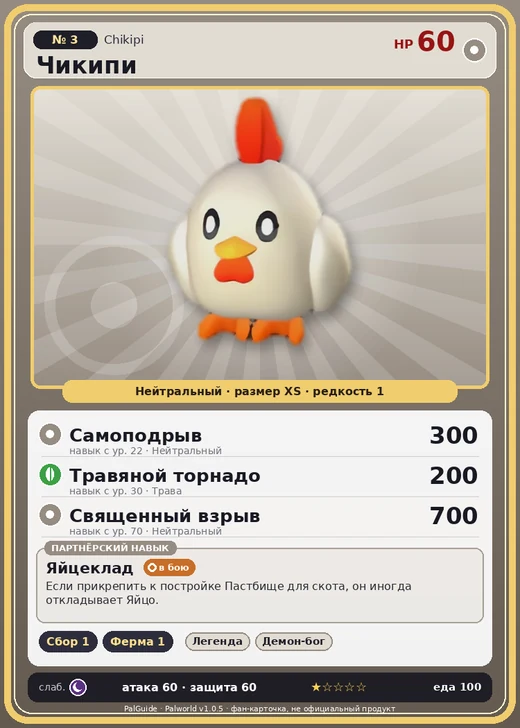

# #3 Чикипи (Chikipi)

#3 · Chikipi

Нейтральный

Слабость: Тьма

🌾 Сбор <b>1</b>🐑 Фермерство <b>1</b>

<b>Яйцеклад</b> 🐾 выпущен

❤️ 60 · ⚔️ 60 · 🛡 60

| Поле | Значение |
|---|---|
| Стихия | Нейтральный |
| Слабость (кто бьёт сильнее) | Тьма |
| Редкость | 1 |
| Размер | XS |
| HP / Атака / Защита (база вида) | 60 / 60 / 60 |
| Сколько ест | 100 |
| Цена продажи | 313 |
| Множитель поимки | ×1.5 |
| Скорость рывка верхом | 550 |

## Работа на базе
- Сбор — ур. 1
- Фермерство — ур. 1

## Партнёрский навык: Яйцеклад
Если прикрепить к постройке Пастбище для скота , он иногда откладывает Яйцо .

## Атаки по уровням
- ур. 1: Куриный натиск (Нейтральный, сила 30)
- ур. 7: Воздушная пушка (Нейтральный, сила 40)
- ур. 15: Силовой выстрел (Нейтральный, сила 80)
- ур. 22: Самоподрыв (Нейтральный, сила 300)
- ур. 30: Травяной торнадо (Трава, сила 200)
- ур. 40: Песчаный вихрь (Земля, сила 200)
- ур. 50: Огненный шторм (Огонь, сила 200)
- ур. 70: Священный взрыв (Нейтральный, сила 700)

## Где водится
- В дикой природе: да; точек появления днём: 279, ночью: 279; уровни в первых точках: 1–3
- Подземелья: Пещера Отдалённого Острова, Пещера Холмов
- Может продаваться у торговца/рекрутера
- Яйцо: Обычное яйцо

## Дроп
- Яйцо — 1 шт., 100%
- Мясо Чикипи — 1 шт., 100%

**Дроп альфы:**
- Деталь древней цивилизации — 1–2 шт., 100%
- Ценное перо — 1–2 шт., 100%

## Разведение
- Ранг разведения (CombiRank): 3080

## Лучшие пассивки по роли
- по обзору: Мастеровитый
- боец: Легенда, Демон-бог, Хладнокровный, Бессмертие, Святое небо (вместо Бессмертия, если нет мутации)
- ездовой: Божественная скорость, Легенда, Вечный двигатель, Небесное скольжение

## Чем хорош / чем плох
- ✅ Яйца на пастбище; можно оседлать
- ❌ Слабый; слабая атака (60); мало здоровья (60)

> Черезвычайно слаб, но при этом невероятно вкусен. Вместе с Ламболл он является одним из самых слабых Палов. Независимо от того, сколько бы ты на них ни охотился, они продолжают появляться снова и снова.

См. также: [Стихии](../../guide/06_stihii.md) · [Разведение](../../guide/07_razvedenie.md) · [Все палы](README.md)
