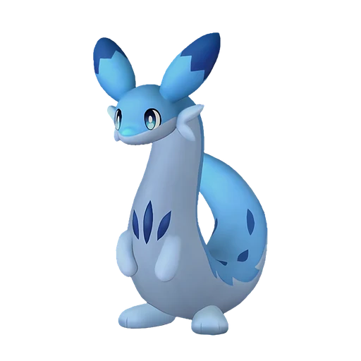

# Чиллет

<canvas id="fx"></canvas>

№ 103

ЛёдДракон

Слабость: Огонь <b class="mx">×1,5</b>Лёд <b class="mx">×1,5</b> <button class="hlp" data-tip="Множители перемножаются по обеим стихиям: ×1,5 за стихию, которую атака бьёт, ×0,65 за ту, что её держит. Огонь: 1,5 × 1 = ×1,5; Лёд: 1 × 1,5 = ×1,5.">?</button>

Устойчив: Тьма <b class="mx">×0,65</b>Дракон <b class="mx">×0,65</b>

🌾 Сбор <b>1</b>❄️ Охлаждение <b>2</b>

<b>Верткая ласка</b> 🐎 Верхом

❤️ 90 · ⚔️ 80 · 🛡 80

Основное

💎Редкость <button class="hlp" data-tip="Чем выше число, тем реже встречается пал. 1–4 — обычные, 5–7 — редкие, 8+ — легендарные.">?</button><b>4</b>

📏Размер<b>M</b>

💰Цена продажи <button class="hlp" data-tip="Сколько золота даст торговец за пала.">?</button><b>1270</b>

Бой

🎯Множитель поимки <button class="hlp" data-tip="Насколько легче или труднее поймать: ×1 — обычно, меньше — сложнее.">?</button><b>×1</b>

🐎Скорость рывка верхом <button class="hlp" data-tip="Скорость, если сесть на пала и бежать рывком.">?</button><b>1050</b>

Ферма и еда

🍖Сколько ест <button class="hlp" data-tip="Сколько сытости пал тратит — чем больше, тем больше еды нужно на базе.">?</button><b>230</b>

Разведение

🧬Сила разведения <button class="hlp" data-tip="Скрытое число игры: у детёныша оно примерно среднее от родителей. Чем меньше — тем «сильнее» пал.">?</button><b>2330</b>

=== "Обзор"

    #### Работа на базе

    
<a class="wbar" href="../../../2_mehaniki/rabota/?w=gathering&lv=1">🧺 Сбор<i style="--v:10%"></i><b>1</b></a><a class="wbar" href="../../../2_mehaniki/rabota/?w=cooling&lv=2">❄️ Охлаждение<i style="--v:20%"></i><b>2</b></a><a class="wb-more" href="../../../2_mehaniki/rabota/">Что значат уровни работы →</a>

    #### Партнёрский навык: Верткая ласка
    Можно оседлать для передвижения. Во время езды элемент атак игрока меняется на Дракон, а сила атаки игрока увеличивается на 5–20%. Технологии 11.

    #### Чем хорош / чем плох
    - ✅ можно оседлать
    - ❌ явных минусов нет

    > Сворачивается в клубок и мчится с бешеной скоростью. В древности люди приручали Чиллет, привязывали к нему мешок с молоком и отпускали пастись. Пока тот катался, внутри сбивалось масло.

    См. также: [Стихии](../../guide/06_stihii.md) · [Разведение](../../guide/07_razvedenie.md) · [Все палы](README.md)

=== "Атаки"

    #### Атаки по уровням
    - ур. 1: Ледяная ракета (Лёд, сила 40)
    - ур. 7: Драконья пушка (Дракон, сила 40)
    - ур. 11: Ракетный удар (Дракон, сила 80)
    - ур. 15: Драконий взрыв (Дракон, сила 80)
    - ур. 22: Ледяной резак (Лёд, сила 80)
    - ур. 30: Дыхание дракона (Дракон, сила 160)
    - ур. 40: Ледяное дыхание (Лёд, сила 160)
    - ур. 50: Драконий метеор (Дракон, сила 600)
    - ур. 70: Алмазный водопад (Лёд, сила 600)

=== "Где живёт"

    #### Где водится

    

<button data-k="d" class="on">☀️ День</button><button data-k="n">🌙 Ночь</button>

<button data-w=p class=on>Палпагос</button><button data-w=t>Мировое древо</button>

ур. 32–80<a class="btn hm-full" href="../../../map/?pal=WeaselDragon">Показать на большой карте</a>

Подножие Астральных горАстральные горы

🕳 Подземелье<b>Пещера Священной Горы</b>

🥚 Яйцо<b>Яйцо льда</b>

=== "Дроп"

    #### Дроп
    - Кожа — 2–3 шт., 100%
    - Ледяной орган — 2–3 шт., 100%

    **Дроп альфы:**
    - Деталь древней цивилизации — 2–4 шт., 100%
    - Ледяной орган — 2–3 шт., 100%
    - Ценный мех — 2–4 шт., 100%

=== "Разведение"

    #### Разведение
    - Ранг разведения: 2330
    - Участвует в особых парах: Арсокс → Чиллет Игнис

=== "Пассивки"

    #### Лучшие пассивки по роли

    

⚔️ Боец

максимум урона и живучести в бою

<a class="psv r-4" data-psv="Легенда" href="../../../passivki/legend/">Легенда</a><a class="psv r-4" data-psv="Демон-бог" href="../../../passivki/demon_god/">Демон-бог</a><a class="psv r-3" data-psv="Император льда" href="../../../passivki/ice_emperor/">Император льда</a><a class="psv r-3" data-psv="Хладнокровный" href="../../../passivki/serenity/">Хладнокровный</a>

🐎 Ездовой

быстрее бегает или летает с тобой верхом

<a class="psv r-4" data-psv="Божественная скорость" href="../../../passivki/swift/">Божественная скорость</a><a class="psv r-4" data-psv="Легенда" href="../../../passivki/legend/">Легенда</a><a class="psv r-4" data-psv="Вечный двигатель" href="../../../passivki/eternal_engine/">Вечный двигатель</a><a class="psv r-4" data-psv="Небесное скольжение" href="../../../passivki/sky_strider/">Небесное скольжение</a>

    <small>Нажми на пассивку, чтобы узнать, что она даёт и где её взять.</small>

<a class="card-link" href="../mossanda_lux/">← Моссанда Лакс</a><a class="card-link" href="../chillet_ignis/">Чиллет Игнис →</a>

