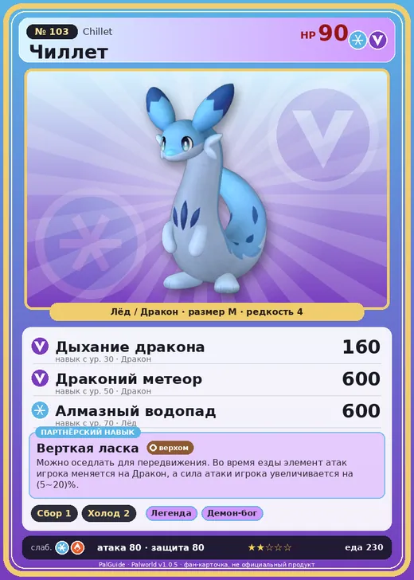

# #103 Чиллет (Chillet)

#103 · Chillet

ЛёдДракон

Слабость: ЛёдОгонь

🌾 Сбор <b>1</b>❄️ Охлаждение <b>2</b>

<b>Верткая ласка</b> 🐎 верхом

❤️ 90 · ⚔️ 80 · 🛡 80

| Поле | Значение |
|---|---|
| Стихия | Лёд, Дракон |
| Слабость (кто бьёт сильнее) | Лёд, Огонь |
| Редкость | 4 |
| Размер | M |
| HP / Атака / Защита (база вида) | 90 / 80 / 80 |
| Сколько ест | 230 |
| Цена продажи | 1270 |
| Множитель поимки | ×1 |
| Скорость рывка верхом | 1050 |

## Работа на базе
- Сбор — ур. 1
- Охлаждение — ур. 2

## Партнёрский навык: Верткая ласка
Можно оседлать для передвижения. Во время езды элемент атак игрока меняется на Дракон , а сила атаки игрока увеличивается на (5~20)% . Технологии 11 level value 1 GiveADragon_Ride 1 GiveElement_TrainerATK_UP_PartnerSkill_Ride 5 2 GiveADragon_Ride 1 GiveElement_TrainerATK_UP_PartnerSkill_Ride 7 3 GiveADragon_Ride 1 GiveElement_TrainerATK_UP_PartnerSkill_Ride 10 4 GiveADragon_Ride 1 GiveElement_TrainerATK_UP_PartnerSkill_Ride 14 5 GiveADragon_Ride 1 GiveElement_TrainerATK_UP_PartnerSkill_Ride 20

## Атаки по уровням
- ур. 1: Ледяная ракета (Лёд, сила 40)
- ур. 7: Драконья пушка (Дракон, сила 40)
- ур. 11: Ракетный удар (Дракон, сила 80)
- ур. 15: Драконий взрыв (Дракон, сила 80)
- ур. 22: Ледяной резак (Лёд, сила 80)
- ур. 30: Дыхание дракона (Дракон, сила 160)
- ур. 40: Ледяное дыхание (Лёд, сила 160)
- ур. 50: Драконий метеор (Дракон, сила 600)
- ур. 70: Алмазный водопад (Лёд, сила 600)

## Где водится
- В дикой природе: да; точек появления днём: 118, ночью: 118; уровни в первых точках: 32–36
- Подземелья: Пещера Священной Горы
- Яйцо: Яйцо льда

## Дроп
- Кожа — 2–3 шт., 100%
- Ледяной орган — 2–3 шт., 100%

**Дроп альфы:**
- Деталь древней цивилизации — 2–4 шт., 100%
- Ледяной орган — 2–3 шт., 100%
- Ценный мех — 2–4 шт., 100%

## Разведение
- Ранг разведения (CombiRank): 2330
- Участвует в особых парах: Арсокс → Чиллет Игнис

## Лучшие пассивки по роли
- боец: Легенда, Демон-бог, Хладнокровный, Бессмертие, Император льда (вместо Бессмертия, если нет мутации)
- ездовой: Божественная скорость, Легенда, Вечный двигатель, Небесное скольжение

## Чем хорош / чем плох
- ✅ можно оседлать
- ❌ явных минусов нет

> Сворачивается в клубок и мчится с бешеной скоростью. В древности люди приручали Чиллет , привязывали к нему мешок с молоком и отпускали пастись. Пока тот катался, внутри сбивалось масло.

См. также: [Стихии](../../guide/06_stihii.md) · [Разведение](../../guide/07_razvedenie.md) · [Все палы](README.md)
