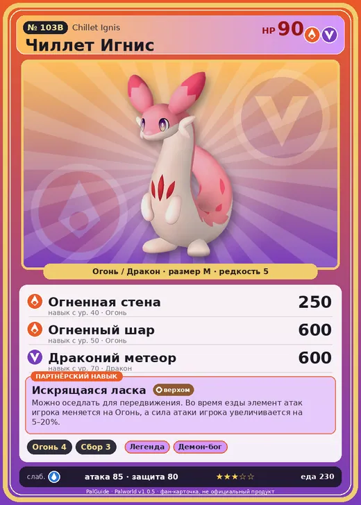

# Чиллет Игнис

<canvas id="fx"></canvas>

№ 103B

ОгоньДракон

Слабость: Вода <b class="mx">×1,5</b> <button class="hlp" data-tip="Множители перемножаются по обеим стихиям: ×1,5 за стихию, которую атака бьёт, ×0,65 за ту, что её держит. Вода: 1,5 × 1 = ×1,5.">?</button>

Устойчив: Трава <b class="mx">×0,65</b>Тьма <b class="mx">×0,65</b>

🔥 Разжигание огня <b>4</b>🌾 Сбор <b>3</b>

<b>Искрящаяся ласка</b> 🐎 Верхом

❤️ 90 · ⚔️ 85 · 🛡 80

Основное

💎Редкость <button class="hlp" data-tip="Чем выше число, тем реже встречается пал. 1–4 — обычные, 5–7 — редкие, 8+ — легендарные.">?</button><b>5</b>

📏Размер<b>M</b>

💰Цена продажи <button class="hlp" data-tip="Сколько золота даст торговец за пала.">?</button><b>1670</b>

Бой

🎯Множитель поимки <button class="hlp" data-tip="Насколько легче или труднее поймать: ×1 — обычно, меньше — сложнее.">?</button><b>×1</b>

🐎Скорость рывка верхом <button class="hlp" data-tip="Скорость, если сесть на пала и бежать рывком.">?</button><b>1050</b>

Ферма и еда

🍖Сколько ест <button class="hlp" data-tip="Сколько сытости пал тратит — чем больше, тем больше еды нужно на базе.">?</button><b>230</b>

Разведение

🧬Сила разведения <button class="hlp" data-tip="Скрытое число игры: у детёныша оно примерно среднее от родителей. Чем меньше — тем «сильнее» пал.">?</button><b>1950</b>

💞Особая пара <button class="hlp" data-tip="Этого пала можно вывести только от этой пары.">?</button><b>Чиллет + Арсокс</b>

=== "Обзор"

    #### Работа на базе

    
🔥 Разжигание огня<i style="--v:40%"></i><b>4</b>🧺 Сбор<i style="--v:30%"></i><b>3</b>

    #### Партнёрский навык: Искрящаяся ласка
    Можно оседлать для передвижения. Во время езды элемент атак игрока меняется на Огонь, а сила атаки игрока увеличивается на 5–20%. Технологии 40.

    #### Чем хорош / чем плох
    - ✅ можно оседлать
    - ❌ разводится только особой парой

    > Сворачивается в клубок и катится, разбрасывая искры. Даже сильное волнение вызывает выброс искр. Если гладить слишком усердно — может загореться.

    См. также: [Стихии](../../guide/06_stihii.md) · [Разведение](../../guide/07_razvedenie.md) · [Все палы](README.md)

=== "Атаки"

    #### Атаки по уровням
    - ур. 1: Огненный выстрел (Огонь, сила 40)
    - ур. 7: Драконий взрыв (Дракон, сила 80)
    - ур. 15: Огненная стрела (Огонь, сила 120)
    - ур. 22: Огненное дыхание (Огонь, сила 160)
    - ур. 30: Ракетный удар (Дракон, сила 80)
    - ур. 40: Огненная стена (Огонь, сила 250)
    - ур. 50: Огненный шар (Огонь, сила 600)
    - ур. 70: Драконий метеор (Дракон, сила 600)

=== "Где живёт"

    #### Где водится

    

<button data-k="d" class="on">☀️ День</button><button data-k="n">🌙 Ночь</button>

<button data-w=p class=on>Палпагос</button><button data-w=t>Мировое древо</button>

ур. 52–80<a class="btn hm-full" href="../../../map/?pal=WeaselDragon_Fire">Показать на большой карте</a>

Сакурадзима

🕳 Подземелье<b>Пещера Цветущей Сакуры</b>

🥚 Яйцо<b>Большое раскалённое яйцо</b>

=== "Дроп"

    #### Дроп
    - Кожа — 2–3 шт., 100%
    - Огненный орган — 1–2 шт., 100%

    **Дроп альфы:**

    - Деталь древней цивилизации — 2–3 шт., 100%
    - Ценный мех — 2–3 шт., 100%

=== "Разведение"

    #### Разведение
    - Ранг разведения: 1950
    - **Особая пара:** [Чиллет](../../4_spravochniki/paly/chillet.md) + [Арсокс](../../4_spravochniki/paly/arsox.md)
    - Участвует в особых парах: [Валаска](whalaska.md) → [Валаска Игнис](whalaska_ignis.md)

=== "Пассивки"

    #### Лучшие пассивки по роли

    

⚔️ Боец

максимум урона и живучести в бою

<a class="psv r-4" data-psv="Легенда" href="../../../passivki/legend/">Легенда</a><a class="psv r-4" data-psv="Демон-бог" href="../../../passivki/demon_god/">Демон-бог</a><a class="psv r-3" data-psv="Император огня" href="../../../passivki/flame_emperor/">Император огня</a><a class="psv r-3" data-psv="Хладнокровный" href="../../../passivki/serenity/">Хладнокровный</a>

🛠 Рабочий

работает быстрее и меньше устаёт на базе

<a class="psv r-5" data-psv="Дьявольские руки" href="../../../passivki/demons_hand/">Дьявольские руки</a><a class="psv r-4" data-psv="Виртуоз" href="../../../passivki/remarkable_craftsmanship/">Виртуоз</a><a class="psv r-3" data-psv="Мастеровитый" href="../../../passivki/artisan/">Мастеровитый</a><a class="psv r-3" data-psv="Трудоголик" href="../../../passivki/workaholic/">Трудоголик</a>

🐎 Ездовой

быстрее бегает или летает с тобой верхом

<a class="psv r-4" data-psv="Божественная скорость" href="../../../passivki/swift/">Божественная скорость</a><a class="psv r-4" data-psv="Легенда" href="../../../passivki/legend/">Легенда</a><a class="psv r-4" data-psv="Вечный двигатель" href="../../../passivki/eternal_engine/">Вечный двигатель</a><a class="psv r-4" data-psv="Небесное скольжение" href="../../../passivki/sky_strider/">Небесное скольжение</a>

    <small>Нажми на пассивку, чтобы узнать, что она даёт и где её взять.</small>

<a class="card-link" href="../chillet/">← Чиллет</a><a class="card-link" href="../ragnahawk/">Рагнахавк →</a>

