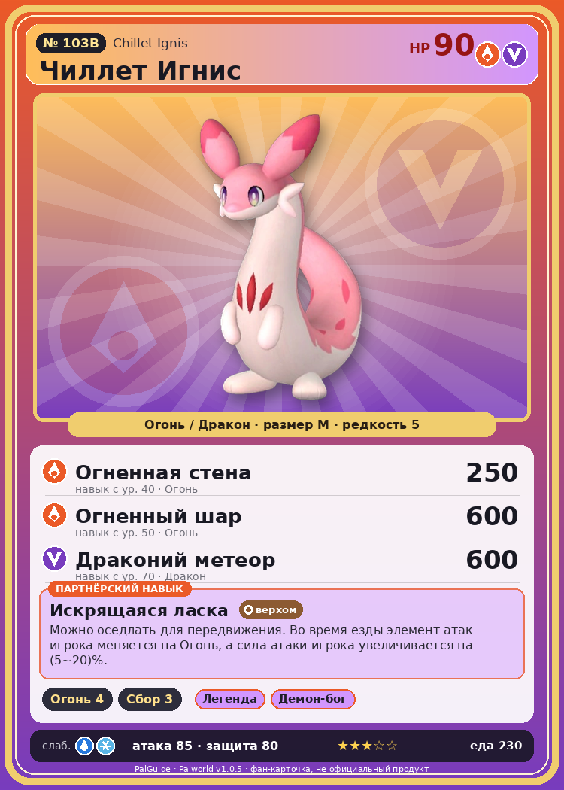

# #103B Чиллет Игнис (Chillet Ignis)

{ width=360 }

| Поле | Значение |
|---|---|
| Стихия | Огонь, Дракон |
| Слабость (кто бьёт сильнее) | Вода, Лёд |
| Редкость | 5 |
| Размер | M |
| HP / Атака / Защита (база вида) | 90 / 85 / 80 |
| Сколько ест | 230 |
| Цена продажи | 1670 |
| Множитель поимки | ×1 |
| Скорость рывка верхом | 1050 |

## Работа на базе
- Разжигание огня — ур. 4
- Сбор — ур. 3

## Партнёрский навык: Искрящаяся ласка
Можно оседлать для передвижения. Во время езды элемент атак игрока меняется на Огонь , а сила атаки игрока увеличивается на (5~20)% . Технологии 40 level value 1 GiveAFire_Ride 1 GiveElement_TrainerATK_UP_PartnerSkill_Ride 5 2 GiveAFire_Ride 1 GiveElement_TrainerATK_UP_PartnerSkill_Ride 7 3 GiveAFire_Ride 1 GiveElement_TrainerATK_UP_PartnerSkill_Ride 10 4 GiveAFire_Ride 1 GiveElement_TrainerATK_UP_PartnerSkill_Ride 14 5 GiveAFire_Ride 1 GiveElement_TrainerATK_UP_PartnerSkill_Ride 20

## Атаки по уровням
- ур. 1: Огненный выстрел (Огонь, сила 40)
- ур. 7: Драконий взрыв (Дракон, сила 80)
- ур. 15: Огненная стрела (Огонь, сила 120)
- ур. 22: Огненное дыхание (Огонь, сила 160)
- ур. 30: Ракетный удар (Дракон, сила 80)
- ур. 40: Огненная стена (Огонь, сила 250)
- ур. 50: Огненный шар (Огонь, сила 600)
- ур. 70: Драконий метеор (Дракон, сила 600)

## Где водится
- В дикой природе: да; точек появления днём: 53, ночью: 53; уровни в первых точках: 53–56
- Подземелья: Пещера Цветущей Сакуры
- Яйцо: Большое раскалённое яйцо

## Дроп
- Кожа — 2–3 шт., 100%
- Огненный орган — 1–2 шт., 100%

**Дроп альфы:**
- Деталь древней цивилизации — 2–3 шт., 100%
- Ценный мех — 2–3 шт., 100%

## Разведение
- Ранг разведения (CombiRank): 1950
- **Особая пара:** [Чиллет](../../4_spravochniki/paly/chillet.md) + [Арсокс](../../4_spravochniki/paly/arsox.md)
- Участвует в особых парах: Валаска → Валаска Игнис

## Лучшие пассивки по роли
- боец: Легенда, Демон-бог, Хладнокровный, Бессмертие, Император огня (вместо Бессмертия, если нет мутации)
- рабочий: Дьявольские руки, Виртуоз, Мастеровитый, Небожитель/Трудоголик
- ездовой: Божественная скорость, Легенда, Вечный двигатель, Небесное скольжение

## Чем хорош / чем плох
- ✅ можно оседлать
- ❌ разводится только особой парой

> Сворачивается в клубок и катится, разбрасывая искры. Даже сильное волнение вызывает выброс искр. Если гладить слишком усердно — может загореться.

См. также: [Стихии](../../2_mehaniki/stihii.md) · [Разведение](../../2_mehaniki/razvedenie.md) · [Все палы](README.md)
_Источник: paldb.cc v1.0.5_
