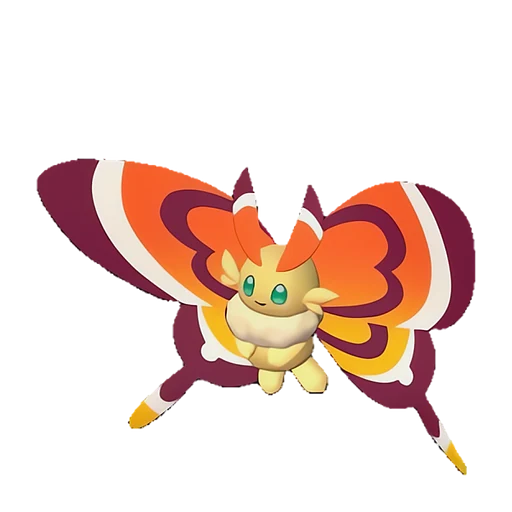

# Синнамос

<canvas id="fx"></canvas>

№ 61

Трава

Слабость: Огонь <b class="mx">×1,5</b> <button class="hlp" data-tip="Множители перемножаются по обеим стихиям: ×1,5 за стихию, которую атака бьёт, ×0,65 за ту, что её держит.">?</button>

Устойчив: Земля <b class="mx">×0,65</b>

🌱 Посев семян <b>2</b>🌾 Сбор <b>2</b>💊 Фармацевтика <b>2</b>

<b>Загадочные чешуйки</b> 🔘 Включается кнопкой🏠 На базе

❤️ 70 · ⚔️ 80 · 🛡 80

Основное

💎Редкость <button class="hlp" data-tip="Чем выше число, тем реже встречается пал. 1–4 — обычные, 5–7 — редкие, 8+ — легендарные.">?</button><b>4</b>

📏Размер<b>M</b>

💰Цена продажи <button class="hlp" data-tip="Сколько золота даст торговец за пала.">?</button><b>534</b>

Бой

🎯Множитель поимки <button class="hlp" data-tip="Насколько легче или труднее поймать: ×1 — обычно, меньше — сложнее.">?</button><b>×1</b>

🐎Скорость рывка верхом <button class="hlp" data-tip="Скорость, если сесть на пала и бежать рывком.">?</button><b>700</b>

Ферма и еда

🍖Сколько ест <button class="hlp" data-tip="Сколько сытости пал тратит — чем больше, тем больше еды нужно на базе.">?</button><b>150</b>

Разведение

🧬Сила разведения <button class="hlp" data-tip="Скрытое число игры: у детёныша оно примерно среднее от родителей. Чем меньше — тем «сильнее» пал.">?</button><b>2620</b>

=== "Обзор"

    #### Работа на базе

    
<a class="wbar" href="../../../2_mehaniki/rabota/?w=planting&lv=2">🌱 Посев семян<i style="--v:20%"></i><b>2</b></a><a class="wbar" href="../../../2_mehaniki/rabota/?w=gathering&lv=2">🧺 Сбор<i style="--v:20%"></i><b>2</b></a><a class="wbar" href="../../../2_mehaniki/rabota/?w=medicine&lv=2">💊 Фармацевтика<i style="--v:20%"></i><b>2</b></a><a class="wb-more" href="../../../2_mehaniki/rabota/">Что значат уровни работы →</a>

    #### Партнёрский навык: Загадочные чешуйки
    При активации атакует выбранного врага с помощью Ядовитый туман. Пока находится на базе, уровень пригодности к работе Фермерство у других Палов на базе увеличивается на +1. (Эффект не суммируется).

    #### Чем хорош / чем плох
    - ✅ хорошая атака (80)
    - ❌ явных минусов нет

    > Вдыхая чешуйки с его крыльев, можно испытать блаженство, словно возносишься к небесам. Хотя предпринимаются меры по усилению контроля, они буксуют из-за сопротивления Организации по Защите Палов.

    См. также: [Стихии](../../guide/06_stihii.md) · [Разведение](../../guide/07_razvedenie.md) · [Все палы](README.md)

=== "Атаки"

    #### Атаки по уровням
    - ур. 1: Воздушная пушка (Нейтральный, сила 40)
    - ур. 7: Ветряной клинок (Трава, сила 40)
    - ур. 15: Ядовитый туман (Тьма, сила 0)
    - ур. 22: Песчаный вихрь (Земля, сила 200)
    - ур. 30: Семенная мина (Трава, сила 120)
    - ур. 40: Травяной торнадо (Трава, сила 200)
    - ур. 50: Солнечный взрыв (Трава, сила 450)
    - ур. 70: Ветряной взрыв (Трава, сила 600)

=== "Где живёт"

    #### Где водится

    

<button data-k="d" class="on">☀️ День</button><button data-k="n">🌙 Ночь</button>

ур. 16–16<a class="btn hm-full" href="../../../map/?pal=CuteButterfly">Показать на большой карте</a>

Берег ПолумесяцаОстров восходящих ветровЗелёный ручей

🕳 Подземелье<b>Пещера Горного Потока</b>

🥚 Яйцо<b>Яйцо свежей листвы</b>

=== "Дроп"

    #### Дроп
    - Мёд — 1 шт., 100%
    - Семена латука — 1 шт., 75%
    - Семена помидоров — 1 шт., 75%

    **Дроп альфы:**
    - Деталь древней цивилизации — 2–4 шт., 100%
    - Ценное перо — 2–4 шт., 100%

=== "Разведение"

    #### Разведение
    - Ранг разведения: 2620

=== "Пассивки"

    #### Лучшие пассивки по роли

    

⚔️ Боец

максимум урона и живучести в бою

<a class="psv r-4" data-psv="Легенда" href="../../../passivki/legend/">Легенда</a><a class="psv r-4" data-psv="Демон-бог" href="../../../passivki/demon_god/">Демон-бог</a><a class="psv r-3" data-psv="Король духов" href="../../../passivki/spirit_emperor/">Король духов</a><a class="psv r-3" data-psv="Хладнокровный" href="../../../passivki/serenity/">Хладнокровный</a>

    <small>Нажми на пассивку, чтобы узнать, что она даёт и где её взять.</small>

<a class="card-link" href="../bristla/">← Бристла</a><a class="card-link" href="../puffolt/">Пуффольт →</a>

