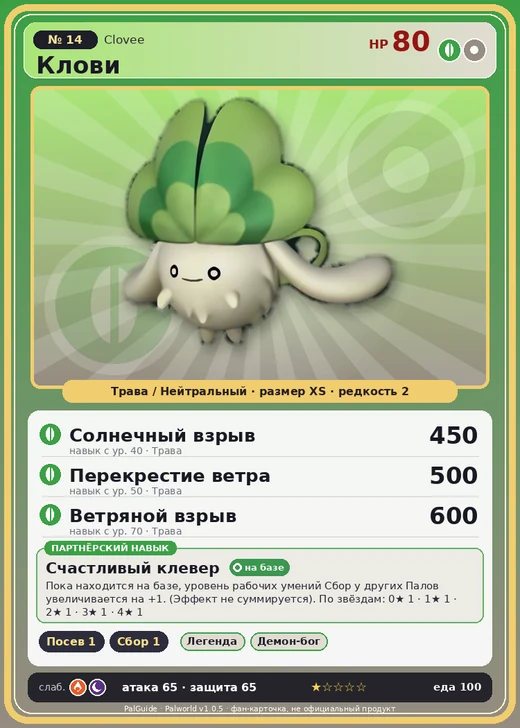

# #14 Клови (Clovee)

№ 14

ТраваНейтральный

Слабость: ОгоньТьма

🌱 Посев семян <b>1</b>🌾 Сбор <b>1</b>

<b>Счастливый клевер</b> 🏠 на базе

❤️ 80 · ⚔️ 65 · 🛡 65

| Поле | Значение |
|---|---|
| Стихия | Трава, Нейтральный |
| Слабость (кто бьёт сильнее) | Огонь, Тьма |
| Редкость | 2 |
| Размер | XS |
| HP / Атака / Защита (база вида) | 80 / 65 / 65 |
| Сколько ест | 100 |
| Цена продажи | 407 |
| Множитель поимки | ×1 |
| Скорость рывка верхом | 550 |

## Работа на базе
- Посев семян — ур. 1
- Сбор — ур. 1

## Партнёрский навык: Счастливый клевер
Пока находится на базе, уровень рабочих умений Сбор у других Палов увеличивается на +1 . (Эффект не суммируется) level value 1 WorkSuitabilityAddRank_Collection 1 2 WorkSuitabilityAddRank_Collection 1 3 WorkSuitabilityAddRank_Collection 1 4 WorkSuitabilityAddRank_Collection 1 5 WorkSuitabilityAddRank_Collection 1

## Атаки по уровням
- ур. 1: Воздушная пушка (Нейтральный, сила 40)
- ур. 7: Семенной пулемёт (Трава, сила 80)
- ур. 15: Семенная мина (Трава, сила 120)
- ур. 22: Воздушные клинки (Нейтральный, сила 160)
- ур. 30: Травяной торнадо (Трава, сила 200)
- ур. 40: Солнечный взрыв (Трава, сила 450)
- ур. 50: Перекрестие ветра (Трава, сила 500)
- ур. 70: Ветряной взрыв (Трава, сила 600)

## Где водится
- В дикой природе: да; точек появления днём: 60, ночью: 60; уровни в первых точках: 3–5
- Подземелья: Пещера Отдалённого Острова, Пещера Холмов
- Яйцо: Яйцо свежей листвы

## Дроп
- Семена ягод — 1–2 шт., 100%

**Дроп альфы:**
- Деталь древней цивилизации — 1–2 шт., 100%
- Ценный мех — 2–3 шт., 100%

## Разведение
- Ранг разведения (CombiRank): 2970

## Лучшие пассивки по роли
- боец: Легенда, Демон-бог, Хладнокровный, Бессмертие, Король духов (вместо Бессмертия, если нет мутации)
- ездовой: Божественная скорость, Легенда, Вечный двигатель, Небесное скольжение

## Чем хорош / чем плох
- ✅ можно оседлать
- ❌ слабая атака (65)

> Раньше встречались особи с тремя и более листьями на лбу. Так как считалось, что это приносит удачу, особей с множеством листьев бесконтрольно отлавливали. В результате вид эволюционирует в сторону меньшего числа листьев.

См. также: [Стихии](../../guide/06_stihii.md) · [Разведение](../../guide/07_razvedenie.md) · [Все палы](README.md)
