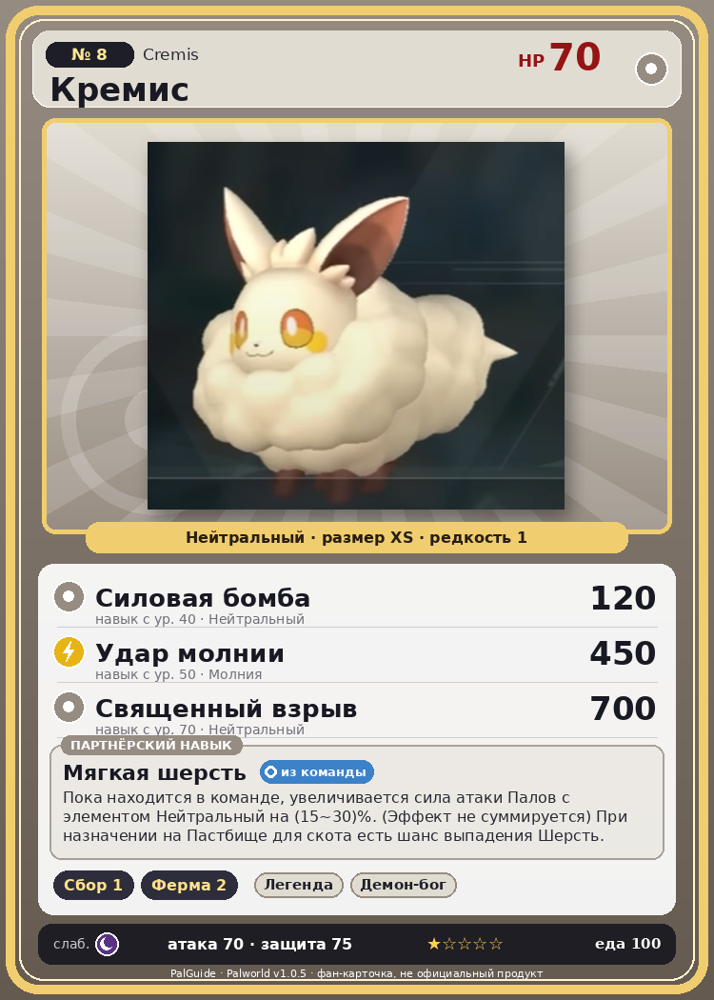

# #8 Кремис (Cremis)

{ width=360 }

| Поле | Значение |
|---|---|
| Стихия | Нейтральный |
| Слабость (кто бьёт сильнее) | Тьма |
| Редкость | 1 |
| Размер | XS |
| HP / Атака / Защита (база вида) | 70 / 70 / 75 |
| Сколько ест | 100 |
| Цена продажи | 489 |
| Множитель поимки | ×1.3 |
| Скорость рывка верхом | 450 |

## Работа на базе
- Сбор — ур. 1
- Фермерство — ур. 2

## Партнёрский навык: Мягкая шерсть
Пока находится в команде, увеличивается сила атаки Палов с элементом Нейтральный на (15~30)% . (Эффект не суммируется) При назначении на Пастбище для скота есть шанс выпадения Шерсть . level value 1 AttackUp_Normal_PartnerSkill 15 2 AttackUp_Normal_PartnerSkill 17 3 AttackUp_Normal_PartnerSkill 20 4 AttackUp_Normal_PartnerSkill 24 5 AttackUp_Normal_PartnerSkill 30

## Атаки по уровням
- ур. 1: Воздушная пушка (Нейтральный, сила 40)
- ур. 7: Грязевой выстрел (Земля, сила 40)
- ур. 15: Искровой выстрел (Молния, сила 50)
- ур. 22: Силовой выстрел (Нейтральный, сила 80)
- ур. 30: Шоковая волна (Молния, сила 80)
- ур. 40: Силовая бомба (Нейтральный, сила 120)
- ур. 50: Удар молнии (Молния, сила 450)
- ур. 70: Священный взрыв (Нейтральный, сила 700)

## Где водится
- В дикой природе: да; точек появления днём: 201, ночью: 201; уровни в первых точках: 1–3
- Подземелья: Пещера Отдалённого Острова, Пещера Холмов
- Яйцо: Обычное яйцо

## Дроп
- Шерсть — 1–2 шт., 100%

**Дроп альфы:**
- Деталь древней цивилизации — 1–2 шт., 100%
- Ценный мех — 1–2 шт., 100%

## Разведение
- Ранг разведения (CombiRank): 2890

## Лучшие пассивки по роли
- боец: Легенда, Демон-бог, Хладнокровный, Бессмертие, Святое небо (вместо Бессмертия, если нет мутации)
- ездовой: Божественная скорость, Легенда, Вечный двигатель, Небесное скольжение

## Чем хорош / чем плох
- ✅ можно оседлать
- ❌ слабая атака (70)

> Обладает более качественной шерстью, чем Ламболл , и более спокойным, пригодным для домашнего разведения нравом. Тем не менее, на протяжении всей истории его держали как милого питомца. Милота была выше логики.

См. также: [Стихии](../../2_mehaniki/stihii.md) · [Разведение](../../2_mehaniki/razvedenie.md) · [Все палы](README.md)
_Источник: paldb.cc v1.0.5_
