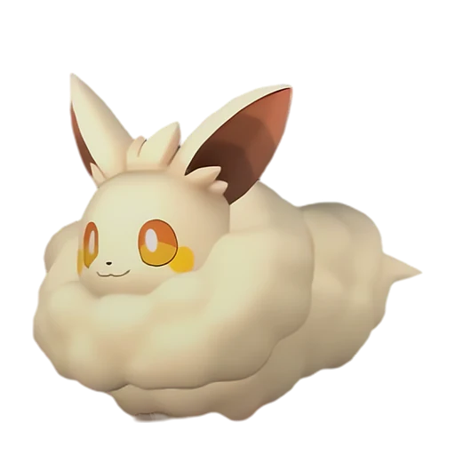

# Кремис

<canvas id="fx"></canvas>

№ 8

Нейтральный

Слабость: Тьма <b class="mx">×1,5</b> <button class="hlp" data-tip="Множители перемножаются по обеим стихиям: ×1,5 за стихию, которую атака бьёт, ×0,65 за ту, что её держит.">?</button>

🌾 Сбор <b>1</b>🐑 Фермерство <b>2</b>

<b>Мягкая шерсть</b> 🎒 Работает из команды🏠 На базе

❤️ 70 · ⚔️ 70 · 🛡 75

Основное

💎Редкость <button class="hlp" data-tip="Чем выше число, тем реже встречается пал. 1–4 — обычные, 5–7 — редкие, 8+ — легендарные.">?</button><b>1</b>

📏Размер<b>XS</b>

💰Цена продажи <button class="hlp" data-tip="Сколько золота даст торговец за пала.">?</button><b>489</b>

Бой

🎯Множитель поимки <button class="hlp" data-tip="Насколько легче или труднее поймать: ×1 — обычно, меньше — сложнее.">?</button><b>×1.3</b>

🐎Скорость рывка верхом <button class="hlp" data-tip="Скорость, если сесть на пала и бежать рывком.">?</button><b>450</b>

Ферма и еда

🍖Сколько ест <button class="hlp" data-tip="Сколько сытости пал тратит — чем больше, тем больше еды нужно на базе.">?</button><b>100</b>

Разведение

🧬Сила разведения <button class="hlp" data-tip="Скрытое число игры: у детёныша оно примерно среднее от родителей. Чем меньше — тем «сильнее» пал.">?</button><b>2890</b>

=== "Обзор"

    #### Работа на базе

    
<a class="wbar" href="../../../2_mehaniki/rabota/?w=gathering&lv=1">🧺 Сбор<i style="--v:10%"></i><b>1</b></a><a class="wbar" href="../../../2_mehaniki/rabota/?w=farming&lv=2">🐄 Фермерство<i style="--v:20%"></i><b>2</b></a><a class="wb-more" href="../../../2_mehaniki/rabota/">Что значат уровни работы →</a>

    #### Партнёрский навык: Мягкая шерсть
    Пока находится в команде, увеличивается сила атаки Палов с элементом Нейтральный на 15–30%. (Эффект не суммируется) При назначении на Пастбище для скота есть шанс выпадения Шерсть. По звёздам: 0★ 15 · 1★ 17 · 2★ 20 · 3★ 24 · 4★ 30

    #### Чем хорош / чем плох
    - ✅ крепкая защита (75)
    - ❌ слабая атака (70)

    > Обладает более качественной шерстью, чем Ламболл, и более спокойным, пригодным для домашнего разведения нравом. Тем не менее, на протяжении всей истории его держали как милого питомца. Милота была выше логики.

    См. также: [Стихии](../../guide/06_stihii.md) · [Разведение](../../guide/07_razvedenie.md) · [Все палы](README.md)

=== "Атаки"

    #### Атаки по уровням
    - ур. 1: Воздушная пушка (Нейтральный, сила 40)
    - ур. 7: Грязевой выстрел (Земля, сила 40)
    - ур. 15: Искровой выстрел (Молния, сила 50)
    - ур. 22: Силовой выстрел (Нейтральный, сила 80)
    - ур. 30: Шоковая волна (Молния, сила 80)
    - ур. 40: Силовая бомба (Нейтральный, сила 120)
    - ур. 50: Удар молнии (Молния, сила 450)
    - ур. 70: Священный взрыв (Нейтральный, сила 700)

=== "Где живёт"

    #### Где водится

    

<button data-k="d" class="on">☀️ День</button><button data-k="n">🌙 Ночь</button>

ур. 1–14<a class="btn hm-full" href="../../../map/?pal=WoolFox">Показать на большой карте</a>

Кричащий островОстров безмолвияАрхипелаг Морских ВетровБолотный остров

🕳 Подземелье<b>Пещера Отдалённого Острова</b>

🕳 Подземелье<b>Пещера Холмов</b>

🥚 Яйцо<b>Обычное яйцо</b>

=== "Дроп"

    #### Дроп
    - Шерсть — 1–2 шт., 100%

    **Дроп альфы:**
    - Деталь древней цивилизации — 1–2 шт., 100%
    - Ценный мех — 1–2 шт., 100%

=== "Разведение"

    #### Разведение
    - Ранг разведения: 2890

=== "Пассивки"

    #### Лучшие пассивки по роли

    

⚔️ Боец

максимум урона и живучести в бою

<a class="psv r-4" data-psv="Легенда" href="../../../passivki/legend/">Легенда</a><a class="psv r-4" data-psv="Демон-бог" href="../../../passivki/demon_god/">Демон-бог</a><a class="psv r-3" data-psv="Святое небо" href="../../../passivki/celestial_emperor/">Святое небо</a><a class="psv r-3" data-psv="Хладнокровный" href="../../../passivki/serenity/">Хладнокровный</a>

    <small>Нажми на пассивку, чтобы узнать, что она даёт и где её взять.</small>

<a class="card-link" href="../celaray_lux/">← Селарай Лакс</a><a class="card-link" href="../croajiro/">Кроадзиро →</a>

