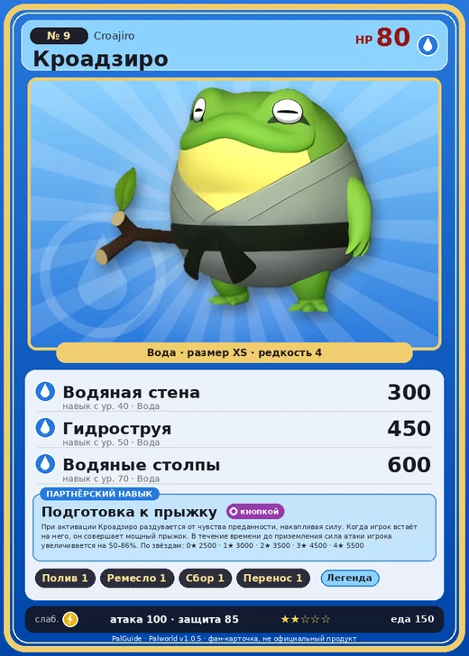

# Кроадзиро

<canvas id="fx"></canvas>

№ 9 · Croajiro

Вода

Слабость: Молния

💧 Полив <b>1</b>🖐️ Ручная работа <b>1</b>🌾 Сбор <b>1</b>📦 Транспортировка <b>1</b>

<b>Подготовка к прыжку</b> 🔘 кнопкой

❤️ 80 · ⚔️ 100 · 🛡 85

| Поле | Значение |
|---|---|
| Стихия | Вода |
| Слабость (кто бьёт сильнее) | Молния |
| Редкость | 4 |
| Размер | XS |
| HP / Атака / Защита (база вида) | 80 / 100 / 85 |
| Сколько ест | 150 |
| Цена продажи | 584 |
| Множитель поимки | ×1 |
| Скорость рывка верхом | 450 |

=== "Обзор"

    #### Работа на базе
    - Полив — ур. 1
    - Ручная работа — ур. 1
    - Сбор — ур. 1
    - Транспортировка — ур. 1

    #### Партнёрский навык: Подготовка к прыжку
    При активации Кроадзиро раздувается от чувства преданности, накапливая силу. Когда игрок встаёт на него, он совершает мощный прыжок. В течение времени до приземления сила атаки игрока увеличивается на 50–86%. По звёздам: 0★ 2500 · 1★ 3000 · 2★ 3500 · 3★ 4500 · 4★ 5500

    #### Чем хорош / чем плох
    - ✅ хорошая атака (100)
    - ❌ явных минусов нет

    > Член стаи, совершивший серьёзную ошибку, обязан покинуть этот мир. Стоит лишь воткнуть ветку в раздутый до предела звуковой мешок — и его с силой уносит за пределы атмосферы, туда, где заканчивается всё живое.

    См. также: [Стихии](../../guide/06_stihii.md) · [Разведение](../../guide/07_razvedenie.md) · [Все палы](README.md)

=== "Атаки"

    #### Атаки по уровням
    - ур. 1: Водяной выстрел (Вода, сила 50)
    - ур. 7: Пузырьковый выстрел (Вода, сила 80)
    - ур. 15: Кислотный дождь (Вода, сила 120)
    - ур. 22: Водяная бомба (Вода, сила 200)
    - ур. 30: Полоса брызг (Вода, сила 160)
    - ур. 40: Водяная стена (Вода, сила 300)
    - ур. 50: Гидроструя (Вода, сила 450)
    - ур. 70: Водяные столпы (Вода, сила 600)

=== "Где живёт"

    #### Где водится
    - В дикой природе: да; точек появления днём: 668, ночью: 668; уровни в первых точках: 1–10
    - Подземелья: Пещера Цветущей Сакуры
    - Яйцо: Яйцо воды

=== "Дроп"

    #### Дроп
    - Жидкость водного Пала — 1–2 шт., 100%
    - Ткань — 1–2 шт., 25%

    **Дроп альфы:**
    - Деталь древней цивилизации — 2–3 шт., 100%
    - Ценные внутренности — 2–3 шт., 100%

=== "Разведение"

    #### Разведение
    - Ранг разведения (CombiRank): 2600
    - Участвует в особых парах: Буси Нокт → Кроадзиро Нокт

=== "Пассивки"

    #### Лучшие пассивки по роли

    

⚔️ Боец

максимум урона и живучести в бою

<a class="psv r-4" data-psv="Легенда" href="../../../passivki/legend/">Легенда</a><a class="psv r-4" data-psv="Демон-бог" href="../../../passivki/demon_god/">Демон-бог</a><a class="psv r-3" data-psv="Владыка морей" href="../../../passivki/lord_of_the_sea/">Владыка морей</a><a class="psv r-3" data-psv="Хладнокровный" href="../../../passivki/serenity/">Хладнокровный</a>

    <small>Нажми на пассивку, чтобы узнать, что она даёт и где её взять.</small>

<a class="card-link" href="../cremis/">← Кремис</a><a class="card-link" href="../croajiro_noct/">Кроадзиро Нокт →</a>

