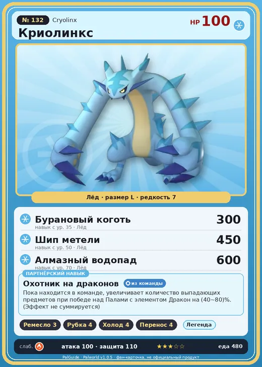

# Криолинкс

<canvas id="fx"></canvas>

№ 132 · Cryolinx

Лёд

Слабость: Огонь

🖐️ Ручная работа <b>3</b>🪓 Рубка деревьев <b>4</b>❄️ Охлаждение <b>4</b>📦 Транспортировка <b>4</b>

<b>Охотник на драконов</b> 🎒 из команды

❤️ 100 · ⚔️ 100 · 🛡 110

Основное

💎Редкость <button class="hlp" data-tip="Чем выше число, тем реже встречается пал. 1–4 — обычные, 5–7 — редкие, 8+ — легендарные.">?</button><b>7</b>

📏Размер<b>L</b>

💰Цена продажи <button class="hlp" data-tip="Сколько золота даст торговец за пала.">?</button><b>1987</b>

Бой

🎯Множитель поимки <button class="hlp" data-tip="Насколько легче или труднее поймать: ×1 — обычно, меньше — сложнее.">?</button><b>×1</b>

🐎Скорость рывка верхом <button class="hlp" data-tip="Скорость, если сесть на пала и бежать рывком.">?</button><b>900</b>

Ферма и еда

🍖Сколько ест <button class="hlp" data-tip="Сколько сытости пал тратит — чем больше, тем больше еды нужно на базе.">?</button><b>480</b>

Разведение

🧬Сила разведения <button class="hlp" data-tip="Скрытое число игры: у детёныша оно примерно среднее от родителей. Чем меньше — тем «сильнее» пал.">?</button><b>1040</b>

=== "Обзор"

    #### Работа на базе
    - Ручная работа — ур. 3
    - Рубка деревьев — ур. 4
    - Охлаждение — ур. 4
    - Транспортировка — ур. 4

    #### Партнёрский навык: Охотник на драконов
    Пока находится в команде, увеличивает количество выпадающих предметов при победе над Палами с элементом Дракон на 40–80%. (Эффект не суммируется).

    #### Чем хорош / чем плох
    - ✅ хорошая атака (100)
    - ❌ явных минусов нет

    > Своими крепкими когтями легко карабкается даже на самые крутые горы. Но из-за коротких ног не умеет толком спускаться — и часто оказывается в полном замешательстве на большой высоте.

    См. также: [Стихии](../../guide/06_stihii.md) · [Разведение](../../guide/07_razvedenie.md) · [Все палы](README.md)

=== "Атаки"

    #### Атаки по уровням
    - ур. 1: Силовой выстрел (Нейтральный, сила 80)
    - ур. 7: Ледяная ракета (Лёд, сила 40)
    - ур. 15: Камнемёт (Земля, сила 120)
    - ур. 22: Ледяной резак (Лёд, сила 80)
    - ур. 30: Айсберг (Лёд, сила 120)
    - ур. 35: Бурановый коготь (Лёд, сила 300)
    - ур. 40: Ледяное дыхание (Лёд, сила 160)
    - ур. 50: Шип метели (Лёд, сила 450)
    - ур. 70: Алмазный водопад (Лёд, сила 600)

=== "Где живёт"

    #### Где водится
    - В дикой природе: да; точек появления днём: 39, ночью: 39; уровни в первых точках: 44–48
    - Подземелья: Пещера Священной Горы
    - Может продаваться у торговца/рекрутера
    - Яйцо: Большое яйцо льда

=== "Дроп"

    #### Дроп
    - Ледяной орган — 1–3 шт., 100%

    **Дроп альфы:**
    - Деталь древней цивилизации — 6–8 шт., 100%
    - Ценный коготь — 6–8 шт., 100%

=== "Разведение"

    #### Разведение
    - Ранг разведения (CombiRank): 1040
    - Участвует в особых парах: Дазему → Криолинкс Терра

=== "Пассивки"

    #### Лучшие пассивки по роли

    

⚔️ Боец

максимум урона и живучести в бою

<a class="psv r-4" data-psv="Легенда" href="../../../passivki/legend/">Легенда</a><a class="psv r-4" data-psv="Демон-бог" href="../../../passivki/demon_god/">Демон-бог</a><a class="psv r-3" data-psv="Император льда" href="../../../passivki/ice_emperor/">Император льда</a><a class="psv r-3" data-psv="Хладнокровный" href="../../../passivki/serenity/">Хладнокровный</a>

🛠 Рабочий

работает быстрее и меньше устаёт на базе

<a class="psv r-5" data-psv="Дьявольские руки" href="../../../passivki/demons_hand/">Дьявольские руки</a><a class="psv r-4" data-psv="Виртуоз" href="../../../passivki/remarkable_craftsmanship/">Виртуоз</a><a class="psv r-3" data-psv="Мастеровитый" href="../../../passivki/artisan/">Мастеровитый</a><a class="psv r-3" data-psv="Трудоголик" href="../../../passivki/workaholic/">Трудоголик</a>

    <small>Нажми на пассивку, чтобы узнать, что она даёт и где её взять.</small>

<a class="card-link" href="../pierdon_cryst/">← Пиродон Крист</a><a class="card-link" href="../cryolinx_terra/">Криолинкс Терра →</a>

