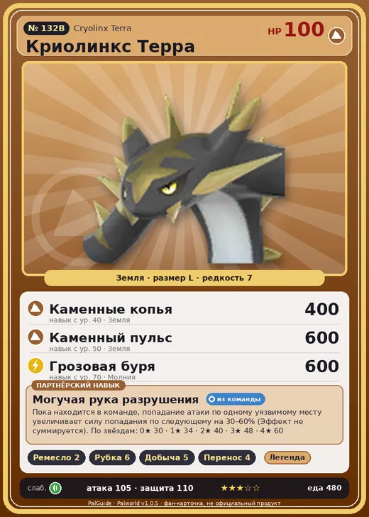

# #132B Криолинкс Терра (Cryolinx Terra)

№ 132B

Земля

Слабость: Трава

🖐️ Ручная работа <b>2</b>🪓 Рубка деревьев <b>6</b>⛏️ Добыча <b>5</b>📦 Транспортировка <b>4</b>

<b>Могучая рука разрушения</b> 🎒 из команды

❤️ 100 · ⚔️ 105 · 🛡 110

| Поле | Значение |
|---|---|
| Стихия | Земля |
| Слабость (кто бьёт сильнее) | Трава |
| Редкость | 7 |
| Размер | L |
| HP / Атака / Защита (база вида) | 100 / 105 / 110 |
| Сколько ест | 480 |
| Цена продажи | 2484 |
| Множитель поимки | ×1 |
| Скорость рывка верхом | 900 |

## Работа на базе
- Ручная работа — ур. 2
- Рубка деревьев — ур. 6
- Добыча — ур. 5
- Транспортировка — ур. 4

## Партнёрский навык: Могучая рука разрушения
Пока находится в команде, попадание атаки по одному уязвимому месту увеличивает силу попадания по следующему на (30~60)% (Эффект не суммируется) level value 1 WhiteTiger_Ground_PartnerSkill 30 2 WhiteTiger_Ground_PartnerSkill 34 3 WhiteTiger_Ground_PartnerSkill 40 4 WhiteTiger_Ground_PartnerSkill 48 5 WhiteTiger_Ground_PartnerSkill 60

## Атаки по уровням
- ур. 1: Силовой выстрел (Нейтральный, сила 80)
- ур. 7: Каменный залп (Земля, сила 80)
- ур. 15: Камнемёт (Земля, сила 120)
- ур. 22: Песчаный вихрь (Земля, сила 200)
- ур. 30: Каменные когти (Земля, сила 300)
- ур. 35: Камнепад (Земля, сила 300)
- ур. 40: Каменные копья (Земля, сила 400)
- ур. 50: Каменный пульс (Земля, сила 600)
- ур. 70: Грозовая буря (Молния, сила 600)

## Где водится
- В дикой природе: да; точек появления днём: 157, ночью: 157; уровни в первых точках: 62–64
- Подземелья: Пещера Тэнраку
- Яйцо: Большое яйцо земли

## Дроп
- Металлическая руда — 2–3 шт., 100%

**Дроп альфы:**
- Деталь древней цивилизации — 7–8 шт., 100%
- Ценный коготь — 2–3 шт., 100%

## Разведение
- Ранг разведения (CombiRank): 470
- **Особая пара:** [Криолинкс](../../4_spravochniki/paly/cryolinx.md) + [Дазему](../../4_spravochniki/paly/dazemu.md)

## Лучшие пассивки по роли
- боец: Легенда, Демон-бог, Хладнокровный, Бессмертие, Император земли (вместо Бессмертия, если нет мутации)
- рабочий: Дьявольские руки, Виртуоз, Мастеровитый, Небожитель/Трудоголик
- ездовой: Божественная скорость, Легенда, Вечный двигатель, Небесное скольжение

## Чем хорош / чем плох
- ✅ хорошая атака (105); отличный рабочий (пригодность 6); можно оседлать
- ❌ разводится только особой парой

> С легкостью переносит своими большими руками горы вещей. Однако короткие ноги мешают ему быстро передвигаться, и нередко ночь застает его в пути.

См. также: [Стихии](../../guide/06_stihii.md) · [Разведение](../../guide/07_razvedenie.md) · [Все палы](README.md)
