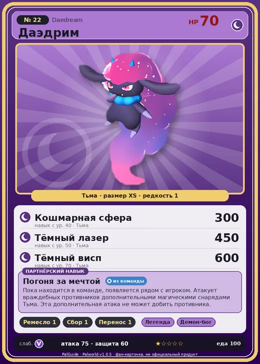

# #22 Даэдрим (Daedream)

#22 · Daedream

Тьма

Слабость: Дракон

🖐️ Ручная работа <b>1</b>🌾 Сбор <b>1</b>📦 Транспортировка <b>1</b>

<b>Погоня за мечтой</b> 🎒 из команды

❤️ 70 · ⚔️ 75 · 🛡 60

| Поле | Значение |
|---|---|
| Стихия | Тьма |
| Слабость (кто бьёт сильнее) | Дракон |
| Редкость | 1 |
| Размер | XS |
| HP / Атака / Защита (база вида) | 70 / 75 / 60 |
| Сколько ест | 100 |
| Цена продажи | 397 |
| Множитель поимки | ×1 |
| Скорость рывка верхом | 550 |

## Работа на базе
- Ручная работа — ур. 1
- Сбор — ур. 1
- Транспортировка — ур. 1

## Партнёрский навык: Погоня за мечтой
Пока находится в команде, появляется рядом с игроком. Атакует враждебных противников дополнительными магическими снарядами Тьма . Эта дополнительная атака не может добить противника. Lv. Range 1 2 3 4 5 level value 1 MainValue 1.5 Пробуждение : 2 MainValue 1.6 Пробуждение : (Увеличение урона: Небольшое ) 3 MainValue 1.8 Пробуждение : (Увеличение урона: Среднее ) 4 MainValue 2.1 Пробуждение : (Увеличение урона: Большое ) 5 MainValue 2.5 Пробуждение : (Увеличение урона: Очень большое )

## Атаки по уровням
- ур. 1: Тёмный шар (Тьма, сила 50)
- ур. 7: Ядовитый выстрел (Тьма, сила 30)
- ур. 15: Теневой взрыв (Тьма, сила 80)
- ур. 22: Ледяное дыхание (Лёд, сила 160)
- ур. 30: Духовное пламя (Тьма, сила 200)
- ур. 40: Кошмарная сфера (Тьма, сила 300)
- ур. 50: Тёмный лазер (Тьма, сила 450)
- ур. 70: Тёмный висп (Тьма, сила 600)

## Где водится
- В дикой природе: нет/особый способ; точек появления днём: 0, ночью: 164; уровни в первых точках: 4–7
- Подземелья: Пещера Отдалённого Острова, Пещера Ущелья, Пещера Холмов
- Яйцо: Яйцо тьмы

## Дроп
- Ядовитая железа — 1 шт., 100%
- Маленькая душа Пала — 1 шт., 1%

**Дроп альфы:**
- Деталь древней цивилизации — 1–3 шт., 100%
- Ценный мех — 1–3 шт., 100%

## Разведение
- Ранг разведения (CombiRank): 2910

## Лучшие пассивки по роли
- боец: Легенда, Демон-бог, Хладнокровный, Бессмертие, Король тьмы (вместо Бессмертия, если нет мутации)
- ездовой: Божественная скорость, Легенда, Вечный двигатель, Небесное скольжение

## Чем хорош / чем плох
- ✅ можно оседлать
- ❌ слабая атака (75)

> Погружает в глубокий сон того, кто ей по душе и дарит ему бесконечные счастливые сны. До самой смерти он уже не проснётся.

См. также: [Стихии](../../2_mehaniki/stihii.md) · [Разведение](../../2_mehaniki/razvedenie.md) · [Все палы](README.md)
_Источник: paldb.cc v1.0.5_
