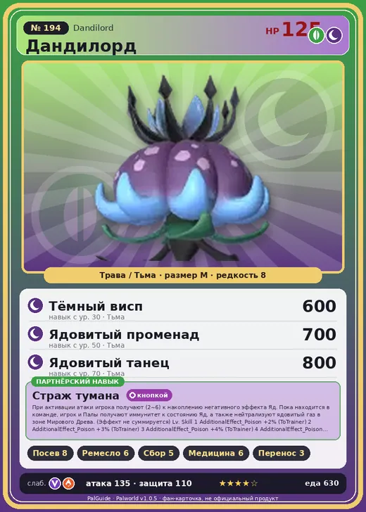

# #194 Дандилорд (Dandilord)

№ 194

ТраваТьма

Слабость: ДраконОгонь

🌱 Посев семян <b>8</b>🖐️ Ручная работа <b>6</b>🌾 Сбор <b>5</b>💊 Фармацевтика <b>6</b>📦 Транспортировка <b>3</b>

<b>Страж тумана</b> 🎒 из команды 🔘 кнопкой

❤️ 125 · ⚔️ 135 · 🛡 110

| Поле | Значение |
|---|---|
| Стихия | Трава, Тьма |
| Слабость (кто бьёт сильнее) | Дракон, Огонь |
| Редкость | 8 |
| Размер | M |
| HP / Атака / Защита (база вида) | 125 / 135 / 110 |
| Сколько ест | 630 |
| Цена продажи | 4442 |
| Множитель поимки | ×1 |
| Скорость рывка верхом | 1000 |

## Работа на базе
- Посев семян — ур. 8
- Ручная работа — ур. 6
- Сбор — ур. 5
- Фармацевтика — ур. 6
- Транспортировка — ур. 3

## Партнёрский навык: Страж тумана
При активации атаки игрока получают (2~6) к накоплению негативного эффекта Яд . Пока находится в команде, игрок и Палы получают иммунитет к состоянию Яд , а также нейтрализуют ядовитый газ в зоне Мирового Древа. (Эффект не суммируется)

## Атаки по уровням
- ур. 1: Тёмная пушка (Тьма, сила 70)
- ур. 7: Семенная мина (Трава, сила 120)
- ур. 15: Кольцевая лоза (Трава, сила 300)
- ур. 22: Тёмный лазер (Тьма, сила 450)
- ур. 30: Тёмный висп (Тьма, сила 600)
- ур. 40: Ветряной взрыв (Трава, сила 600)
- ур. 50: Ядовитый променад (Тьма, сила 700)
- ур. 70: Ядовитый танец (Тьма, сила 800)

## Где водится
- В дикой природе: нет/особый способ; точек появления днём: 0, ночью: 0
- Яйцо: Огромное яйцо свежей листвы

## Дроп
- Абсолютная душа Пала — 1 шт., 100%
- Ядро древней цивилизации — 1 шт., 100%
- Ядовитая железа — 4–5 шт., 100%

**Дроп альфы:**
- Деталь древней цивилизации — 6–8 шт., 100%
- Ценные внутренности — 2–3 шт., 100%

## Разведение
- Ранг разведения (CombiRank): 60
- **Особая пара:** [Дандилорд](../../4_spravochniki/paly/dandilord.md) + [Дандилорд](../../4_spravochniki/paly/dandilord.md)
- Участвует в особых парах: Дандилорд → Дандилорд; Дандилорд → Дандилорд

## Лучшие пассивки по роли
- по обзору: Мастеровитый, Виртуоз, Трудоголик, Аскет
- боец: Легенда, Демон-бог, Хладнокровный, Бессмертие, Король духов (вместо Бессмертия, если нет мутации)
- рабочий: Дьявольские руки, Виртуоз, Мастеровитый, Небожитель/Трудоголик
- ездовой: Божественная скорость, Легенда, Вечный двигатель, Небесное скольжение

## Чем хорош / чем плох
- ✅ Посев 8; очень высокая атака (135); много здоровья (125); отличный рабочий (пригодность 8); можно оседлать
- ❌ Поздний; много ест (630); разводится только особой парой

> С незапамятных времён он стоит у Древа и продолжает что-то охранять. Что именно он защищает сейчас и почему делает это — Дандилорд не пытается постичь. Потому что Древо знает ответ. Потому что лишь подвластный ему туман позволяет увидеть истину.

См. также: [Стихии](../../guide/06_stihii.md) · [Разведение](../../guide/07_razvedenie.md) · [Все палы](README.md)
