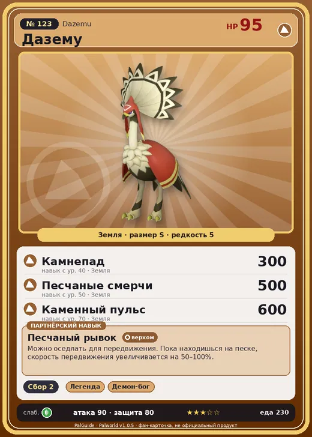

# #123 Дазему (Dazemu)

#123 · Dazemu

Земля

Слабость: Трава

🌾 Сбор <b>2</b>

<b>Песчаный рывок</b> 🐎 верхом

❤️ 95 · ⚔️ 90 · 🛡 80

| Поле | Значение |
|---|---|
| Стихия | Земля |
| Слабость (кто бьёт сильнее) | Трава |
| Редкость | 5 |
| Размер | S |
| HP / Атака / Защита (база вида) | 95 / 90 / 80 |
| Сколько ест | 230 |
| Цена продажи | 896 |
| Множитель поимки | ×1 |
| Скорость рывка верхом | 1200 |

## Работа на базе
- Сбор — ур. 2

## Партнёрский навык: Песчаный рывок
Можно оседлать для передвижения. Пока находишься на песке , скорость передвижения увеличивается на (50~100)% . Технологии 28 level value 1 MoveSpeed_Up_GroundType_PartnerSkill 50 2 MoveSpeed_Up_GroundType_PartnerSkill 62 3 MoveSpeed_Up_GroundType_PartnerSkill 74 4 MoveSpeed_Up_GroundType_PartnerSkill 86 5 MoveSpeed_Up_GroundType_PartnerSkill 100

## Атаки по уровням
- ур. 1: Грязевой выстрел (Земля, сила 40)
- ур. 7: Силовой выстрел (Нейтральный, сила 80)
- ур. 15: Каменный залп (Земля, сила 80)
- ур. 22: Камнемёт (Земля, сила 120)
- ур. 30: Террабросок (Земля, сила 250)
- ур. 40: Камнепад (Земля, сила 300)
- ур. 50: Песчаные смерчи (Земля, сила 500)
- ур. 70: Каменный пульс (Земля, сила 600)

## Где водится
- В дикой природе: да; точек появления днём: 405, ночью: 405; уровни в первых точках: 31–35
- Подземелья: Пещера Цветущей Сакуры
- Может продаваться у торговца/рекрутера
- Яйцо: Большое яйцо земли

## Дроп
- Кость — 1 шт., 100%

**Дроп альфы:**
- Деталь древней цивилизации — 2–3 шт., 100%
- Ценное перо — 2–3 шт., 100%

## Разведение
- Ранг разведения (CombiRank): 2210
- Участвует в особых парах: Криолинкс → Криолинкс Терра

## Лучшие пассивки по роли
- боец: Легенда, Демон-бог, Хладнокровный, Бессмертие, Император земли (вместо Бессмертия, если нет мутации)
- ездовой: Божественная скорость, Легенда, Вечный двигатель, Небесное скольжение

## Чем хорош / чем плох
- ✅ можно оседлать
- ❌ явных минусов нет

> Один шаг — и исчезает сомнение. Второй шаг — и уходит тревога. Третий шаг — и забывается страх. После этого — им по силам любой враг.

См. также: [Стихии](../../2_mehaniki/stihii.md) · [Разведение](../../2_mehaniki/razvedenie.md) · [Все палы](README.md)
_Источник: paldb.cc v1.0.5_
