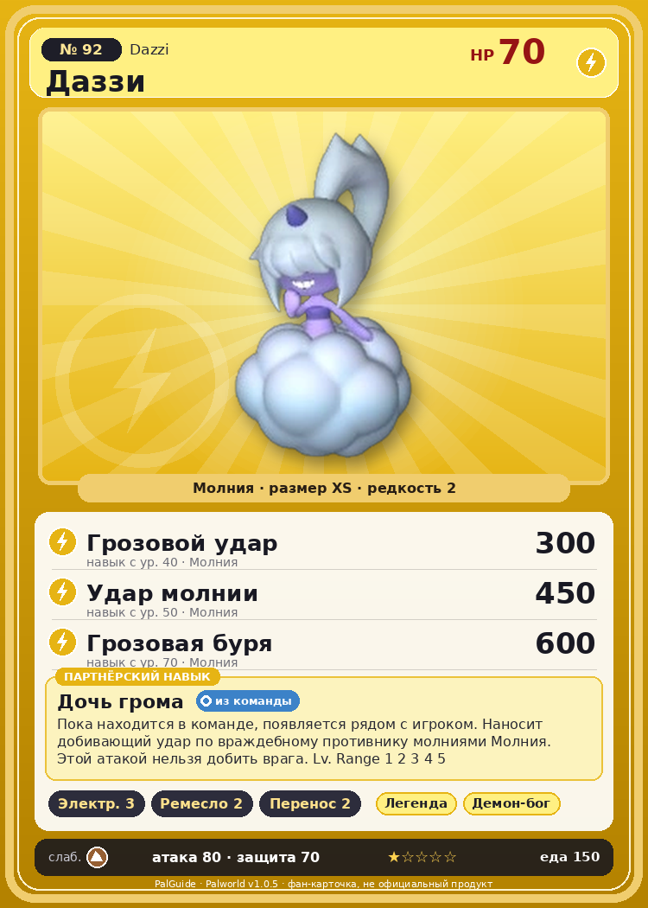

# #92 Даззи (Dazzi)

{ width=360 }

| Поле | Значение |
|---|---|
| Стихия | Молния |
| Слабость (кто бьёт сильнее) | Земля |
| Редкость | 2 |
| Размер | XS |
| HP / Атака / Защита (база вида) | 70 / 80 / 70 |
| Сколько ест | 150 |
| Цена продажи | 616 |
| Множитель поимки | ×1 |
| Скорость рывка верхом | 550 |

## Работа на базе
- Генерация энергии — ур. 3
- Ручная работа — ур. 2
- Транспортировка — ур. 2

## Партнёрский навык: Дочь грома
Пока находится в команде, появляется рядом с игроком. Наносит добивающий удар по враждебному противнику молниями Молния . Этой атакой нельзя добить врага. Lv. Range 1 2 3 4 5 level value 1 MainValue 1 Пробуждение : 2 MainValue 1.1 Пробуждение : (Усиление дополнительных атак: Небольшое ) 3 MainValue 1.3 Пробуждение : (Усиление дополнительных атак: Среднее ) 4 MainValue 1.6 Пробуждение : (Усиление дополнительных атак: Большое ) 5 MainValue 2 Пробуждение : (Усиление дополнительных атак: Очень большое )

## Атаки по уровням
- ур. 1: Воздушная пушка (Нейтральный, сила 40)
- ур. 7: Шоковая волна (Молния, сила 80)
- ур. 15: Кислотный дождь (Вода, сила 120)
- ур. 22: Грозовая линия (Молния, сила 160)
- ур. 30: Тройная молния (Молния, сила 200)
- ур. 40: Грозовой удар (Молния, сила 300)
- ур. 50: Удар молнии (Молния, сила 450)
- ур. 70: Грозовая буря (Молния, сила 600)

## Где водится
- В дикой природе: да; точек появления днём: 140, ночью: 140; уровни в первых точках: 30–33
- Подземелья: Пещера Песчаных Дюн
- Может продаваться у торговца/рекрутера
- Яйцо: Яйцо молнии

## Дроп
- Электрический орган — 1 шт., 100%
- Облако Даззи — 1 шт., 100%

**Дроп альфы:**
- Деталь древней цивилизации — 1–2 шт., 100%
- Ценный мех — 1–2 шт., 100%

## Разведение
- Ранг разведения (CombiRank): 2400
- Участвует в особых парах: Омаскул → Даззи Нокт

## Лучшие пассивки по роли
- боец: Легенда, Демон-бог, Хладнокровный, Бессмертие, Император молнии (вместо Бессмертия, если нет мутации)
- рабочий: Дьявольские руки, Виртуоз, Мастеровитый, Небожитель/Трудоголик
- ездовой: Божественная скорость, Легенда, Вечный двигатель, Небесное скольжение

## Чем хорош / чем плох
- ✅ можно оседлать
- ❌ явных минусов нет

> Часто проявляет доброту к одиноким Палам. Стоит кому-то из них принять это за нечто большее — и в следующую секунду тот уже ловит разряд молнии.

См. также: [Стихии](../../2_mehaniki/stihii.md) · [Разведение](../../2_mehaniki/razvedenie.md) · [Все палы](README.md)
_Источник: paldb.cc v1.0.5_
