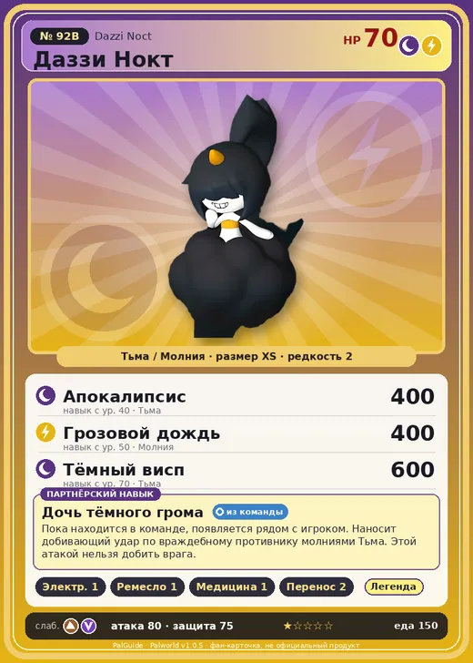

# #92B Даззи Нокт (Dazzi Noct)

#92B · Dazzi Noct

ТьмаМолния

Слабость: ДраконЗемля

⚡ Генерация энергии <b>1</b>🖐️ Ручная работа <b>1</b>💊 Фармацевтика <b>1</b>📦 Транспортировка <b>2</b>

<b>Дочь тёмного грома</b> 🎒 из команды

❤️ 70 · ⚔️ 80 · 🛡 75

| Поле | Значение |
|---|---|
| Стихия | Тьма, Молния |
| Слабость (кто бьёт сильнее) | Дракон, Земля |
| Редкость | 2 |
| Размер | XS |
| HP / Атака / Защита (база вида) | 70 / 80 / 75 |
| Сколько ест | 150 |
| Цена продажи | 599 |
| Множитель поимки | ×1 |
| Скорость рывка верхом | 550 |

## Работа на базе
- Генерация энергии — ур. 1
- Ручная работа — ур. 1
- Фармацевтика — ур. 1
- Транспортировка — ур. 2

## Партнёрский навык: Дочь тёмного грома
Пока находится в команде, появляется рядом с игроком. Наносит добивающий удар по враждебному противнику молниями Тьма . Этой атакой нельзя добить врага. Lv. Range 1 2 3 4 5 level value 1 MainValue 1 Пробуждение : 2 MainValue 1.1 Пробуждение : (Усиление дополнительных атак: Небольшое ) 3 MainValue 1.3 Пробуждение : (Усиление дополнительных атак: Среднее ) 4 MainValue 1.6 Пробуждение : (Усиление дополнительных атак: Большое ) 5 MainValue 2 Пробуждение : (Усиление дополнительных атак: Очень большое )

## Атаки по уровням
- ур. 1: Воздушная пушка (Нейтральный, сила 40)
- ур. 7: Теневой взрыв (Тьма, сила 80)
- ур. 15: Стрелы тьмы (Тьма, сила 120)
- ур. 22: Кислотный дождь (Вода, сила 120)
- ур. 30: Тройная молния (Молния, сила 200)
- ур. 40: Апокалипсис (Тьма, сила 400)
- ур. 50: Грозовой дождь (Молния, сила 400)
- ур. 70: Тёмный висп (Тьма, сила 600)

## Где водится
- В дикой природе: да; точек появления днём: 139, ночью: 139; уровни в первых точках: 50–52
- Подземелья: Пещера Тэнраку
- Яйцо: Яйцо тьмы

## Дроп
- Электрический орган — 1 шт., 100%
- Облако Даззи — 1 шт., 100%
- Осколок тьмы — 1 шт., 100%

**Дроп альфы:**
- Деталь древней цивилизации — 6–8 шт., 100%
- Ценный мех — 2–3 шт., 100%

## Разведение
- Ранг разведения (CombiRank): 1910
- **Особая пара:** [Даззи](../../4_spravochniki/paly/dazzi.md) + [Омаскул](../../4_spravochniki/paly/omascul.md)

## Лучшие пассивки по роли
- боец: Легенда, Демон-бог, Хладнокровный, Бессмертие, Король тьмы (вместо Бессмертия, если нет мутации)
- ездовой: Божественная скорость, Легенда, Вечный двигатель, Небесное скольжение

## Чем хорош / чем плох
- ✅ можно оседлать
- ❌ разводится только особой парой

> Проявляет доброту к одиноким Палам, выжидая удобный момент, чтобы ударить молнией. Таков был замысел. Но подходящий случай всё не представлялся — и в итоге они просто становились друзьями.

См. также: [Стихии](../../2_mehaniki/stihii.md) · [Разведение](../../2_mehaniki/razvedenie.md) · [Все палы](README.md)
_Источник: paldb.cc v1.0.5_
