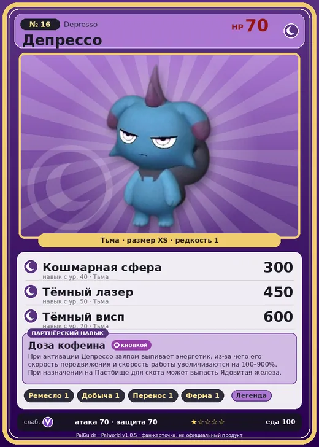

# #16 Депрессо (Depresso)

#16 · Depresso

Тьма

Слабость: Дракон

🖐️ Ручная работа <b>1</b>⛏️ Добыча <b>1</b>📦 Транспортировка <b>1</b>🐑 Фермерство <b>1</b>

<b>Доза кофеина</b> 🔘 кнопкой 🏠 на базе

❤️ 70 · ⚔️ 70 · 🛡 70

| Поле | Значение |
|---|---|
| Стихия | Тьма |
| Слабость (кто бьёт сильнее) | Дракон |
| Редкость | 1 |
| Размер | XS |
| HP / Атака / Защита (база вида) | 70 / 70 / 70 |
| Сколько ест | 100 |
| Цена продажи | 436 |
| Множитель поимки | ×1 |
| Скорость рывка верхом | 400 |

## Работа на базе
- Ручная работа — ур. 1
- Добыча — ур. 1
- Транспортировка — ур. 1
- Фермерство — ур. 1

## Партнёрский навык: Доза кофеина
При активации Депрессо залпом выпивает энергетик, из-за чего его скорость передвижения и скорость работы увеличиваются на (100~900)% . При назначении на Пастбище для скота может выпасть Ядовитая железа . Lv. Skill 1 Скорость работы +100% (ToSelf) 2 Скорость работы +200% (ToSelf) 3 Скорость работы +400% (ToSelf) 4 Скорость работы +600% (ToSelf) 5 Скорость работы +900% (ToSelf) Lv. speed multiplier 1 2 2 3 3 4 5 5 7

## Атаки по уровням
- ур. 1: Ядовитый выстрел (Тьма, сила 30)
- ур. 7: Грязевой выстрел (Земля, сила 40)
- ур. 15: Тёмный шар (Тьма, сила 50)
- ур. 22: Ледяная ракета (Лёд, сила 40)
- ур. 30: Теневой взрыв (Тьма, сила 80)
- ур. 40: Кошмарная сфера (Тьма, сила 300)
- ур. 50: Тёмный лазер (Тьма, сила 450)
- ур. 70: Тёмный висп (Тьма, сила 600)

## Где водится
- В дикой природе: да; точек появления днём: 6, ночью: 413; уровни в первых точках: 4–7
- Подземелья: Пещера Отдалённого Острова, Пещера Холмов
- Яйцо: Яйцо тьмы

## Дроп
- Ядовитая железа — 2–3 шт., 100%

**Дроп альфы:**
- Деталь древней цивилизации — 1–2 шт., 100%
- Ценный мех — 1–2 шт., 100%

## Разведение
- Ранг разведения (CombiRank): 3000

## Лучшие пассивки по роли
- боец: Легенда, Демон-бог, Хладнокровный, Бессмертие, Король тьмы (вместо Бессмертия, если нет мутации)
- ездовой: Божественная скорость, Легенда, Вечный двигатель, Небесное скольжение

## Чем хорош / чем плох
- ✅ можно оседлать
- ❌ слабая атака (70)

> Из-за своего угрюмого взгляда имеет мало друзей, но обладает добрым сердцем. Можно увидеть, как они делятся едой с отбившимися от стаи Палами. Викси не даст соврать.

См. также: [Стихии](../../2_mehaniki/stihii.md) · [Разведение](../../2_mehaniki/razvedenie.md) · [Все палы](README.md)
