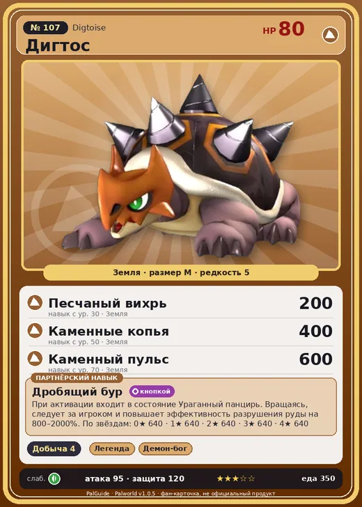

# #107 Дигтос (Digtoise)

#107 · Digtoise

Земля

Слабость: Трава

⛏️ Добыча <b>4</b>

<b>Дробящий бур</b> 🔘 кнопкой

❤️ 80 · ⚔️ 95 · 🛡 120

| Поле | Значение |
|---|---|
| Стихия | Земля |
| Слабость (кто бьёт сильнее) | Трава |
| Редкость | 5 |
| Размер | M |
| HP / Атака / Защита (база вида) | 80 / 95 / 120 |
| Сколько ест | 350 |
| Цена продажи | 1577 |
| Множитель поимки | ×1 |
| Скорость рывка верхом | 420 |

## Работа на базе
- Добыча — ур. 4

## Партнёрский навык: Дробящий бур
При активации входит в состояние Ураганный панцирь . Вращаясь, следует за игроком и повышает эффективность разрушения руды на (800~2000)% . level value 1 Mining_up_PartnerSkill_DrillGame 640 MainValue 1.25 2 Mining_up_PartnerSkill_DrillGame 640 MainValue 1.5 3 Mining_up_PartnerSkill_DrillGame 640 MainValue 1.875 4 Mining_up_PartnerSkill_DrillGame 640 MainValue 2.25 5 Mining_up_PartnerSkill_DrillGame 640 MainValue 3.125

## Атаки по уровням
- ур. 1: Водяной выстрел (Вода, сила 50)
- ур. 7: Каменный залп (Земля, сила 80)
- ур. 15: Ураганный панцирь (Земля, сила 120)
- ур. 22: Камнемёт (Земля, сила 120)
- ур. 30: Песчаный вихрь (Земля, сила 200)
- ур. 40: Водяная бомба (Вода, сила 200)
- ур. 50: Каменные копья (Земля, сила 400)
- ур. 70: Каменный пульс (Земля, сила 600)

## Где водится
- В дикой природе: да; точек появления днём: 661, ночью: 661; уровни в первых точках: 33–37
- Подземелья: Пещера Песчаных Дюн, Пещера Ущелья
- Может продаваться у торговца/рекрутера
- Яйцо: Большое яйцо земли

## Дроп
- Металлическая руда — 2–3 шт., 100%
- Качественное масло Пала — 2–3 шт., 100%

**Дроп альфы:**
- Деталь древней цивилизации — 2–3 шт., 100%
- Ценный коготь — 2–3 шт., 100%

## Разведение
- Ранг разведения (CombiRank): 1550
- Участвует в особых парах: Туртакл → Туртакл Терра; Ворсект → Ворсект Терра

## Лучшие пассивки по роли
- боец: Легенда, Демон-бог, Хладнокровный, Бессмертие, Император земли (вместо Бессмертия, если нет мутации)
- рабочий: Дьявольские руки, Виртуоз, Мастеровитый, Небожитель/Трудоголик
- ездовой: Божественная скорость, Легенда, Вечный двигатель, Небесное скольжение

## Чем хорош / чем плох
- ✅ крепкая защита (120); можно оседлать
- ❌ явных минусов нет

> | Дигтос и бур| — поучительная история о Дигтос с самым прочным панцирем и буром, который размышляет о природе противоречий.

См. также: [Стихии](../../guide/06_stihii.md) · [Разведение](../../guide/07_razvedenie.md) · [Все палы](README.md)
