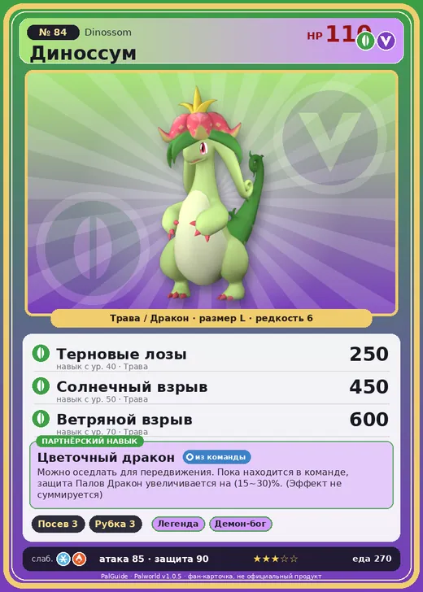

# #84 Диноссум (Dinossom)

#84 · Dinossom

ТраваДракон

Слабость: ЛёдОгонь

🌱 Посев семян <b>3</b>🪓 Рубка деревьев <b>3</b>

<b>Цветочный дракон</b> 🎒 из команды 🐎 верхом

❤️ 110 · ⚔️ 85 · 🛡 90

| Поле | Значение |
|---|---|
| Стихия | Трава, Дракон |
| Слабость (кто бьёт сильнее) | Лёд, Огонь |
| Редкость | 6 |
| Размер | L |
| HP / Атака / Защита (база вида) | 110 / 85 / 90 |
| Сколько ест | 270 |
| Цена продажи | 1315 |
| Множитель поимки | ×1 |
| Скорость рывка верхом | 1030 |

## Работа на базе
- Посев семян — ур. 3
- Рубка деревьев — ур. 3

## Партнёрский навык: Цветочный дракон
Можно оседлать для передвижения. Пока находится в команде, защита Палов Дракон увеличивается на (15~30)% . (Эффект не суммируется) Технологии 24 level value 1 DefenseUp_Dragon_PartnerSkill 15 2 DefenseUp_Dragon_PartnerSkill 17 3 DefenseUp_Dragon_PartnerSkill 20 4 DefenseUp_Dragon_PartnerSkill 24 5 DefenseUp_Dragon_PartnerSkill 30

## Атаки по уровням
- ур. 1: Ветряной клинок (Трава, сила 40)
- ур. 7: Ботанический хлыст (Трава, сила 80)
- ур. 15: Драконий взрыв (Дракон, сила 80)
- ур. 22: Семенная мина (Трава, сила 120)
- ур. 30: Дыхание дракона (Дракон, сила 160)
- ур. 40: Терновые лозы (Трава, сила 250)
- ур. 50: Солнечный взрыв (Трава, сила 450)
- ур. 70: Ветряной взрыв (Трава, сила 600)

## Где водится
- В дикой природе: да; точек появления днём: 263, ночью: 263; уровни в первых точках: 25–28
- Подземелья: Пещера Отдалённого Острова, Пещера Холмов
- Яйцо: Большое яйцо свежей листвы

## Дроп
- Семена помидоров — 1–2 шт., 100%
- Семена латука — 1–2 шт., 100%

**Дроп альфы:**
- Деталь древней цивилизации — 1–3 шт., 100%
- Ценный драконий самоцвет — 1–3 шт., 100%

## Разведение
- Ранг разведения (CombiRank): 2100
- Участвует в особых парах: Райхаунд → Диноссум Лакс

## Лучшие пассивки по роли
- боец: Легенда, Демон-бог, Хладнокровный, Бессмертие, Король духов (вместо Бессмертия, если нет мутации)
- рабочий: Дьявольские руки, Виртуоз, Мастеровитый, Небожитель/Трудоголик
- ездовой: Божественная скорость, Легенда, Вечный двигатель, Небесное скольжение

## Чем хорош / чем плох
- ✅ можно оседлать
- ❌ явных минусов нет

> Стоит этому Палу разозлиться — и он выходит из-под контроля, беснуясь, словно пылающее пламя. Выражение |наступить на хвост Диноссум | означает довести кого-то до ярости.

См. также: [Стихии](../../2_mehaniki/stihii.md) · [Разведение](../../2_mehaniki/razvedenie.md) · [Все палы](README.md)
