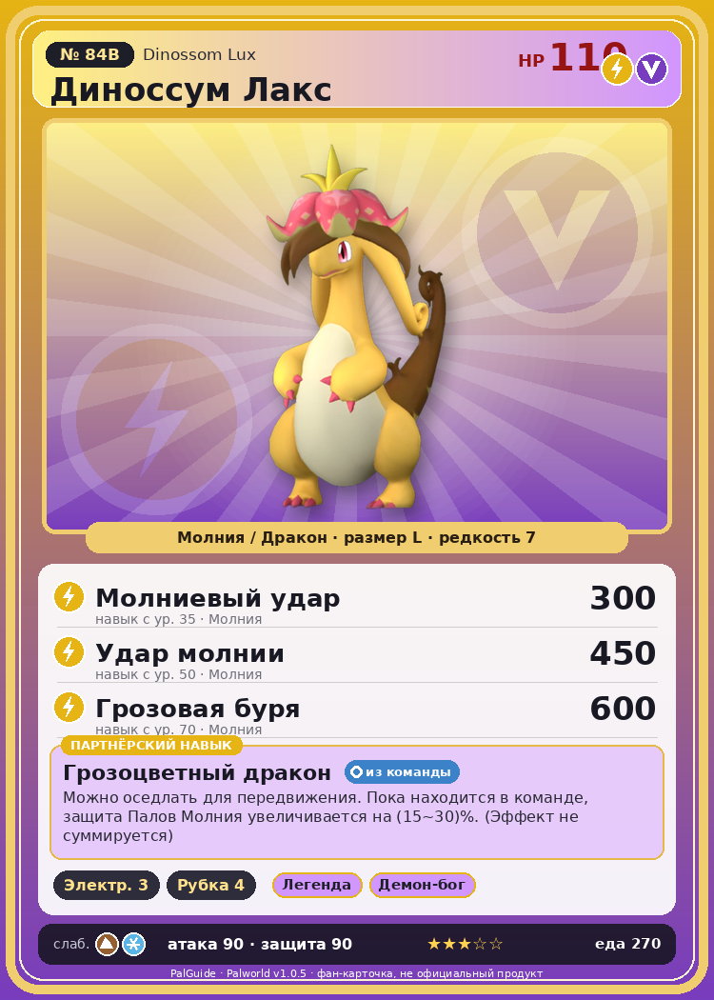

# #84B Диноссум Лакс (Dinossom Lux)

{ width=360 }

| Поле | Значение |
|---|---|
| Стихия | Молния, Дракон |
| Слабость (кто бьёт сильнее) | Земля, Лёд |
| Редкость | 7 |
| Размер | L |
| HP / Атака / Защита (база вида) | 110 / 90 / 90 |
| Сколько ест | 270 |
| Цена продажи | 1543 |
| Множитель поимки | ×1 |
| Скорость рывка верхом | 1030 |

## Работа на базе
- Генерация энергии — ур. 3
- Рубка деревьев — ур. 4

## Партнёрский навык: Грозоцветный дракон
Можно оседлать для передвижения. Пока находится в команде, защита Палов Молния увеличивается на (15~30)% . (Эффект не суммируется) Технологии 34 level value 1 DefenseUp_Electricity_PartnerSkill 15 2 DefenseUp_Electricity_PartnerSkill 17 3 DefenseUp_Electricity_PartnerSkill 20 4 DefenseUp_Electricity_PartnerSkill 24 5 DefenseUp_Electricity_PartnerSkill 30

## Атаки по уровням
- ур. 1: Шоковая волна (Молния, сила 80)
- ур. 7: Плазмомёт (Молния, сила 120)
- ур. 15: Ботанический хлыст (Трава, сила 80)
- ур. 22: Дыхание дракона (Дракон, сила 160)
- ур. 30: Тройная молния (Молния, сила 200)
- ур. 35: Молниевый удар (Молния, сила 300)
- ур. 40: Грозовой удар (Молния, сила 300)
- ур. 50: Удар молнии (Молния, сила 450)
- ур. 70: Грозовая буря (Молния, сила 600)

## Где водится
- В дикой природе: да; точек появления днём: 574, ночью: 574; уровни в первых точках: 34–38
- Подземелья: Пещера Песчаных Дюн
- Может продаваться у торговца/рекрутера
- Яйцо: Большое яйцо молнии

## Дроп
- Семена помидоров — 1–2 шт., 100%
- Семена моркови — 1–2 шт., 100%

**Дроп альфы:**
- Деталь древней цивилизации — 5–7 шт., 100%
- Ценный драконий самоцвет — 5–7 шт., 100%

## Разведение
- Ранг разведения (CombiRank): 1890
- **Особая пара:** [Диноссум](../../4_spravochniki/paly/dinossom.md) + [Райхаунд](../../4_spravochniki/paly/rayhound.md)

## Лучшие пассивки по роли
- боец: Легенда, Демон-бог, Хладнокровный, Бессмертие, Император молнии (вместо Бессмертия, если нет мутации)
- рабочий: Дьявольские руки, Виртуоз, Мастеровитый, Небожитель/Трудоголик
- ездовой: Божественная скорость, Легенда, Вечный двигатель, Небесное скольжение

## Чем хорош / чем плох
- ✅ можно оседлать
- ❌ разводится только особой парой

> В этого Пала ударила молния — но он чудом выжил. Выражение |в Диноссум Лакс ударила молния| означает чудесное спасение от гибели.

См. также: [Стихии](../../2_mehaniki/stihii.md) · [Разведение](../../2_mehaniki/razvedenie.md) · [Все палы](README.md)
_Источник: paldb.cc v1.0.5_
