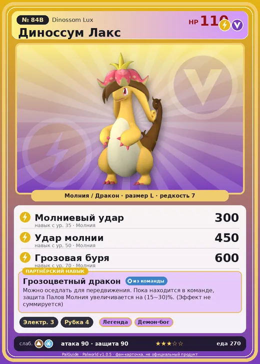

# Диноссум Лакс

<canvas id="fx"></canvas>

№ 84B

МолнияДракон

Слабость: Лёд <b class="mx">×1,5</b>Земля <b class="mx">×1,5</b> <button class="hlp" data-tip="Множители перемножаются по обеим стихиям: ×1,5 за стихию, которую атака бьёт, ×0,65 за ту, что её держит. Лёд: 1 × 1,5 = ×1,5; Земля: 1,5 × 1 = ×1,5.">?</button>

Устойчив: Вода <b class="mx">×0,65</b>Тьма <b class="mx">×0,65</b>

⚡ Генерация энергии <b>3</b>🪓 Рубка деревьев <b>4</b>

<b>Грозоцветный дракон</b> 🎒 Работает из команды🐎 Верхом

❤️ 110 · ⚔️ 90 · 🛡 90

Основное

💎Редкость <button class="hlp" data-tip="Чем выше число, тем реже встречается пал. 1–4 — обычные, 5–7 — редкие, 8+ — легендарные.">?</button><b>7</b>

📏Размер<b>L</b>

💰Цена продажи <button class="hlp" data-tip="Сколько золота даст торговец за пала.">?</button><b>1543</b>

Бой

🎯Множитель поимки <button class="hlp" data-tip="Насколько легче или труднее поймать: ×1 — обычно, меньше — сложнее.">?</button><b>×1</b>

🐎Скорость рывка верхом <button class="hlp" data-tip="Скорость, если сесть на пала и бежать рывком.">?</button><b>1030</b>

Ферма и еда

🍖Сколько ест <button class="hlp" data-tip="Сколько сытости пал тратит — чем больше, тем больше еды нужно на базе.">?</button><b>270</b>

Разведение

🧬Сила разведения <button class="hlp" data-tip="Скрытое число игры: у детёныша оно примерно среднее от родителей. Чем меньше — тем «сильнее» пал.">?</button><b>1890</b>

💞Особая пара <button class="hlp" data-tip="Этого пала можно вывести только от этой пары.">?</button><b>Диноссум + Райхаунд</b>

=== "Обзор"

    #### Работа на базе

    
<a class="wbar" href="../../../2_mehaniki/rabota/?w=electricity&lv=3">⚡ Генерация энергии<i style="--v:30%"></i><b>3</b></a><a class="wbar" href="../../../2_mehaniki/rabota/?w=lumbering&lv=4">🪓 Рубка деревьев<i style="--v:40%"></i><b>4</b></a><a class="wb-more" href="../../../2_mehaniki/rabota/">Что значат уровни работы →</a>

    #### Партнёрский навык: Грозоцветный дракон
    Можно оседлать для передвижения. Пока находится в команде, защита Палов Молния увеличивается на 15–30%. (Эффект не суммируется) Технологии 34. По звёздам: 0★ 15 · 1★ 17 · 2★ 20 · 3★ 24 · 4★ 30

    #### Чем хорош / чем плох
    - ✅ можно оседлать
    - ❌ разводится только особой парой

    > В этого Пала ударила молния — но он чудом выжил. Выражение |в пала «Диноссум Лакс» ударила молния| означает чудесное спасение от гибели.

    См. также: [Стихии](../../guide/06_stihii.md) · [Разведение](../../guide/07_razvedenie.md) · [Все палы](README.md)

=== "Атаки"

    #### Атаки по уровням
    - ур. 1: Шоковая волна (Молния, сила 80)
    - ур. 7: Плазмомёт (Молния, сила 120)
    - ур. 15: Ботанический хлыст (Трава, сила 80)
    - ур. 22: Дыхание дракона (Дракон, сила 160)
    - ур. 30: Тройная молния (Молния, сила 200)
    - ур. 35: Молниевый удар (Молния, сила 300)
    - ур. 40: Грозовой удар (Молния, сила 300)
    - ур. 50: Удар молнии (Молния, сила 450)
    - ур. 70: Грозовая буря (Молния, сила 600)

=== "Где живёт"

    #### Где водится

    

<button data-k="d" class="on">☀️ День</button><button data-k="n">🌙 Ночь</button>

ур. 34–36<a class="btn hm-full" href="../../../map/?pal=FlowerDinosaur_Electric">Показать на большой карте</a>

Иссохшие дюныШрамы войны

🕳 Подземелье<b>Пещера Песчаных Дюн</b>

🥚 Яйцо<b>Большое яйцо молнии</b>

🛒 Торговец<b>Продаётся у торговца палами</b>

=== "Дроп"

    #### Дроп
    - Семена помидоров — 1–2 шт., 100%
    - Семена моркови — 1–2 шт., 100%

    **Дроп альфы:**

    - Деталь древней цивилизации — 5–7 шт., 100%
    - Ценный драконий самоцвет — 5–7 шт., 100%

=== "Разведение"

    #### Разведение
    - Ранг разведения: 1890
    - **Особая пара:** [Диноссум](../../4_spravochniki/paly/dinossom.md) + [Райхаунд](../../4_spravochniki/paly/rayhound.md)

=== "Пассивки"

    #### Лучшие пассивки по роли

    

⚔️ Боец

максимум урона и живучести в бою

<a class="psv r-4" data-psv="Легенда" href="../../../passivki/legend/">Легенда</a><a class="psv r-4" data-psv="Демон-бог" href="../../../passivki/demon_god/">Демон-бог</a><a class="psv r-3" data-psv="Император молнии" href="../../../passivki/lord_of_lightning/">Император молнии</a><a class="psv r-3" data-psv="Хладнокровный" href="../../../passivki/serenity/">Хладнокровный</a>

🛠 Рабочий

работает быстрее и меньше устаёт на базе

<a class="psv r-5" data-psv="Дьявольские руки" href="../../../passivki/demons_hand/">Дьявольские руки</a><a class="psv r-4" data-psv="Виртуоз" href="../../../passivki/remarkable_craftsmanship/">Виртуоз</a><a class="psv r-3" data-psv="Мастеровитый" href="../../../passivki/artisan/">Мастеровитый</a><a class="psv r-3" data-psv="Трудоголик" href="../../../passivki/workaholic/">Трудоголик</a>

🐎 Ездовой

быстрее бегает или летает с тобой верхом

<a class="psv r-4" data-psv="Божественная скорость" href="../../../passivki/swift/">Божественная скорость</a><a class="psv r-4" data-psv="Легенда" href="../../../passivki/legend/">Легенда</a><a class="psv r-4" data-psv="Вечный двигатель" href="../../../passivki/eternal_engine/">Вечный двигатель</a><a class="psv r-4" data-psv="Небесное скольжение" href="../../../passivki/sky_strider/">Небесное скольжение</a>

    <small>Нажми на пассивку, чтобы узнать, что она даёт и где её взять.</small>

<a class="card-link" href="../dinossom/">← Диноссум</a><a class="card-link" href="../bushi/">Буси →</a>

