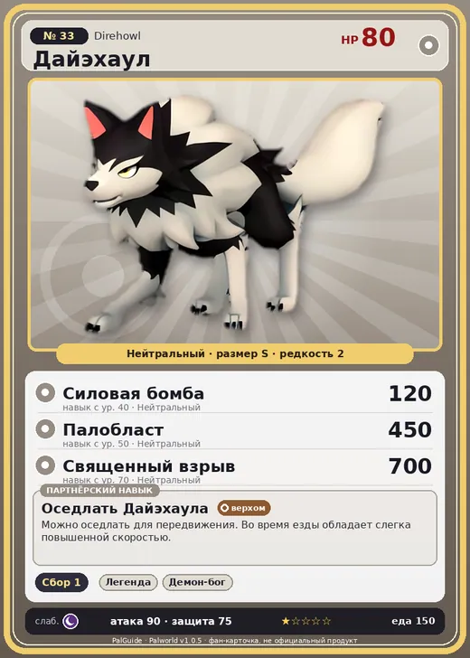

# Дайэхаул

<canvas id="fx"></canvas>

№ 33

Нейтральный

Слабость: Тьма <b class="mx">×1,5</b> <button class="hlp" data-tip="Множители перемножаются по обеим стихиям: ×1,5 за стихию, которую атака бьёт, ×0,65 за ту, что её держит.">?</button>

🌾 Сбор <b>1</b>

<b>Оседлать Дайэхаула</b> 🐎 Верхом

❤️ 80 · ⚔️ 90 · 🛡 75

Основное

💎Редкость <button class="hlp" data-tip="Чем выше число, тем реже встречается пал. 1–4 — обычные, 5–7 — редкие, 8+ — легендарные.">?</button><b>2</b>

📏Размер<b>S</b>

💰Цена продажи <button class="hlp" data-tip="Сколько золота даст торговец за пала.">?</button><b>611</b>

Бой

🎯Множитель поимки <button class="hlp" data-tip="Насколько легче или труднее поймать: ×1 — обычно, меньше — сложнее.">?</button><b>×1</b>

🐎Скорость рывка верхом <button class="hlp" data-tip="Скорость, если сесть на пала и бежать рывком.">?</button><b>1050</b>

Ферма и еда

🍖Сколько ест <button class="hlp" data-tip="Сколько сытости пал тратит — чем больше, тем больше еды нужно на базе.">?</button><b>150</b>

Разведение

🧬Сила разведения <button class="hlp" data-tip="Скрытое число игры: у детёныша оно примерно среднее от родителей. Чем меньше — тем «сильнее» пал.">?</button><b>2680</b>

=== "Обзор"

    #### Работа на базе

    
🧺 Сбор<i style="--v:10%"></i><b>1</b>

    #### Партнёрский навык: Оседлать Дайэхаула
    Можно оседлать для передвижения. Во время езды обладает слегка повышенной скоростью. Технологии 9.

    #### Чем хорош / чем плох
    - ✅ можно оседлать
    - ❌ явных минусов нет

    > Связь с людьми давно ослабла, но система охоты Дайэхаул и их сородичей берёт своё начало в тех временах, когда они охотились вместе с человеком.

    См. также: [Стихии](../../guide/06_stihii.md) · [Разведение](../../guide/07_razvedenie.md) · [Все палы](README.md)

=== "Атаки"

    #### Атаки по уровням
    - ур. 1: Двойные клыки (Нейтральный, сила 40)
    - ур. 2: Дикие клыки (Нейтральный, сила 50)
    - ур. 7: Грязевой выстрел (Земля, сила 40)
    - ур. 15: Воздушная пушка (Нейтральный, сила 40)
    - ур. 22: Силовой выстрел (Нейтральный, сила 80)
    - ур. 30: Огненный выстрел (Огонь, сила 40)
    - ур. 40: Силовая бомба (Нейтральный, сила 120)
    - ур. 50: Палобласт (Нейтральный, сила 450)
    - ур. 70: Священный взрыв (Нейтральный, сила 700)

=== "Где живёт"

    #### Где водится

    

<button data-k="d" class="on">☀️ День</button><button data-k="n">🌙 Ночь</button>

ур. 10–44<a class="btn hm-full" href="../../../map/?pal=Garm">Показать на большой карте</a>

Глубины бамбуковой рощиАрхипелаг Морских ВетровБолотный островБамбуковые рощи

🕳 Подземелье<b>Пещера Отдалённого Острова</b>

🕳 Подземелье<b>Пещера Холмов</b>

🥚 Яйцо<b>Обычное яйцо</b>

🛒 Торговец<b>Продаётся у торговца палами</b>

=== "Дроп"

    #### Дроп
    - Кожа — 1–2 шт., 100%
    - Рубин — 1 шт., 3%
    - Золотая монета — 10–20 шт., 3%

    **Дроп альфы:**

    - Деталь древней цивилизации — 1–2 шт., 100%
    - Рубин — 1 шт., 3%
    - Ценный коготь — 1–2 шт., 100%

=== "Разведение"

    #### Разведение
    - Ранг разведения: 2680

=== "Пассивки"

    #### Лучшие пассивки по роли

    

⚔️ Боец

максимум урона и живучести в бою

<a class="psv r-4" data-psv="Легенда" href="../../../passivki/legend/">Легенда</a><a class="psv r-4" data-psv="Демон-бог" href="../../../passivki/demon_god/">Демон-бог</a><a class="psv r-3" data-psv="Святое небо" href="../../../passivki/celestial_emperor/">Святое небо</a><a class="psv r-3" data-psv="Хладнокровный" href="../../../passivki/serenity/">Хладнокровный</a>

🐎 Ездовой

быстрее бегает или летает с тобой верхом

<a class="psv r-4" data-psv="Божественная скорость" href="../../../passivki/swift/">Божественная скорость</a><a class="psv r-4" data-psv="Легенда" href="../../../passivki/legend/">Легенда</a><a class="psv r-4" data-psv="Вечный двигатель" href="../../../passivki/eternal_engine/">Вечный двигатель</a><a class="psv r-4" data-psv="Небесное скольжение" href="../../../passivki/sky_strider/">Небесное скольжение</a>

    <small>Нажми на пассивку, чтобы узнать, что она даёт и где её взять.</small>

<a class="card-link" href="../eikthyrdeer_terra/">← Иктирдир Тэрра</a><a class="card-link" href="../caprity/">Каприти →</a>

