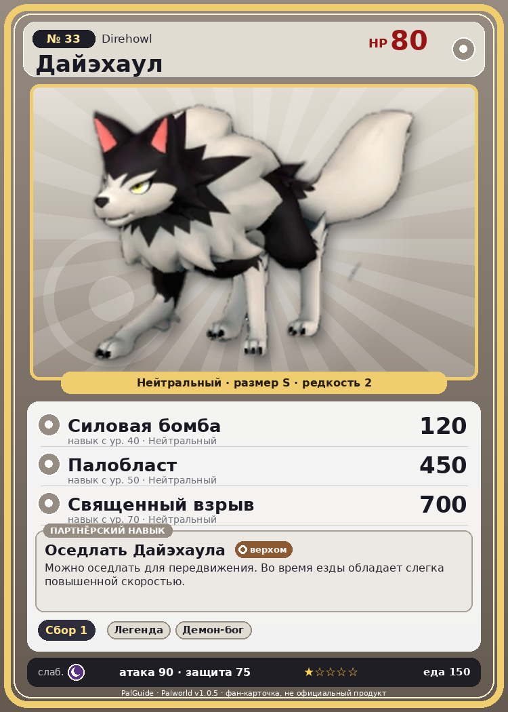

# #33 Дайэхаул (Direhowl)

{ width=360 }

| Поле | Значение |
|---|---|
| Стихия | Нейтральный |
| Слабость (кто бьёт сильнее) | Тьма |
| Редкость | 2 |
| Размер | S |
| HP / Атака / Защита (база вида) | 80 / 90 / 75 |
| Сколько ест | 150 |
| Цена продажи | 611 |
| Множитель поимки | ×1 |
| Скорость рывка верхом | 1050 |

## Работа на базе
- Сбор — ур. 1

## Партнёрский навык: Оседлать Дайэхаула
Можно оседлать для передвижения. Во время езды обладает слегка повышенной скоростью. Технологии 9 level value 2 MoveSpeed_up_PartnerSkill_Ride_1 10 Пробуждение : (Скорость передвижения верхом: +10% ) 3 MoveSpeed_up_PartnerSkill_Ride_2 12 Пробуждение : (Скорость передвижения верхом: +12% ) 4 MoveSpeed_up_PartnerSkill_Ride_3 15 Пробуждение : (Скорость передвижения верхом: +15% ) 5 MoveSpeed_up_PartnerSkill_Ride_4 20 Пробуждение : (Скорость передвижения верхом: +20% ) 1 Пробуждение :

## Атаки по уровням
- ур. 1: Двойные клыки (Нейтральный, сила 40)
- ур. 2: Дикие клыки (Нейтральный, сила 50)
- ур. 7: Грязевой выстрел (Земля, сила 40)
- ур. 15: Воздушная пушка (Нейтральный, сила 40)
- ур. 22: Силовой выстрел (Нейтральный, сила 80)
- ур. 30: Огненный выстрел (Огонь, сила 40)
- ур. 40: Силовая бомба (Нейтральный, сила 120)
- ур. 50: Палобласт (Нейтральный, сила 450)
- ур. 70: Священный взрыв (Нейтральный, сила 700)

## Где водится
- В дикой природе: да; точек появления днём: 461, ночью: 461; уровни в первых точках: 10–11
- Подземелья: Пещера Отдалённого Острова, Пещера Холмов
- Может продаваться у торговца/рекрутера
- Яйцо: Обычное яйцо

## Дроп
- Кожа — 1–2 шт., 100%
- Рубин — 1 шт., 3%
- Золотая монета — 10–20 шт., 3%

**Дроп альфы:**
- Деталь древней цивилизации — 1–2 шт., 100%
- Рубин — 1 шт., 3%
- Ценный коготь — 1–2 шт., 100%

## Разведение
- Ранг разведения (CombiRank): 2680

## Лучшие пассивки по роли
- боец: Легенда, Демон-бог, Хладнокровный, Бессмертие, Святое небо (вместо Бессмертия, если нет мутации)
- ездовой: Божественная скорость, Легенда, Вечный двигатель, Небесное скольжение

## Чем хорош / чем плох
- ✅ можно оседлать
- ❌ явных минусов нет

> Связь с людьми давно ослабла, но система охоты Дайэхаул и их сородичей берёт своё начало в тех временах, когда они охотились вместе с человеком.

См. также: [Стихии](../../2_mehaniki/stihii.md) · [Разведение](../../2_mehaniki/razvedenie.md) · [Все палы](README.md)
_Источник: paldb.cc v1.0.5_
