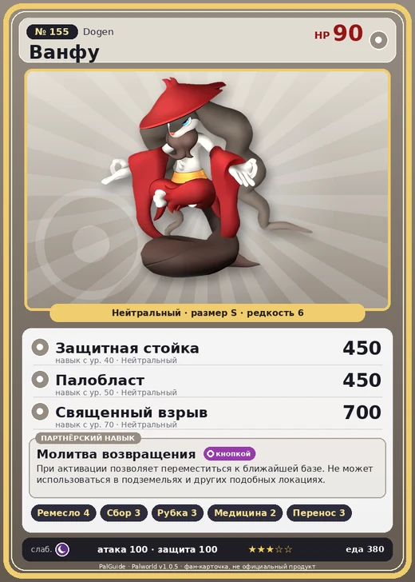

# #155 Ванфу (Dogen)

№ 155

Нейтральный

Слабость: Тьма

🖐️ Ручная работа <b>4</b>🌾 Сбор <b>3</b>🪓 Рубка деревьев <b>3</b>💊 Фармацевтика <b>2</b>📦 Транспортировка <b>3</b>

<b>Молитва возвращения</b> 🔘 кнопкой

❤️ 90 · ⚔️ 100 · 🛡 100

| Поле | Значение |
|---|---|
| Стихия | Нейтральный |
| Слабость (кто бьёт сильнее) | Тьма |
| Редкость | 6 |
| Размер | S |
| HP / Атака / Защита (база вида) | 90 / 100 / 100 |
| Сколько ест | 380 |
| Цена продажи | 1683 |
| Множитель поимки | ×1 |
| Скорость рывка верхом | 550 |

=== "Обзор"

    #### Работа на базе
    - Ручная работа — ур. 4
    - Сбор — ур. 3
    - Рубка деревьев — ур. 3
    - Фармацевтика — ур. 2
    - Транспортировка — ур. 3

    #### Партнёрский навык: Молитва возвращения
    При активации позволяет переместиться к ближайшей базе. Не может использоваться в подземельях и других подобных локациях. level value 1 OverWriteCoolTime 1000 Пробуждение : 2 OverWriteCoolTime 875 Пробуждение : (Сокращение перезарядки: Небольшое ) 3 OverWriteCoolTime 750 Пробуждение : (Сокращение перезарядки: Среднее ) 4 OverWriteCoolTime 625 Пробуждение : (Сокращение перезарядки: Большое ) 5 OverWriteCoolTime 500 Пробуждение : (Сокращение перезарядки: Очень большое )

    #### Чем хорош / чем плох
    - ✅ хорошая атака (100); можно оседлать
    - ❌ явных минусов нет

    > Они проводят дни в медитации, стремясь достичь состояния небытия. Столкнувшись с мирскими желаниями, ощущают облегчение и набрасываются на еду. Потом думают: |Сегодня я снова переел|.

    См. также: [Стихии](../../guide/06_stihii.md) · [Разведение](../../guide/07_razvedenie.md) · [Все палы](README.md)

=== "Атаки"

    #### Атаки по уровням
    - ур. 1: Воздушная пушка (Нейтральный, сила 40)
    - ур. 7: Силовой выстрел (Нейтральный, сила 80)
    - ур. 15: Камнемёт (Земля, сила 120)
    - ур. 22: Силовая бомба (Нейтральный, сила 120)
    - ур. 30: Воздушные клинки (Нейтральный, сила 160)
    - ур. 40: Защитная стойка (Нейтральный, сила 450)
    - ур. 50: Палобласт (Нейтральный, сила 450)
    - ур. 70: Священный взрыв (Нейтральный, сила 700)

=== "Где живёт"

    #### Где водится
    - В дикой природе: да; точек появления днём: 52, ночью: 52; уровни в первых точках: 53–56
    - Подземелья: Пещера Цветущей Сакуры
    - Яйцо: Большое обычное яйцо

=== "Дроп"

    #### Дроп
    - Кость — 1 шт., 100%

    **Дроп альфы:**
    - Деталь древней цивилизации — 2–3 шт., 100%
    - Ценный мех — 2–3 шт., 100%

=== "Разведение"

    #### Разведение
    - Ранг разведения (CombiRank): 1460

=== "Пассивки"

    #### Лучшие пассивки по роли
    - боец: Легенда, Демон-бог, Хладнокровный, Бессмертие, Святое небо (вместо Бессмертия, если нет мутации)
    - рабочий: Дьявольские руки, Виртуоз, Мастеровитый, Небожитель/Трудоголик
    - ездовой: Божественная скорость, Легенда, Вечный двигатель, Небесное скольжение

<a class="card-link" href="../gildane/">← Гилдейн</a><a class="card-link" href="../bulldosu/">Буллдос →</a>

