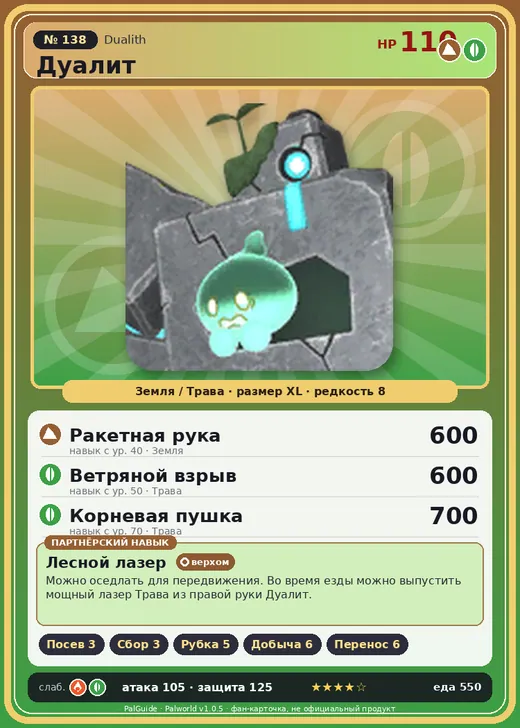

# #138 Дуалит (Dualith)

№ 138

ЗемляТрава

Слабость: ОгоньТрава

🌱 Посев семян <b>3</b>🌾 Сбор <b>3</b>🪓 Рубка деревьев <b>5</b>⛏️ Добыча <b>6</b>📦 Транспортировка <b>6</b>

<b>Лесной лазер</b> 🐎 верхом

❤️ 110 · ⚔️ 105 · 🛡 125

| Поле | Значение |
|---|---|
| Стихия | Земля, Трава |
| Слабость (кто бьёт сильнее) | Огонь, Трава |
| Редкость | 8 |
| Размер | XL |
| HP / Атака / Защита (база вида) | 110 / 105 / 125 |
| Сколько ест | 550 |
| Цена продажи | 3113 |
| Множитель поимки | ×1 |
| Скорость рывка верхом | 800 |

=== "Обзор"

    #### Работа на базе
    - Посев семян — ур. 3
    - Сбор — ур. 3
    - Рубка деревьев — ур. 5
    - Добыча — ур. 6
    - Транспортировка — ур. 6

    #### Партнёрский навык: Лесной лазер
    Можно оседлать для передвижения. Во время езды можно выпустить мощный лазер Трава из правой руки Дуалит . Технологии 48 level value 1 OverWriteCoolTime 120 Пробуждение : 2 OverWriteCoolTime 110 Пробуждение : (Сокращение перезарядки: Небольшое ) 3 OverWriteCoolTime 100 Пробуждение : (Сокращение перезарядки: Среднее ) 4 OverWriteCoolTime 90 Пробуждение : (Сокращение перезарядки: Большое ) 5 OverWriteCoolTime 80 Пробуждение : (Сокращение перезарядки: Очень большое )

    #### Чем хорош / чем плох
    - ✅ хорошая атака (105); крепкая защита (125); отличный рабочий (пригодность 6); можно оседлать
    - ❌ много ест (550)

    > Одно тело, два сознания. Иногда они ссорятся из-за разных целей. Пока не помирятся, совершенно непонятно, куда движется доспех!

    См. также: [Стихии](../../guide/06_stihii.md) · [Разведение](../../guide/07_razvedenie.md) · [Все палы](README.md)

=== "Атаки"

    #### Атаки по уровням
    - ур. 1: Грязевой выстрел (Земля, сила 40)
    - ур. 7: Каменный залп (Земля, сила 80)
    - ур. 15: Семенная мина (Трава, сила 120)
    - ур. 22: Камнепад (Земля, сила 300)
    - ур. 30: Солнечный взрыв (Трава, сила 450)
    - ур. 40: Ракетная рука (Земля, сила 600)
    - ур. 50: Ветряной взрыв (Трава, сила 600)
    - ур. 70: Корневая пушка (Трава, сила 700)

=== "Где живёт"

    #### Где водится
    - В дикой природе: да; точек появления днём: 36, ночью: 36
    - Яйцо: Огромное яйцо земли

=== "Дроп"

    #### Дроп
    - Красивый цветок — 3–5 шт., 100%
    - Большая душа Пала — 1 шт., 100%

    **Дроп альфы:**
    - Деталь древней цивилизации — 7–9 шт., 100%
    - Ценные внутренности — 2–3 шт., 100%

=== "Разведение"

    #### Разведение
    - Ранг разведения (CombiRank): 510
    - Участвует в особых парах: Гостлайт → Дуалит Нокт

=== "Пассивки"

    #### Лучшие пассивки по роли
    - боец: Легенда, Демон-бог, Хладнокровный, Бессмертие, Император земли (вместо Бессмертия, если нет мутации)
    - рабочий: Дьявольские руки, Виртуоз, Мастеровитый, Небожитель/Трудоголик
    - ездовой: Божественная скорость, Легенда, Вечный двигатель, Небесное скольжение

<a class="card-link" href="../blazamut_ryu/">← Блазамут Рю</a><a class="card-link" href="../dualith_noct/">Дуалит Нокт →</a>

