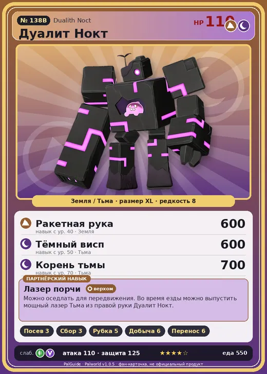

# #138B Дуалит Нокт (Dualith Noct)

№ 138B

ЗемляТьма

Слабость: ДраконТрава

🌱 Посев семян <b>3</b>🌾 Сбор <b>3</b>🪓 Рубка деревьев <b>5</b>⛏️ Добыча <b>6</b>📦 Транспортировка <b>6</b>

<b>Лазер порчи</b> 🐎 верхом

❤️ 110 · ⚔️ 110 · 🛡 125

| Поле | Значение |
|---|---|
| Стихия | Земля, Тьма |
| Слабость (кто бьёт сильнее) | Дракон, Трава |
| Редкость | 8 |
| Размер | XL |
| HP / Атака / Защита (база вида) | 110 / 110 / 125 |
| Сколько ест | 550 |
| Цена продажи | 3234 |
| Множитель поимки | ×1 |
| Скорость рывка верхом | 800 |

=== "Обзор"

    #### Работа на базе
    - Посев семян — ур. 3
    - Сбор — ур. 3
    - Рубка деревьев — ур. 5
    - Добыча — ур. 6
    - Транспортировка — ур. 6

    #### Партнёрский навык: Лазер порчи
    Можно оседлать для передвижения. Во время езды можно выпустить мощный лазер Тьма из правой руки Дуалит Нокт . Технологии 69 level value 1 OverWriteCoolTime 120 Пробуждение : 2 OverWriteCoolTime 110 Пробуждение : (Сокращение перезарядки: Небольшое ) 3 OverWriteCoolTime 100 Пробуждение : (Сокращение перезарядки: Среднее ) 4 OverWriteCoolTime 90 Пробуждение : (Сокращение перезарядки: Большое ) 5 OverWriteCoolTime 80 Пробуждение : (Сокращение перезарядки: Очень большое )

    #### Чем хорош / чем плох
    - ✅ хорошая атака (110); крепкая защита (125); отличный рабочий (пригодность 6); можно оседлать
    - ❌ много ест (550); разводится только особой парой

    > Одно тело, два сознания. Обычно мнения расходятся и ссор нет-нет да бывают, но стоит начаться бою — разум и тело мгновенно сливаются в одно!

    См. также: [Стихии](../../guide/06_stihii.md) · [Разведение](../../guide/07_razvedenie.md) · [Все палы](README.md)

=== "Атаки"

    #### Атаки по уровням
    - ур. 1: Распространение тьмы (Тьма, сила 60)
    - ур. 7: Тёмная пушка (Тьма, сила 70)
    - ур. 15: Стрелы тьмы (Тьма, сила 120)
    - ур. 22: Камнепад (Земля, сила 300)
    - ур. 30: Тёмный лазер (Тьма, сила 450)
    - ур. 40: Ракетная рука (Земля, сила 600)
    - ур. 50: Тёмный висп (Тьма, сила 600)
    - ур. 70: Корень тьмы (Тьма, сила 700)

=== "Где живёт"

    #### Где водится
    - В дикой природе: да; точек появления днём: 1, ночью: 1
    - Яйцо: Огромное яйцо земли

=== "Дроп"

    #### Дроп
    - Загадочный гриб — 3–5 шт., 100%
    - Большая душа Пала — 1 шт., 100%

    **Дроп альфы:**
    - Деталь древней цивилизации — 7–9 шт., 100%
    - Ценные внутренности — 2–3 шт., 100%

=== "Разведение"

    #### Разведение
    - Ранг разведения (CombiRank): 250
    - **Особая пара:** [Дуалит](../../4_spravochniki/paly/dualith.md) + [Гостлайт](../../4_spravochniki/paly/sootseer.md)

=== "Пассивки"

    #### Лучшие пассивки по роли
    - боец: Легенда, Демон-бог, Хладнокровный, Бессмертие, Император земли (вместо Бессмертия, если нет мутации)
    - рабочий: Дьявольские руки, Виртуоз, Мастеровитый, Небожитель/Трудоголик
    - ездовой: Божественная скорость, Легенда, Вечный двигатель, Небесное скольжение

<a class="card-link" href="../dualith/">← Дуалит</a><a class="card-link" href="../anubis/">Анубис →</a>

