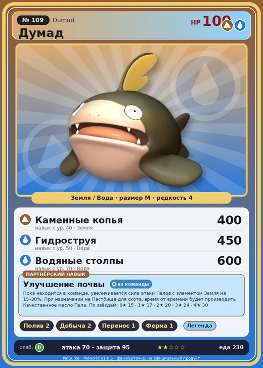

# #109 Думад (Dumud)

#109 · Dumud

ЗемляВода

Слабость: МолнияТрава

💧 Полив <b>2</b>⛏️ Добыча <b>2</b>📦 Транспортировка <b>1</b>🐑 Фермерство <b>1</b>

<b>Улучшение почвы</b> 🎒 из команды 🏠 на базе

❤️ 100 · ⚔️ 70 · 🛡 95

| Поле | Значение |
|---|---|
| Стихия | Земля, Вода |
| Слабость (кто бьёт сильнее) | Молния, Трава |
| Редкость | 4 |
| Размер | M |
| HP / Атака / Защита (база вида) | 100 / 70 / 95 |
| Сколько ест | 230 |
| Цена продажи | 995 |
| Множитель поимки | ×1 |
| Скорость рывка верхом | 600 |

## Работа на базе
- Полив — ур. 2
- Добыча — ур. 2
- Транспортировка — ур. 1
- Фермерство — ур. 1

## Партнёрский навык: Улучшение почвы
Пока находится в команде, увеличивается сила атаки Палов с элементом Земля на (15~30)% . При назначении на Пастбище для скота , время от времени будет производить Качественное масло Пала . level value 1 AttackUp_Earth_PartnerSkill 15 2 AttackUp_Earth_PartnerSkill 17 3 AttackUp_Earth_PartnerSkill 20 4 AttackUp_Earth_PartnerSkill 24 5 AttackUp_Earth_PartnerSkill 30

## Атаки по уровням
- ур. 1: Грязевой выстрел (Земля, сила 40)
- ур. 7: Водяной выстрел (Вода, сила 50)
- ур. 15: Каменный залп (Земля, сила 80)
- ур. 22: Пузырьковый выстрел (Вода, сила 80)
- ур. 30: Водяная бомба (Вода, сила 200)
- ур. 40: Каменные копья (Земля, сила 400)
- ур. 50: Гидроструя (Вода, сила 450)
- ур. 70: Водяные столпы (Вода, сила 600)

## Где водится
- В дикой природе: да; точек появления днём: 373, ночью: 373; уровни в первых точках: 20–24
- Подземелья: Пещера Вулкана, Пещера Ущелья
- Может продаваться у торговца/рекрутера
- Яйцо: Яйцо земли

## Дроп
- Мясо Думада — 2 шт., 100%
- Качественное масло Пала — 1 шт., 100%

**Дроп альфы:**
- Деталь древней цивилизации — 3–4 шт., 100%
- Ценные внутренности — 3–4 шт., 100%

## Разведение
- Ранг разведения (CombiRank): 2290
- Участвует в особых парах: Серфент → Серфент Терра; Иктирдир Тэрра → Думад Гилд

## Лучшие пассивки по роли
- по обзору: Легенда
- боец: Легенда, Демон-бог, Хладнокровный, Бессмертие, Император земли (вместо Бессмертия, если нет мутации)
- ездовой: Божественная скорость, Легенда, Вечный двигатель, Небесное скольжение

## Чем хорош / чем плох
- ✅ +атака земляных; масло на пастбище; можно оседлать
- ❌ слабая атака (70)

> Когда этот Пал слишком расслабляется, все его реакции замедляются. Даже получив 28 колотых ран, он замечает это только на следующее утро — и тут же умирает.

См. также: [Стихии](../../guide/06_stihii.md) · [Разведение](../../guide/07_razvedenie.md) · [Все палы](README.md)
