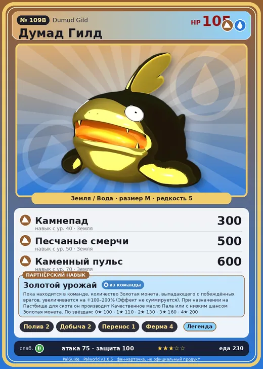

# Думад Гилд

<canvas id="fx"></canvas>

№ 109B

ЗемляВода

Слабость: Трава <b class="mx">×1,5</b> <button class="hlp" data-tip="Множители перемножаются по обеим стихиям: ×1,5 за стихию, которую атака бьёт, ×0,65 за ту, что её держит. Трава: 1,5 × 1 = ×1,5.">?</button>

Устойчив: Огонь <b class="mx">×0,65</b>

💧 Полив <b>2</b>⛏️ Добыча <b>2</b>📦 Транспортировка <b>1</b>🐑 Фермерство <b>4</b>

<b>Золотой урожай</b> 🎒 Работает из команды🏠 На базе

❤️ 105 · ⚔️ 75 · 🛡 100

Основное

💎Редкость <button class="hlp" data-tip="Чем выше число, тем реже встречается пал. 1–4 — обычные, 5–7 — редкие, 8+ — легендарные.">?</button><b>5</b>

📏Размер<b>M</b>

💰Цена продажи <button class="hlp" data-tip="Сколько золота даст торговец за пала.">?</button><b>19900</b>

Бой

🎯Множитель поимки <button class="hlp" data-tip="Насколько легче или труднее поймать: ×1 — обычно, меньше — сложнее.">?</button><b>×1</b>

🐎Скорость рывка верхом <button class="hlp" data-tip="Скорость, если сесть на пала и бежать рывком.">?</button><b>600</b>

Ферма и еда

🍖Сколько ест <button class="hlp" data-tip="Сколько сытости пал тратит — чем больше, тем больше еды нужно на базе.">?</button><b>230</b>

Разведение

🧬Сила разведения <button class="hlp" data-tip="Скрытое число игры: у детёныша оно примерно среднее от родителей. Чем меньше — тем «сильнее» пал.">?</button><b>1620</b>

💞Особая пара <button class="hlp" data-tip="Этого пала можно вывести только от этой пары.">?</button><b>Думад + Иктирдир Тэрра</b>

=== "Обзор"

    #### Работа на базе

    
💧 Полив<i style="--v:20%"></i><b>2</b>⛏️ Добыча<i style="--v:20%"></i><b>2</b>📦 Транспортировка<i style="--v:10%"></i><b>1</b>🐄 Фермерство<i style="--v:40%"></i><b>4</b>

    #### Партнёрский навык: Золотой урожай
    Пока находится в команде, количество Золотая монета, выпадающего с побеждённых врагов, увеличивается на +100–200% (Эффект не суммируется). При назначении на Пастбище для скота он производит Качественное масло Пала или с низким шансом Золотая монета. По звёздам: 0★ 100 · 1★ 110 · 2★ 130 · 3★ 160 · 4★ 200

    #### Чем хорош / чем плох
    - ✅ хорош в работе: Фермерство (ур. 4)
    - ❌ слабая атака (75); разводится только особой парой

    > Его тело имеет невероятно высокую способность к отражению. А скорость его реакций ещё медленнее, чем у пала «Думад»!

    См. также: [Стихии](../../guide/06_stihii.md) · [Разведение](../../guide/07_razvedenie.md) · [Все палы](README.md)

=== "Атаки"

    #### Атаки по уровням
    - ур. 1: Грязевой выстрел (Земля, сила 40)
    - ур. 7: Водяной выстрел (Вода, сила 50)
    - ур. 15: Каменный залп (Земля, сила 80)
    - ур. 22: Песчаный вихрь (Земля, сила 200)
    - ур. 30: Гидроатака под давлением (Вода, сила 250)
    - ур. 40: Камнепад (Земля, сила 300)
    - ур. 50: Песчаные смерчи (Земля, сила 500)
    - ур. 70: Каменный пульс (Земля, сила 600)

=== "Где живёт"

    #### Где водится

    

<button data-k="d" class="on">☀️ День</button><button data-k="n">🌙 Ночь</button>

ур. 25–48<a class="btn hm-full" href="../../../map/?pal=LazyCatfish_Gold">Показать на большой карте</a>

СакурадзимаОбсидиановый вулканИссушенное побережьеПодножье вулкана

🥚 Яйцо<b>Большое яйцо земли</b>

=== "Дроп"

    #### Дроп
    - Мясо Думада — 2 шт., 100%
    - Качественное масло Пала — 1 шт., 100%
    - Золотая монета — 100–200 шт., 50%

    **Дроп альфы:**

    - Деталь древней цивилизации — 3–4 шт., 100%
    - Ценные внутренности — 2–3 шт., 100%

=== "Разведение"

    #### Разведение
    - Ранг разведения: 1620
    - **Особая пара:** [Думад](../../4_spravochniki/paly/dumud.md) + [Иктирдир Тэрра](../../4_spravochniki/paly/eikthyrdeer_terra.md)

=== "Пассивки"

    #### Лучшие пассивки по роли

    

⚔️ Боец

максимум урона и живучести в бою

<a class="psv r-4" data-psv="Легенда" href="../../../passivki/legend/">Легенда</a><a class="psv r-4" data-psv="Демон-бог" href="../../../passivki/demon_god/">Демон-бог</a><a class="psv r-3" data-psv="Император земли" href="../../../passivki/earth_emperor/">Император земли</a><a class="psv r-3" data-psv="Хладнокровный" href="../../../passivki/serenity/">Хладнокровный</a>

🛠 Рабочий

работает быстрее и меньше устаёт на базе

<a class="psv r-5" data-psv="Дьявольские руки" href="../../../passivki/demons_hand/">Дьявольские руки</a><a class="psv r-4" data-psv="Виртуоз" href="../../../passivki/remarkable_craftsmanship/">Виртуоз</a><a class="psv r-3" data-psv="Мастеровитый" href="../../../passivki/artisan/">Мастеровитый</a><a class="psv r-3" data-psv="Трудоголик" href="../../../passivki/workaholic/">Трудоголик</a>

    <small>Нажми на пассивку, чтобы узнать, что она даёт и где её взять.</small>

<a class="card-link" href="../dumud/">← Думад</a><a class="card-link" href="../braloha/">Бралоха →</a>

