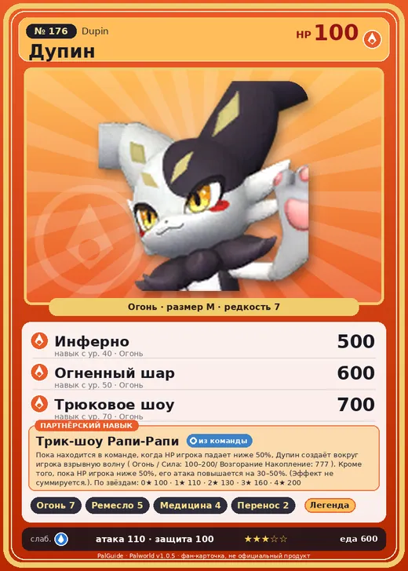

# #176 Дупин (Dupin)

№ 176

Огонь

Слабость: Вода

🔥 Разжигание огня <b>7</b>🖐️ Ручная работа <b>5</b>💊 Фармацевтика <b>4</b>📦 Транспортировка <b>2</b>

<b>Трик-шоу Рапи-Рапи</b> 🎒 из команды

❤️ 100 · ⚔️ 110 · 🛡 100

| Поле | Значение |
|---|---|
| Стихия | Огонь |
| Слабость (кто бьёт сильнее) | Вода |
| Редкость | 7 |
| Размер | M |
| HP / Атака / Защита (база вида) | 100 / 110 / 100 |
| Сколько ест | 600 |
| Цена продажи | 3191 |
| Множитель поимки | ×1 |
| Скорость рывка верхом | 750 |

## Работа на базе
- Разжигание огня — ур. 7
- Ручная работа — ур. 5
- Фармацевтика — ур. 4
- Транспортировка — ур. 2

## Партнёрский навык: Трик-шоу Рапи-Рапи
Пока находится в команде, когда HP игрока падает ниже 50%, Дупин создаёт вокруг игрока взрывную волну ( Огонь / Сила: (100~200) / Возгорание Накопление: 777 ). Кроме того, пока HP игрока ниже 50%, его атака повышается на (30~50)% . (Эффект не суммируется.) level value 1 ClownRabbit_PlayerLowHealthBlast_PartnerSkill 100 AttackRateHPThreshold_PartnerSkill 30 2 ClownRabbit_PlayerLowHealthBlast_PartnerSkill 110 AttackRateHPThreshold_PartnerSkill 35 3 ClownRabbit_PlayerLowHealthBlast_PartnerSkill 130 AttackRateHPThreshold_PartnerSkill 40 4 ClownRabbit_PlayerLowHealthBlast_PartnerSkill 160 AttackRateHPThreshold_PartnerSkill 45 5 ClownRabbit_PlayerLowHealthBlast_PartnerSkill 200 AttackRateHPThreshold_PartnerSkill 50

## Атаки по уровням
- ур. 1: Расщеплённый огонь (Огонь, сила 80)
- ур. 7: Огненное дыхание (Огонь, сила 160)
- ур. 15: Огненная стена (Огонь, сила 250)
- ур. 22: Огненная воронка (Огонь, сила 300)
- ур. 30: Вулканический дождь (Огонь, сила 450)
- ур. 40: Инферно (Огонь, сила 500)
- ур. 50: Огненный шар (Огонь, сила 600)
- ур. 70: Трюковое шоу (Огонь, сила 700)

## Где водится
- В дикой природе: да; точек появления днём: 21, ночью: 21
- Яйцо: Большое раскалённое яйцо

## Дроп
- Кожа — 2–3 шт., 100%
- Огненный орган — 2 шт., 100%

**Дроп альфы:**
- Деталь древней цивилизации — 4–6 шт., 100%
- Ценные внутренности — 2–3 шт., 100%

## Разведение
- Ранг разведения (CombiRank): 520

## Лучшие пассивки по роли
- боец: Легенда, Демон-бог, Хладнокровный, Бессмертие, Император огня (вместо Бессмертия, если нет мутации)
- рабочий: Дьявольские руки, Виртуоз, Мастеровитый, Небожитель/Трудоголик
- ездовой: Божественная скорость, Легенда, Вечный двигатель, Небесное скольжение

## Чем хорош / чем плох
- ✅ хорошая атака (110); отличный рабочий (пригодность 7); можно оседлать
- ❌ много ест (600)

> Иногда вызванный двойник одерживает верх и занимает место оригинала. Тот ли Дупин сегодня, что и вчера, не вполне ясно даже самому Дупин .

См. также: [Стихии](../../guide/06_stihii.md) · [Разведение](../../guide/07_razvedenie.md) · [Все палы](README.md)
