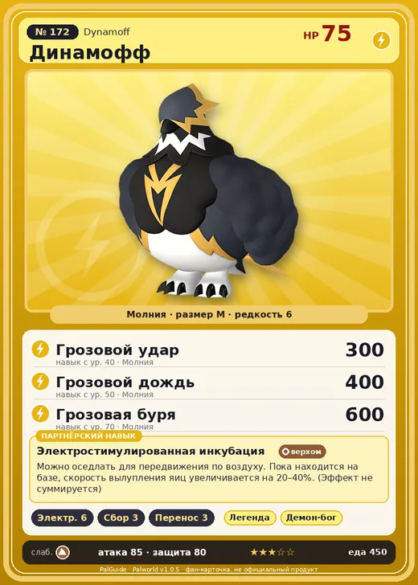

# #172 Динамофф (Dynamoff)

№ 172

Молния

Слабость: Земля

⚡ Генерация энергии <b>6</b>🌾 Сбор <b>3</b>📦 Транспортировка <b>3</b>

<b>Электростимулированная инкубация</b> 🐎 верхом 🏠 на базе

❤️ 75 · ⚔️ 85 · 🛡 80

| Поле | Значение |
|---|---|
| Стихия | Молния |
| Слабость (кто бьёт сильнее) | Земля |
| Редкость | 6 |
| Размер | M |
| HP / Атака / Защита (база вида) | 75 / 85 / 80 |
| Сколько ест | 450 |
| Цена продажи | 1963 |
| Множитель поимки | ×1 |
| Скорость рывка верхом | 1000 |

## Работа на базе
- Генерация энергии — ур. 6
- Сбор — ур. 3
- Транспортировка — ур. 3

## Партнёрский навык: Электростимулированная инкубация
Можно оседлать для передвижения по воздуху. Пока находится на базе, скорость вылупления яиц увеличивается на (20~40)% . (Эффект не суммируется) Технологии 66 level value 1 ThunderFluffyBird_PartnerSkill 20 2 ThunderFluffyBird_PartnerSkill 22 3 ThunderFluffyBird_PartnerSkill 26 4 ThunderFluffyBird_PartnerSkill 32 5 ThunderFluffyBird_PartnerSkill 40

## Атаки по уровням
- ур. 1: Искровой выстрел (Молния, сила 50)
- ур. 7: Шоковая волна (Молния, сила 80)
- ур. 15: Шаровая молния (Молния, сила 100)
- ур. 22: Воздушные клинки (Нейтральный, сила 160)
- ур. 30: Тройная молния (Молния, сила 200)
- ур. 40: Грозовой удар (Молния, сила 300)
- ур. 50: Грозовой дождь (Молния, сила 400)
- ур. 70: Грозовая буря (Молния, сила 600)

## Где водится
- В дикой природе: да; точек появления днём: 28, ночью: 28
- Яйцо: Большое яйцо молнии

## Дроп
- Электрический орган — 2 шт., 100%

**Дроп альфы:**
- Деталь древней цивилизации — 7–9 шт., 100%
- Ценное перо — 2–3 шт., 100%

## Разведение
- Ранг разведения (CombiRank): 1400

## Лучшие пассивки по роли
- боец: Легенда, Демон-бог, Хладнокровный, Бессмертие, Император молнии (вместо Бессмертия, если нет мутации)
- рабочий: Дьявольские руки, Виртуоз, Мастеровитый, Небожитель/Трудоголик
- ездовой: Божественная скорость, Легенда, Вечный двигатель, Небесное скольжение

## Чем хорош / чем плох
- ✅ отличный рабочий (пригодность 6); можно оседлать; летает (ездовой)
- ❌ явных минусов нет

> В высоких слоях, где пищи мало, порой едят даже мозги врагов. Считается, что группа, искавшая более стабильный источник пищи, спустилась ниже и эволюционировала в Райберд .

См. также: [Стихии](../../guide/06_stihii.md) · [Разведение](../../guide/07_razvedenie.md) · [Все палы](README.md)
