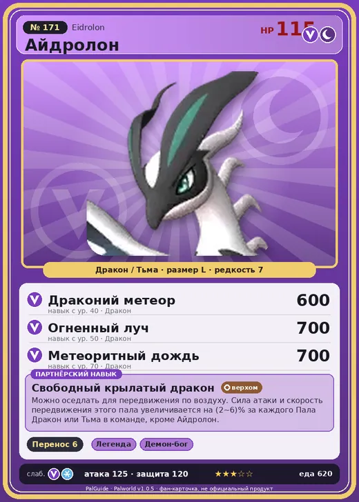

# Айдролон

<canvas id="fx"></canvas>

№ 171

ДраконТьма

Слабость: Лёд <b class="mx">×1,5</b>Дракон <b class="mx">×1,5</b> <button class="hlp" data-tip="Множители перемножаются по обеим стихиям: ×1,5 за стихию, которую атака бьёт, ×0,65 за ту, что её держит. Лёд: 1,5 × 1 = ×1,5; Дракон: 1 × 1,5 = ×1,5.">?</button>

Устойчив: Нейтральный <b class="mx">×0,65</b>Тьма <b class="mx">×0,65</b>

📦 Транспортировка <b>6</b>

<b>Свободный крылатый дракон</b> 🐎 Верхом

❤️ 115 · ⚔️ 125 · 🛡 120

Основное

💎Редкость <button class="hlp" data-tip="Чем выше число, тем реже встречается пал. 1–4 — обычные, 5–7 — редкие, 8+ — легендарные.">?</button><b>7</b>

📏Размер<b>L</b>

💰Цена продажи <button class="hlp" data-tip="Сколько золота даст торговец за пала.">?</button><b>3323</b>

Бой

🎯Множитель поимки <button class="hlp" data-tip="Насколько легче или труднее поймать: ×1 — обычно, меньше — сложнее.">?</button><b>×1</b>

🐎Скорость рывка верхом <button class="hlp" data-tip="Скорость, если сесть на пала и бежать рывком.">?</button><b>2750</b>

Ферма и еда

🍖Сколько ест <button class="hlp" data-tip="Сколько сытости пал тратит — чем больше, тем больше еды нужно на базе.">?</button><b>620</b>

Разведение

🧬Сила разведения <button class="hlp" data-tip="Скрытое число игры: у детёныша оно примерно среднее от родителей. Чем меньше — тем «сильнее» пал.">?</button><b>300</b>

=== "Обзор"

    #### Работа на базе

    
<a class="wbar" href="../../../2_mehaniki/rabota/?w=transporting&lv=6">📦 Транспортировка<i style="--v:60%"></i><b>6</b></a><a class="wb-more" href="../../../2_mehaniki/rabota/">Что значат уровни работы →</a>

    #### Партнёрский навык: Свободный крылатый дракон
    Можно оседлать для передвижения по воздуху. Сила атаки и скорость передвижения этого пала увеличивается на 2–6% за каждого Пала Дракон или Тьма в команде, кроме Айдролон. Технологии 68.

    #### Чем хорош / чем плох
    - ✅ очень высокая атака (125); крепкая защита (120); отличный рабочий (пригодность 6); можно оседлать; летает (ездовой)
    - ❌ много ест (620)

    > Новый Пал, которого лишь недавно начали замечать. Спокойный и тихий, он просто живёт, наслаждаясь свободой. Больше ничто его не сдерживает.

    См. также: [Стихии](../../guide/06_stihii.md) · [Разведение](../../guide/07_razvedenie.md) · [Все палы](README.md)

=== "Атаки"

    #### Атаки по уровням
    - ур. 1: Драконий взрыв (Дракон, сила 80)
    - ур. 7: Дыхание дракона (Дракон, сила 160)
    - ур. 15: Режущий луч (Дракон, сила 350)
    - ур. 22: Кометопад (Дракон, сила 450)
    - ур. 30: Удар хвостом (Дракон, сила 550)
    - ур. 40: Драконий метеор (Дракон, сила 600)
    - ур. 50: Огненный луч (Дракон, сила 700)
    - ур. 70: Метеоритный дождь (Дракон, сила 700)

=== "Где живёт"

    #### Где водится

    

<button data-k="d" class="on">☀️ День</button><button data-k="n">🌙 Ночь</button>

ур. 80–80<a class="btn hm-full" href="../../../map/?pal=GhostDragon">Показать на большой карте</a>

🥚 Яйцо<b>Большое яйцо дракона</b>

=== "Дроп"

    #### Дроп
    - Кожа — 4–5 шт., 100%
    - Качественное масло Пала — 5–6 шт., 100%

    **Дроп альфы:**
    - Деталь древней цивилизации — 7–9 шт., 100%
    - Ценный драконий самоцвет — 2–3 шт., 100%

=== "Разведение"

    #### Разведение
    - Ранг разведения: 300
    - Участвует в особых парах: Судзаку → Айдролон Игнис

=== "Пассивки"

    #### Лучшие пассивки по роли

    

⚔️ Боец

максимум урона и живучести в бою

<a class="psv r-4" data-psv="Легенда" href="../../../passivki/legend/">Легенда</a><a class="psv r-4" data-psv="Демон-бог" href="../../../passivki/demon_god/">Демон-бог</a><a class="psv r-3" data-psv="Божественный дракон" href="../../../passivki/divine_dragon/">Божественный дракон</a><a class="psv r-3" data-psv="Хладнокровный" href="../../../passivki/serenity/">Хладнокровный</a>

🛠 Рабочий

работает быстрее и меньше устаёт на базе

<a class="psv r-5" data-psv="Дьявольские руки" href="../../../passivki/demons_hand/">Дьявольские руки</a><a class="psv r-4" data-psv="Виртуоз" href="../../../passivki/remarkable_craftsmanship/">Виртуоз</a><a class="psv r-3" data-psv="Мастеровитый" href="../../../passivki/artisan/">Мастеровитый</a><a class="psv r-3" data-psv="Трудоголик" href="../../../passivki/workaholic/">Трудоголик</a>

🐎 Ездовой

быстрее бегает или летает с тобой верхом

<a class="psv r-4" data-psv="Божественная скорость" href="../../../passivki/swift/">Божественная скорость</a><a class="psv r-4" data-psv="Легенда" href="../../../passivki/legend/">Легенда</a><a class="psv r-4" data-psv="Вечный двигатель" href="../../../passivki/eternal_engine/">Вечный двигатель</a><a class="psv r-3" data-psv="Умелый бегун" href="../../../passivki/runner/">Умелый бегун</a>

    <small>Нажми на пассивку, чтобы узнать, что она даёт и где её взять.</small>

<a class="card-link" href="../lapure/">← Немофи</a><a class="card-link" href="../eidrolon_ignis/">Айдролон Игнис →</a>

