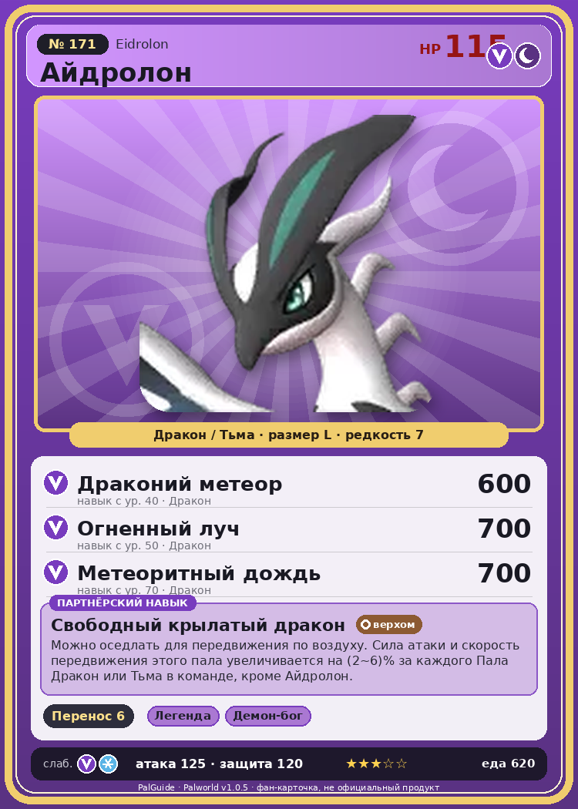

# #171 Айдролон (Eidrolon)

{ width=360 }

| Поле | Значение |
|---|---|
| Стихия | Дракон, Тьма |
| Слабость (кто бьёт сильнее) | Дракон, Лёд |
| Редкость | 7 |
| Размер | L |
| HP / Атака / Защита (база вида) | 115 / 125 / 120 |
| Сколько ест | 620 |
| Цена продажи | 3323 |
| Множитель поимки | ×1 |
| Скорость рывка верхом | 2750 |

## Работа на базе
- Транспортировка — ур. 6

## Партнёрский навык: Свободный крылатый дракон
Можно оседлать для передвижения по воздуху. Сила атаки и скорость передвижения этого пала увеличивается на (2~6)% за каждого Пала Дракон или Тьма в команде, кроме Айдролон . Технологии 68 level value 1 ShotAttack_MoveSpeed_PartnerSkill_SpecificElement 2, 2 2 ShotAttack_MoveSpeed_PartnerSkill_SpecificElement 3, 3 3 ShotAttack_MoveSpeed_PartnerSkill_SpecificElement 4, 4 4 ShotAttack_MoveSpeed_PartnerSkill_SpecificElement 5, 5 5 ShotAttack_MoveSpeed_PartnerSkill_SpecificElement 6, 6

## Атаки по уровням
- ур. 1: Драконий взрыв (Дракон, сила 80)
- ур. 7: Дыхание дракона (Дракон, сила 160)
- ур. 15: Режущий луч (Дракон, сила 350)
- ур. 22: Кометопад (Дракон, сила 450)
- ур. 30: Удар хвостом (Дракон, сила 550)
- ур. 40: Драконий метеор (Дракон, сила 600)
- ур. 50: Огненный луч (Дракон, сила 700)
- ур. 70: Метеоритный дождь (Дракон, сила 700)

## Где водится
- В дикой природе: да; точек появления днём: 1, ночью: 1
- Яйцо: Большое яйцо дракона

## Дроп
- Кожа — 4–5 шт., 100%
- Качественное масло Пала — 5–6 шт., 100%

**Дроп альфы:**
- Деталь древней цивилизации — 7–9 шт., 100%
- Ценный драконий самоцвет — 2–3 шт., 100%

## Разведение
- Ранг разведения (CombiRank): 300
- Участвует в особых парах: Судзаку → Айдролон Игнис

## Лучшие пассивки по роли
- боец: Легенда, Демон-бог, Хладнокровный, Бессмертие, Божественный дракон (вместо Бессмертия, если нет мутации)
- рабочий: Дьявольские руки, Виртуоз, Мастеровитый, Небожитель/Трудоголик
- ездовой: Божественная скорость, Легенда, Вечный двигатель, Небесное скольжение

## Чем хорош / чем плох
- ✅ очень высокая атака (125); крепкая защита (120); отличный рабочий (пригодность 6); можно оседлать; летает (ездовой)
- ❌ много ест (620)

> Новый Пал, которого лишь недавно начали замечать. Спокойный и тихий, он просто живёт, наслаждаясь свободой. Больше ничто его не сдерживает.

См. также: [Стихии](../../2_mehaniki/stihii.md) · [Разведение](../../2_mehaniki/razvedenie.md) · [Все палы](README.md)
_Источник: paldb.cc v1.0.5_
