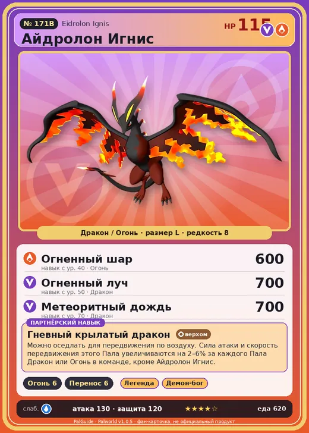

# #171B Айдролон Игнис (Eidrolon Ignis)

№ 171B

ДраконОгонь

Слабость: ВодаЛёд

🔥 Разжигание огня <b>6</b>📦 Транспортировка <b>6</b>

<b>Гневный крылатый дракон</b> 🐾 выпущен 🐎 верхом

❤️ 115 · ⚔️ 130 · 🛡 120

| Поле | Значение |
|---|---|
| Стихия | Дракон, Огонь |
| Слабость (кто бьёт сильнее) | Вода, Лёд |
| Редкость | 8 |
| Размер | L |
| HP / Атака / Защита (база вида) | 115 / 130 / 120 |
| Сколько ест | 620 |
| Цена продажи | 3521 |
| Множитель поимки | ×1 |
| Скорость рывка верхом | 2750 |

=== "Обзор"

    #### Работа на базе
    - Разжигание огня — ур. 6
    - Транспортировка — ур. 6

    #### Партнёрский навык: Гневный крылатый дракон
    Можно оседлать для передвижения по воздуху. Сила атаки и скорость передвижения этого Пала увеличиваются на 2–6% за каждого Пала Дракон или Огонь в команде, кроме Айдролон Игнис. Технологии 76.

    #### Чем хорош / чем плох
    - ✅ очень высокая атака (130); крепкая защита (120); отличный рабочий (пригодность 6); можно оседлать; летает (ездовой)
    - ❌ много ест (620); разводится только особой парой

    > Новый Пал, появившийся совсем недавно. Свирепый по натуре, он непрестанно выплёскивает свой гнев на окружающий мир. Он утратил веру во всё.

    См. также: [Стихии](../../guide/06_stihii.md) · [Разведение](../../guide/07_razvedenie.md) · [Все палы](README.md)

=== "Атаки"

    #### Атаки по уровням
    - ур. 1: Драконий взрыв (Дракон, сила 80)
    - ур. 7: Огненное дыхание (Огонь, сила 160)
    - ур. 15: Взрывная пушка (Дракон, сила 200)
    - ур. 22: Заряженный выстрел (Дракон, сила 400)
    - ур. 30: Удар хвостом (Дракон, сила 550)
    - ур. 40: Огненный шар (Огонь, сила 600)
    - ур. 50: Огненный луч (Дракон, сила 700)
    - ур. 70: Метеоритный дождь (Дракон, сила 700)

=== "Где живёт"

    #### Где водится
    - В дикой природе: нет/особый способ; точек появления днём: 0, ночью: 0
    - Яйцо: Огромное яйцо дракона

=== "Дроп"

    #### Дроп
    - Кожа — 4–5 шт., 100%
    - Качественное масло Пала — 5–6 шт., 100%
    - Огненный орган — 4–5 шт., 100%

    **Дроп альфы:**
    - Деталь древней цивилизации — 7–9 шт., 100%
    - Ценный драконий самоцвет — 2–3 шт., 100%

=== "Разведение"

    #### Разведение
    - Ранг разведения (CombiRank): 140
    - **Особая пара:** [Айдролон](../../4_spravochniki/paly/eidrolon.md) + [Судзаку](../../4_spravochniki/paly/suzaku.md)

=== "Пассивки"

    #### Лучшие пассивки по роли

    

⚔️ Боец

максимум урона и живучести в бою

<a class="psv r-4" data-psv="Легенда" href="../../../passivki/legend/">Легенда</a><a class="psv r-4" data-psv="Демон-бог" href="../../../passivki/demon_god/">Демон-бог</a><a class="psv r-3" data-psv="Божественный дракон" href="../../../passivki/divine_dragon/">Божественный дракон</a><a class="psv r-3" data-psv="Хладнокровный" href="../../../passivki/serenity/">Хладнокровный</a>

🛠 Рабочий

работает быстрее и меньше устаёт на базе

<a class="psv r-5" data-psv="Дьявольские руки" href="../../../passivki/demons_hand/">Дьявольские руки</a><a class="psv r-4" data-psv="Виртуоз" href="../../../passivki/remarkable_craftsmanship/">Виртуоз</a><a class="psv r-3" data-psv="Мастеровитый" href="../../../passivki/artisan/">Мастеровитый</a><a class="psv r-3" data-psv="Трудоголик" href="../../../passivki/workaholic/">Трудоголик</a>

🐎 Ездовой

быстрее бегает или летает с тобой верхом

<a class="psv r-4" data-psv="Божественная скорость" href="../../../passivki/swift/">Божественная скорость</a><a class="psv r-4" data-psv="Легенда" href="../../../passivki/legend/">Легенда</a><a class="psv r-4" data-psv="Вечный двигатель" href="../../../passivki/eternal_engine/">Вечный двигатель</a><a class="psv r-3" data-psv="Умелый бегун" href="../../../passivki/runner/">Умелый бегун</a>

    <small>Нажми на пассивку, чтобы узнать, что она даёт и где её взять.</small>

<a class="card-link" href="../eidrolon/">← Айдролон</a><a class="card-link" href="../dynamoff/">Динамофф →</a>

