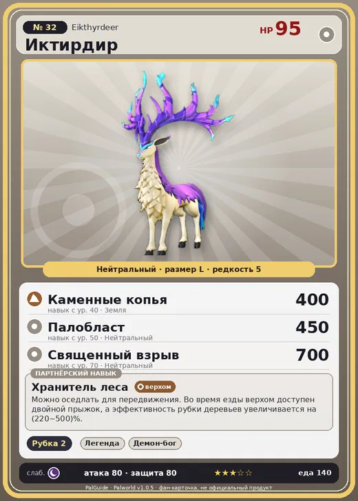

# #32 Иктирдир (Eikthyrdeer)

#32 · Eikthyrdeer

Нейтральный

Слабость: Тьма

🪓 Рубка деревьев <b>2</b>

<b>Хранитель леса</b> 🐎 верхом

❤️ 95 · ⚔️ 80 · 🛡 80

| Поле | Значение |
|---|---|
| Стихия | Нейтральный |
| Слабость (кто бьёт сильнее) | Тьма |
| Редкость | 5 |
| Размер | L |
| HP / Атака / Защита (база вида) | 95 / 80 / 80 |
| Сколько ест | 140 |
| Цена продажи | 791 |
| Множитель поимки | ×1 |
| Скорость рывка верхом | 900 |

## Работа на базе
- Рубка деревьев — ур. 2

## Партнёрский навык: Хранитель леса
Можно оседлать для передвижения. Во время езды верхом доступен двойной прыжок , а эффективность рубки деревьев увеличивается на (220~500)% . Технологии 12 level value 1 Logging_up2_Otomo_only 220 2 Logging_up3_Otomo_only 260 3 Logging_up4_Otomo_only 320 4 Logging_up5_Otomo_only 400 5 Logging_up6_Otomo_only 500

## Атаки по уровням
- ур. 1: Силовой выстрел (Нейтральный, сила 80)
- ур. 7: Роговой апперкот (Нейтральный, сила 90)
- ур. 15: Каменный залп (Земля, сила 80)
- ур. 22: Камнемёт (Земля, сила 120)
- ур. 30: Силовая бомба (Нейтральный, сила 120)
- ур. 40: Каменные копья (Земля, сила 400)
- ур. 50: Палобласт (Нейтральный, сила 450)
- ур. 70: Священный взрыв (Нейтральный, сила 700)

## Где водится
- В дикой природе: да; точек появления днём: 228, ночью: 228; уровни в первых точках: 9–11
- Подземелья: Пещера Отдалённого Острова, Пещера Холмов
- Может продаваться у торговца/рекрутера
- Яйцо: Большое обычное яйцо

## Дроп
- Мясо Иктирдира — 2 шт., 100%
- Кожа — 2–3 шт., 100%
- Рог — 2 шт., 100%

**Дроп альфы:**
- Деталь древней цивилизации — 1–2 шт., 100%
- Ценный мех — 1–2 шт., 100%

## Разведение
- Ранг разведения (CombiRank): 2710
- Участвует в особых парах: Хангю → Иктирдир Тэрра

## Лучшие пассивки по роли
- боец: Легенда, Демон-бог, Хладнокровный, Бессмертие, Святое небо (вместо Бессмертия, если нет мутации)
- ездовой: Божественная скорость, Легенда, Вечный двигатель, Небесное скольжение

## Чем хорош / чем плох
- ✅ можно оседлать
- ❌ явных минусов нет

> Особь с самыми величественными рогами становится вожаком. Когда ломаются рога — ломается и дух. И тогда он покидает стаю и уходит умирать в место, где его никто не увидит.

См. также: [Стихии](../../2_mehaniki/stihii.md) · [Разведение](../../2_mehaniki/razvedenie.md) · [Все палы](README.md)
_Источник: paldb.cc v1.0.5_
