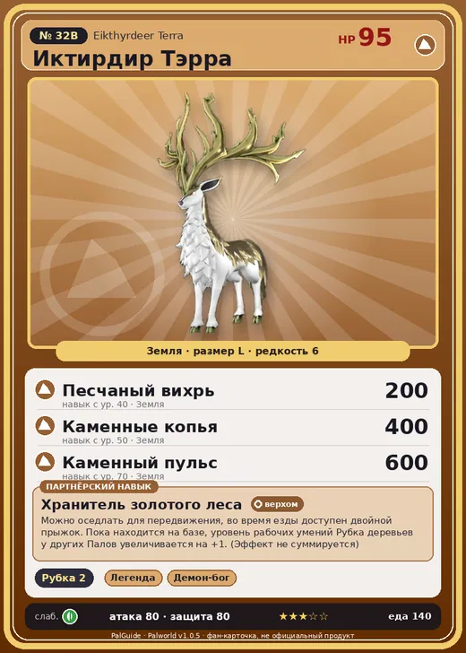

# #32B Иктирдир Тэрра (Eikthyrdeer Terra)

#32B · Eikthyrdeer Terra

Земля

Слабость: Трава

🪓 Рубка деревьев <b>2</b>

<b>Хранитель золотого леса</b> 🐎 верхом 🏠 на базе

❤️ 95 · ⚔️ 80 · 🛡 80

| Поле | Значение |
|---|---|
| Стихия | Земля |
| Слабость (кто бьёт сильнее) | Трава |
| Редкость | 6 |
| Размер | L |
| HP / Атака / Защита (база вида) | 95 / 80 / 80 |
| Сколько ест | 140 |
| Цена продажи | 891 |
| Множитель поимки | ×1 |
| Скорость рывка верхом | 900 |

## Работа на базе
- Рубка деревьев — ур. 2

## Партнёрский навык: Хранитель золотого леса
Можно оседлать для передвижения, во время езды доступен двойной прыжок . Пока находится на базе, уровень рабочих умений Рубка деревьев у других Палов увеличивается на +1 . (Эффект не суммируется) Технологии 21 level value 1 WorkSuitabilityAddRank_Deforest 1 2 WorkSuitabilityAddRank_Deforest 1 3 WorkSuitabilityAddRank_Deforest 1 4 WorkSuitabilityAddRank_Deforest 1 5 WorkSuitabilityAddRank_Deforest 1

## Атаки по уровням
- ур. 1: Силовой выстрел (Нейтральный, сила 80)
- ур. 7: Роговой апперкот (Нейтральный, сила 90)
- ур. 15: Каменный залп (Земля, сила 80)
- ур. 18: Грязевой рог (Земля, сила 120)
- ур. 22: Камнемёт (Земля, сила 120)
- ур. 30: Силовая бомба (Нейтральный, сила 120)
- ур. 40: Песчаный вихрь (Земля, сила 200)
- ур. 50: Каменные копья (Земля, сила 400)
- ур. 70: Каменный пульс (Земля, сила 600)

## Где водится
- В дикой природе: да; точек появления днём: 12, ночью: 12
- Яйцо: Большое яйцо земли

## Дроп
- Мясо Иктирдира — 2 шт., 100%
- Кожа — 2–3 шт., 100%
- Рог — 2 шт., 100%

**Дроп альфы:**
- Деталь древней цивилизации — 1–2 шт., 100%
- Ценный мех — 1–2 шт., 100%

## Разведение
- Ранг разведения (CombiRank): 2580
- **Особая пара:** [Иктирдир](../../4_spravochniki/paly/eikthyrdeer.md) + [Хангю](../../4_spravochniki/paly/hangyu.md)
- Участвует в особых парах: Думад → Думад Гилд; Гилдейн → Селесдир

## Лучшие пассивки по роли
- боец: Легенда, Демон-бог, Хладнокровный, Бессмертие, Император земли (вместо Бессмертия, если нет мутации)
- ездовой: Божественная скорость, Легенда, Вечный двигатель, Небесное скольжение

## Чем хорош / чем плох
- ✅ можно оседлать
- ❌ разводится только особой парой

> Вожаком становится тот, чьи рога самые крепкие. Потеряв их, он теряет и право вести стаю. Под прощальные взгляды сородичей он уходит… и в тишине возвращается к земле.

См. также: [Стихии](../../2_mehaniki/stihii.md) · [Разведение](../../2_mehaniki/razvedenie.md) · [Все палы](README.md)
