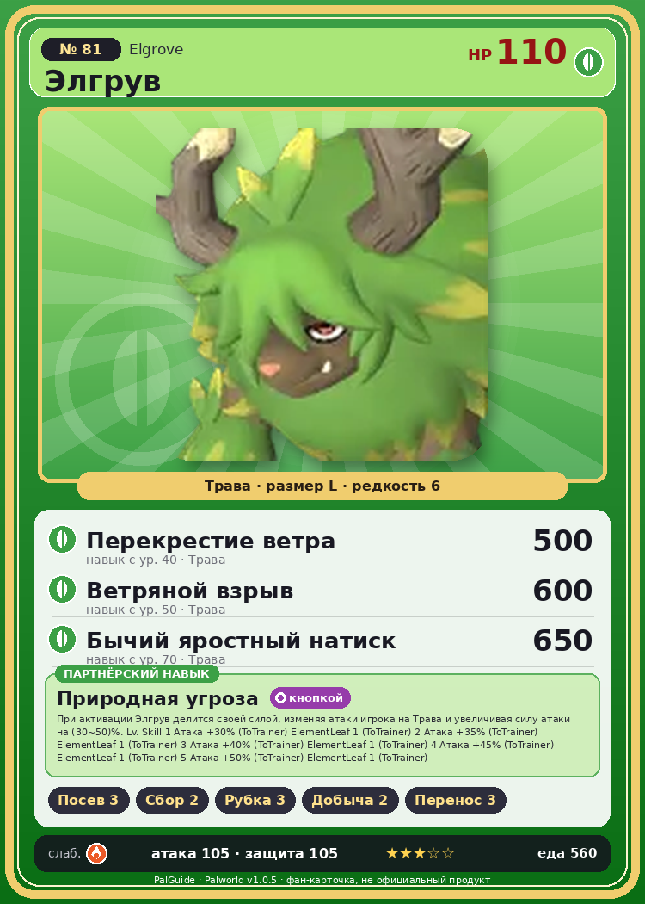

# #81 Элгрув (Elgrove)

{ width=360 }

| Поле | Значение |
|---|---|
| Стихия | Трава |
| Слабость (кто бьёт сильнее) | Огонь |
| Редкость | 6 |
| Размер | L |
| HP / Атака / Защита (база вида) | 110 / 105 / 105 |
| Сколько ест | 560 |
| Цена продажи | 2041 |
| Множитель поимки | ×1 |
| Скорость рывка верхом | 1000 |

## Работа на базе
- Посев семян — ур. 3
- Сбор — ур. 2
- Рубка деревьев — ур. 3
- Добыча — ур. 2
- Транспортировка — ур. 3

## Партнёрский навык: Природная угроза
При активации Элгрув делится своей силой, изменяя атаки игрока на Трава и увеличивая силу атаки на (30~50)% . Lv. Skill 1 Атака +30% (ToTrainer) ElementLeaf 1 (ToTrainer) 2 Атака +35% (ToTrainer) ElementLeaf 1 (ToTrainer) 3 Атака +40% (ToTrainer) ElementLeaf 1 (ToTrainer) 4 Атака +45% (ToTrainer) ElementLeaf 1 (ToTrainer) 5 Атака +50% (ToTrainer) ElementLeaf 1 (ToTrainer)

## Атаки по уровням
- ур. 1: Грязевой выстрел (Земля, сила 40)
- ур. 7: Травяной торнадо (Трава, сила 200)
- ур. 15: Камнепад (Земля, сила 300)
- ур. 22: Бычий натиск (Трава, сила 250)
- ур. 30: Кольцевая лоза (Трава, сила 300)
- ур. 40: Перекрестие ветра (Трава, сила 500)
- ур. 50: Ветряной взрыв (Трава, сила 600)
- ур. 70: Бычий яростный натиск (Трава, сила 650)

## Где водится
- В дикой природе: да; точек появления днём: 75, ночью: 75; уровни в первых точках: 24–26
- Может продаваться у торговца/рекрутера
- Яйцо: Большое яйцо свежей листвы

## Дроп
- Рог — 2–3 шт., 100%
- Кожа — 2–3 шт., 100%

**Дроп альфы:**
- Деталь древней цивилизации — 3–4 шт., 100%
- Ценный мех — 2–3 шт., 100%

## Разведение
- Ранг разведения (CombiRank): 2020
- Участвует в особых парах: Пиродон Крист → Элгрув Крист

## Лучшие пассивки по роли
- боец: Легенда, Демон-бог, Хладнокровный, Бессмертие, Король духов (вместо Бессмертия, если нет мутации)
- рабочий: Дьявольские руки, Виртуоз, Мастеровитый, Небожитель/Трудоголик
- ездовой: Божественная скорость, Легенда, Вечный двигатель, Небесное скольжение

## Чем хорош / чем плох
- ✅ хорошая атака (105); можно оседлать
- ❌ много ест (560)

> Листок, приставший к рогу, как ни тяни, не оторвать. Когда этот лист сам по себе упадёт, Элгрув осознаёт, что пришёл его срок.

См. также: [Стихии](../../2_mehaniki/stihii.md) · [Разведение](../../2_mehaniki/razvedenie.md) · [Все палы](README.md)
_Источник: paldb.cc v1.0.5_
