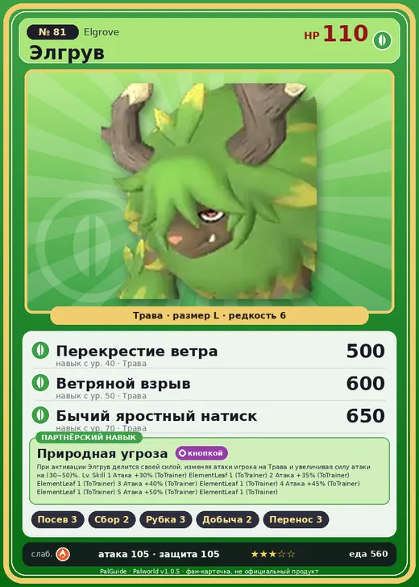

# Элгрув

<canvas id="fx"></canvas>

№ 81 · Elgrove

Трава

Слабость: Огонь

🌱 Посев семян <b>3</b>🌾 Сбор <b>2</b>🪓 Рубка деревьев <b>3</b>⛏️ Добыча <b>2</b>📦 Транспортировка <b>3</b>

<b>Природная угроза</b> 🔘 кнопкой

❤️ 110 · ⚔️ 105 · 🛡 105

Основное

💎Редкость <button class="hlp" data-tip="Чем выше число, тем реже встречается пал. 1–4 — обычные, 5–7 — редкие, 8+ — легендарные.">?</button><b>6</b>

📏Размер<b>L</b>

💰Цена продажи <button class="hlp" data-tip="Сколько золота даст торговец за пала.">?</button><b>2041</b>

Бой

🎯Множитель поимки <button class="hlp" data-tip="Насколько легче или труднее поймать: ×1 — обычно, меньше — сложнее.">?</button><b>×1</b>

🐎Скорость рывка верхом <button class="hlp" data-tip="Скорость, если сесть на пала и бежать рывком.">?</button><b>1000</b>

Ферма и еда

🍖Сколько ест <button class="hlp" data-tip="Сколько сытости пал тратит — чем больше, тем больше еды нужно на базе.">?</button><b>560</b>

Разведение

🧬Сила разведения <button class="hlp" data-tip="Скрытое число игры: у детёныша оно примерно среднее от родителей. Чем меньше — тем «сильнее» пал.">?</button><b>2020</b>

=== "Обзор"

    #### Работа на базе
    - Посев семян — ур. 3
    - Сбор — ур. 2
    - Рубка деревьев — ур. 3
    - Добыча — ур. 2
    - Транспортировка — ур. 3

    #### Партнёрский навык: Природная угроза
    При активации Элгрув делится своей силой, изменяя атаки игрока на Трава и увеличивая силу атаки на 30–50%.

    #### Чем хорош / чем плох
    - ✅ хорошая атака (105)
    - ❌ много ест (560)

    > Листок, приставший к рогу, как ни тяни, не оторвать. Когда этот лист сам по себе упадёт, Элгрув осознаёт, что пришёл его срок.

    См. также: [Стихии](../../guide/06_stihii.md) · [Разведение](../../guide/07_razvedenie.md) · [Все палы](README.md)

=== "Атаки"

    #### Атаки по уровням
    - ур. 1: Грязевой выстрел (Земля, сила 40)
    - ур. 7: Травяной торнадо (Трава, сила 200)
    - ур. 15: Камнепад (Земля, сила 300)
    - ур. 22: Бычий натиск (Трава, сила 250)
    - ур. 30: Кольцевая лоза (Трава, сила 300)
    - ур. 40: Перекрестие ветра (Трава, сила 500)
    - ур. 50: Ветряной взрыв (Трава, сила 600)
    - ур. 70: Бычий яростный натиск (Трава, сила 650)

=== "Где живёт"

    #### Где водится
    - В дикой природе: да; точек появления днём: 75, ночью: 75; уровни в первых точках: 24–26
    - Может продаваться у торговца/рекрутера
    - Яйцо: Большое яйцо свежей листвы

=== "Дроп"

    #### Дроп
    - Рог — 2–3 шт., 100%
    - Кожа — 2–3 шт., 100%

    **Дроп альфы:**
    - Деталь древней цивилизации — 3–4 шт., 100%
    - Ценный мех — 2–3 шт., 100%

=== "Разведение"

    #### Разведение
    - Ранг разведения (CombiRank): 2020
    - Участвует в особых парах: Пиродон Крист → Элгрув Крист

=== "Пассивки"

    #### Лучшие пассивки по роли

    

⚔️ Боец

максимум урона и живучести в бою

<a class="psv r-4" data-psv="Легенда" href="../../../passivki/legend/">Легенда</a><a class="psv r-4" data-psv="Демон-бог" href="../../../passivki/demon_god/">Демон-бог</a><a class="psv r-3" data-psv="Король духов" href="../../../passivki/spirit_emperor/">Король духов</a><a class="psv r-3" data-psv="Хладнокровный" href="../../../passivki/serenity/">Хладнокровный</a>

🛠 Рабочий

работает быстрее и меньше устаёт на базе

<a class="psv r-5" data-psv="Дьявольские руки" href="../../../passivki/demons_hand/">Дьявольские руки</a><a class="psv r-4" data-psv="Виртуоз" href="../../../passivki/remarkable_craftsmanship/">Виртуоз</a><a class="psv r-3" data-psv="Мастеровитый" href="../../../passivki/artisan/">Мастеровитый</a><a class="psv r-3" data-psv="Трудоголик" href="../../../passivki/workaholic/">Трудоголик</a>

    <small>Нажми на пассивку, чтобы узнать, что она даёт и где её взять.</small>

<a class="card-link" href="../helzephyr_lux/">← Хэлзефир Лакс</a><a class="card-link" href="../elgrove_cryst/">Элгрув Крист →</a>

