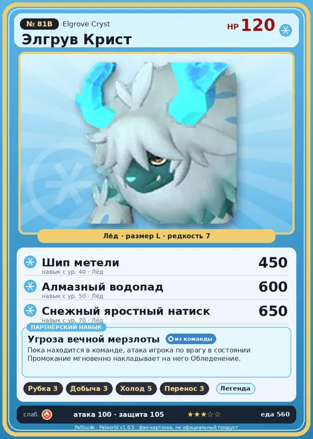

# #81B Элгрув Крист (Elgrove Cryst)

#81B · Elgrove Cryst

Лёд

Слабость: Огонь

🪓 Рубка деревьев <b>3</b>⛏️ Добыча <b>3</b>❄️ Охлаждение <b>5</b>📦 Транспортировка <b>3</b>

<b>Угроза вечной мерзлоты</b> 🎒 из команды

❤️ 120 · ⚔️ 100 · 🛡 105

| Поле | Значение |
|---|---|
| Стихия | Лёд |
| Слабость (кто бьёт сильнее) | Огонь |
| Редкость | 7 |
| Размер | L |
| HP / Атака / Защита (база вида) | 120 / 100 / 105 |
| Сколько ест | 560 |
| Цена продажи | 2484 |
| Множитель поимки | ×1 |
| Скорость рывка верхом | 1000 |

## Работа на базе
- Рубка деревьев — ур. 3
- Добыча — ур. 3
- Охлаждение — ур. 5
- Транспортировка — ур. 3

## Партнёрский навык: Угроза вечной мерзлоты
Пока находится в команде, атака игрока по врагу в состоянии Промокание мгновенно накладывает на него Обледенение . Lv. Skill 1 Атака +30% (ToTrainer) ElementLeaf 1 (ToTrainer) 2 Атака +35% (ToTrainer) ElementLeaf 1 (ToTrainer) 3 Атака +40% (ToTrainer) ElementLeaf 1 (ToTrainer) 4 Атака +45% (ToTrainer) ElementLeaf 1 (ToTrainer) 5 Атака +50% (ToTrainer) ElementLeaf 1 (ToTrainer) level value 1 PlayerInflictEffect_AttackWet_ApplyFreeze 100 2 PlayerInflictEffect_AttackWet_ApplyFreeze 100 3 PlayerInflictEffect_AttackWet_ApplyFreeze 100 4 PlayerInflictEffect_AttackWet_ApplyFreeze 100 5 PlayerInflictEffect_AttackWet_ApplyFreeze 100

## Атаки по уровням
- ур. 1: Грязевой выстрел (Земля, сила 40)
- ур. 7: Ледяное дыхание (Лёд, сила 160)
- ур. 15: Ледяная стена (Лёд, сила 200)
- ур. 22: Снежный натиск (Лёд, сила 250)
- ур. 30: Ледяной след (Лёд, сила 300)
- ур. 40: Шип метели (Лёд, сила 450)
- ур. 50: Алмазный водопад (Лёд, сила 600)
- ур. 70: Снежный яростный натиск (Лёд, сила 650)

## Где водится
- В дикой природе: нет/особый способ; точек появления днём: 0, ночью: 0
- Яйцо: Большое яйцо льда

## Дроп
- Рог — 2–3 шт., 100%
- Кожа — 2–3 шт., 100%
- Ледяной орган — 2–3 шт., 100%

**Дроп альфы:**
- Деталь древней цивилизации — 7–9 шт., 100%
- Ценный мех — 2–3 шт., 100%

## Разведение
- Ранг разведения (CombiRank): 440
- **Особая пара:** [Элгрув](../../4_spravochniki/paly/elgrove.md) + [Пиродон Крист](../../4_spravochniki/paly/pierdon_cryst.md)

## Лучшие пассивки по роли
- боец: Легенда, Демон-бог, Хладнокровный, Бессмертие, Император льда (вместо Бессмертия, если нет мутации)
- рабочий: Дьявольские руки, Виртуоз, Мастеровитый, Небожитель/Трудоголик
- ездовой: Божественная скорость, Легенда, Вечный двигатель, Небесное скольжение

## Чем хорош / чем плох
- ✅ хорошая атака (100); много здоровья (120); отличный рабочий (пригодность 5); можно оседлать
- ❌ много ест (560); разводится только особой парой

> Ледяные рога не тают на протяжении жизни. Капли воды, стекающие с них, предупреждают о том, что тело Элгрув Крист постепенно теряет тепло.

См. также: [Стихии](../../2_mehaniki/stihii.md) · [Разведение](../../2_mehaniki/razvedenie.md) · [Все палы](README.md)
