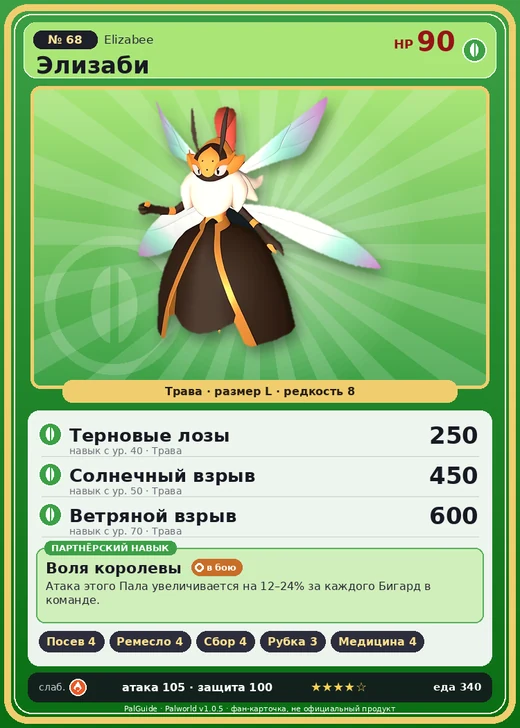

# Элизаби

<canvas id="fx"></canvas>

№ 68 · Elizabee

Трава

Слабость: Огонь

🌱 Посев семян <b>4</b>🖐️ Ручная работа <b>4</b>🌾 Сбор <b>4</b>🪓 Рубка деревьев <b>3</b>💊 Фармацевтика <b>4</b>

<b>Воля королевы</b> 🐾 выпущен

❤️ 90 · ⚔️ 105 · 🛡 100

| Поле | Значение |
|---|---|
| Стихия | Трава |
| Слабость (кто бьёт сильнее) | Огонь |
| Редкость | 8 |
| Размер | L |
| HP / Атака / Защита (база вида) | 90 / 105 / 100 |
| Сколько ест | 340 |
| Цена продажи | 1769 |
| Множитель поимки | ×1 |
| Скорость рывка верхом | 550 |

=== "Обзор"

    #### Работа на базе
    - Посев семян — ур. 4
    - Ручная работа — ур. 4
    - Сбор — ур. 4
    - Рубка деревьев — ур. 3
    - Фармацевтика — ур. 4

    #### Партнёрский навык: Воля королевы
    Атака этого Пала увеличивается на 12–24% за каждого Бигард в команде.

    #### Чем хорош / чем плох
    - ✅ хорошая атака (105)
    - ❌ явных минусов нет

    > Избранная королева, повелевающая Бигард . Радость служения великой королеве так велика, что её слуги работают до изнеможения и умирают от переутомления — один за другим.

    См. также: [Стихии](../../guide/06_stihii.md) · [Разведение](../../guide/07_razvedenie.md) · [Все палы](README.md)

=== "Атаки"

    #### Атаки по уровням
    - ур. 1: Воздушная пушка (Нейтральный, сила 40)
    - ур. 7: Ветряной клинок (Трава, сила 40)
    - ур. 15: Ядовитый выстрел (Тьма, сила 30)
    - ур. 22: Вращающийся посох (Трава, сила 160)
    - ур. 30: Травяной торнадо (Трава, сила 200)
    - ур. 40: Терновые лозы (Трава, сила 250)
    - ур. 50: Солнечный взрыв (Трава, сила 450)
    - ур. 70: Ветряной взрыв (Трава, сила 600)

=== "Где живёт"

    #### Где водится
    - В дикой природе: да; точек появления днём: 43, ночью: 43; уровни в первых точках: 34–38
    - Яйцо: Огромное яйцо свежей листвы

=== "Дроп"

    #### Дроп
    - Мёд — 5 шт., 100%
    - Жезл Элизаби — 1 шт., 3%

    **Дроп альфы:**
    - Деталь древней цивилизации — 5–6 шт., 100%
    - Ценное перо — 5–6 шт., 100%

=== "Разведение"

    #### Разведение
    - Ранг разведения (CombiRank): 1790

=== "Пассивки"

    #### Лучшие пассивки по роли

    

⚔️ Боец

максимум урона и живучести в бою

<a class="psv r-4" data-psv="Легенда" href="../../../passivki/legend/">Легенда</a><a class="psv r-4" data-psv="Демон-бог" href="../../../passivki/demon_god/">Демон-бог</a><a class="psv r-3" data-psv="Король духов" href="../../../passivki/spirit_emperor/">Король духов</a><a class="psv r-3" data-psv="Хладнокровный" href="../../../passivki/serenity/">Хладнокровный</a>

🛠 Рабочий

работает быстрее и меньше устаёт на базе

<a class="psv r-5" data-psv="Дьявольские руки" href="../../../passivki/demons_hand/">Дьявольские руки</a><a class="psv r-4" data-psv="Виртуоз" href="../../../passivki/remarkable_craftsmanship/">Виртуоз</a><a class="psv r-3" data-psv="Мастеровитый" href="../../../passivki/artisan/">Мастеровитый</a><a class="psv r-3" data-psv="Трудоголик" href="../../../passivki/workaholic/">Трудоголик</a>

    <small>Нажми на пассивку, чтобы узнать, что она даёт и где её взять.</small>

<a class="card-link" href="../beegarde/">← Бигард</a><a class="card-link" href="../lovander/">Ловандер →</a>

