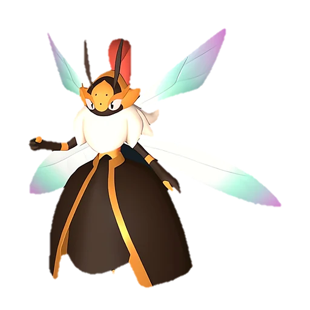

# Элизаби

<canvas id="fx"></canvas>

№ 68 · Elizabee

Трава

Слабость: Огонь <b class="mx">×1,5</b> <button class="hlp" data-tip="Множители перемножаются по обеим стихиям пала: ×1,5 за каждую стихию, которую атака бьёт, ×0,65 за каждую, которая её держит. Если одна стихия слаба, а другая устойчива (×1,5 × 0,65 ≈ ×0,98), слабости нет.">?</button>

Устойчив: Земля <b class="mx">×0,65</b>

🌱 Посев семян <b>4</b>🖐️ Ручная работа <b>4</b>🌾 Сбор <b>4</b>🪓 Рубка деревьев <b>3</b>💊 Фармацевтика <b>4</b>

<b>Воля королевы</b> 🐾 выпущен

❤️ 90 · ⚔️ 105 · 🛡 100

Основное

💎Редкость <button class="hlp" data-tip="Чем выше число, тем реже встречается пал. 1–4 — обычные, 5–7 — редкие, 8+ — легендарные.">?</button><b>8</b>

📏Размер<b>L</b>

💰Цена продажи <button class="hlp" data-tip="Сколько золота даст торговец за пала.">?</button><b>1769</b>

Бой

🎯Множитель поимки <button class="hlp" data-tip="Насколько легче или труднее поймать: ×1 — обычно, меньше — сложнее.">?</button><b>×1</b>

🐎Скорость рывка верхом <button class="hlp" data-tip="Скорость, если сесть на пала и бежать рывком.">?</button><b>550</b>

Ферма и еда

🍖Сколько ест <button class="hlp" data-tip="Сколько сытости пал тратит — чем больше, тем больше еды нужно на базе.">?</button><b>340</b>

Разведение

🧬Сила разведения <button class="hlp" data-tip="Скрытое число игры: у детёныша оно примерно среднее от родителей. Чем меньше — тем «сильнее» пал.">?</button><b>1790</b>

=== "Обзор"

    #### Работа на базе
    - Посев семян — ур. 4
    - Ручная работа — ур. 4
    - Сбор — ур. 4
    - Рубка деревьев — ур. 3
    - Фармацевтика — ур. 4

    #### Партнёрский навык: Воля королевы
    Атака этого Пала увеличивается на 12–24% за каждого Бигард в команде.

    #### Чем хорош / чем плох
    - ✅ хорошая атака (105)
    - ❌ явных минусов нет

    > Избранная королева, повелевающая Бигард . Радость служения великой королеве так велика, что её слуги работают до изнеможения и умирают от переутомления — один за другим.

    См. также: [Стихии](../../guide/06_stihii.md) · [Разведение](../../guide/07_razvedenie.md) · [Все палы](README.md)

=== "Атаки"

    #### Атаки по уровням
    - ур. 1: Воздушная пушка (Нейтральный, сила 40)
    - ур. 7: Ветряной клинок (Трава, сила 40)
    - ур. 15: Ядовитый выстрел (Тьма, сила 30)
    - ур. 22: Вращающийся посох (Трава, сила 160)
    - ур. 30: Травяной торнадо (Трава, сила 200)
    - ур. 40: Терновые лозы (Трава, сила 250)
    - ур. 50: Солнечный взрыв (Трава, сила 450)
    - ур. 70: Ветряной взрыв (Трава, сила 600)

=== "Где живёт"

    #### Где водится

    

<button data-k="d" class="on">☀️ День</button><button data-k="n">🌙 Ночь</button>

ур. 34–34<a class="btn hm-full" href="../../../map/?pal=QueenBee">Показать на большой карте</a>

Зелёный ручейЛедяная гораБерег Полумесяца

🥚 Яйцо<b>Огромное яйцо свежей листвы</b>

=== "Дроп"

    #### Дроп
    - Мёд — 5 шт., 100%
    - Жезл Элизаби — 1 шт., 3%

    **Дроп альфы:**
    - Деталь древней цивилизации — 5–6 шт., 100%
    - Ценное перо — 5–6 шт., 100%

=== "Разведение"

    #### Разведение
    - Ранг разведения (CombiRank): 1790

=== "Пассивки"

    #### Лучшие пассивки по роли

    

⚔️ Боец

максимум урона и живучести в бою

<a class="psv r-4" data-psv="Легенда" href="../../../passivki/legend/">Легенда</a><a class="psv r-4" data-psv="Демон-бог" href="../../../passivki/demon_god/">Демон-бог</a><a class="psv r-3" data-psv="Король духов" href="../../../passivki/spirit_emperor/">Король духов</a><a class="psv r-3" data-psv="Хладнокровный" href="../../../passivki/serenity/">Хладнокровный</a>

🛠 Рабочий

работает быстрее и меньше устаёт на базе

<a class="psv r-5" data-psv="Дьявольские руки" href="../../../passivki/demons_hand/">Дьявольские руки</a><a class="psv r-4" data-psv="Виртуоз" href="../../../passivki/remarkable_craftsmanship/">Виртуоз</a><a class="psv r-3" data-psv="Мастеровитый" href="../../../passivki/artisan/">Мастеровитый</a><a class="psv r-3" data-psv="Трудоголик" href="../../../passivki/workaholic/">Трудоголик</a>

    <small>Нажми на пассивку, чтобы узнать, что она даёт и где её взять.</small>

<a class="card-link" href="../beegarde/">← Бигард</a><a class="card-link" href="../lovander/">Ловандер →</a>

