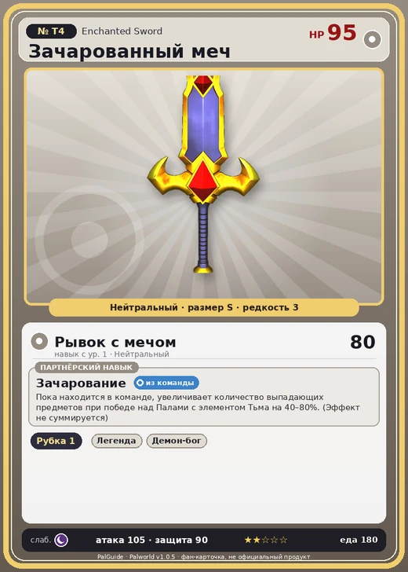

# Зачарованный меч

<canvas id="fx"></canvas>

№ T4 · Enchanted Sword

Нейтральный

Слабость: Тьма

🪓 Рубка деревьев <b>1</b>

<b>Зачарование</b> 🎒 из команды

❤️ 95 · ⚔️ 105 · 🛡 90

| Поле | Значение |
|---|---|
| Стихия | Нейтральный |
| Слабость (кто бьёт сильнее) | Тьма |
| Редкость | 3 |
| Размер | S |
| HP / Атака / Защита (база вида) | 95 / 105 / 90 |
| Сколько ест | 180 |
| Цена продажи | 1250 |
| Множитель поимки | ×1 |
| Скорость рывка верхом | 900 |
| Коллаборация | Terraria (остров Якусима) (нет в Палпедии) |

=== "Обзор"

    #### Работа на базе
    - Рубка деревьев — ур. 1

    #### Партнёрский навык: Зачарование
    Пока находится в команде, увеличивает количество выпадающих предметов при победе над Палами с элементом Тьма на 40–80%. (Эффект не суммируется)

    #### Чем хорош / чем плох
    - ✅ хорошая атака (105)
    - ❌ явных минусов нет

    > [Коллаборация с Terraria] Монстр из другого мира. Похоже, здесь его можно приручить.

    См. также: [Стихии](../../guide/06_stihii.md) · [Разведение](../../guide/07_razvedenie.md) · [Все палы](README.md)

=== "Атаки"

    #### Атаки по уровням
    - ур. 1: Рывок с мечом (Нейтральный, сила 80)

=== "Где живёт"

    #### Где водится
    - В дикой природе: да; точек появления днём: ?, ночью: ?
    - Яйцо: Обычное яйцо

=== "Дроп"

    #### Дроп
    - Святой слиток — 2–4 шт., 100%

=== "Разведение"

    #### Разведение
    - Ранг разведения (CombiRank): 3100

=== "Пассивки"

    #### Лучшие пассивки по роли

    

⚔️ Боец

максимум урона и живучести в бою

<a class="psv r-4" data-psv="Легенда" href="../../../passivki/legend/">Легенда</a><a class="psv r-4" data-psv="Демон-бог" href="../../../passivki/demon_god/">Демон-бог</a><a class="psv r-3" data-psv="Святое небо" href="../../../passivki/celestial_emperor/">Святое небо</a><a class="psv r-3" data-psv="Хладнокровный" href="../../../passivki/serenity/">Хладнокровный</a>

    <small>Нажми на пассивку, чтобы узнать, что она даёт и где её взять.</small>

<a class="card-link" href="../demon_eye/">← Демонический глаз</a><a class="card-link" href="../eye_of_cthulhu/">Глаз Ктулху →</a>

