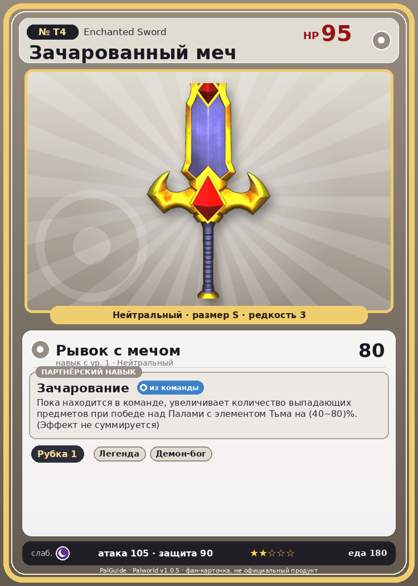

# #T4 Зачарованный меч (Enchanted Sword)

{ width=360 }

| Поле | Значение |
|---|---|
| Стихия | Нейтральный |
| Слабость (кто бьёт сильнее) | Тьма |
| Редкость | 3 |
| Размер | S |
| HP / Атака / Защита (база вида) | 95 / 105 / 90 |
| Сколько ест | 180 |
| Цена продажи | 1250 |
| Множитель поимки | ×1 |
| Скорость рывка верхом | 900 |
| Коллаборация | Terraria (остров Якусима) (нет в Палпедии) |

## Работа на базе
- Рубка деревьев — ур. 1

## Партнёрский навык: Зачарование
Пока находится в команде, увеличивает количество выпадающих предметов при победе над Палами с элементом Тьма на (40~80)% . (Эффект не суммируется)

## Атаки по уровням
- ур. 1: Рывок с мечом (Нейтральный, сила 80)

## Где водится
- В дикой природе: да; точек появления днём: ?, ночью: ?
- Яйцо: Обычное яйцо

## Дроп
- Святой слиток — 2–4 шт., 100%

## Разведение
- Ранг разведения (CombiRank): 3100

## Лучшие пассивки по роли
- боец: Легенда, Демон-бог, Хладнокровный, Бессмертие, Святое небо (вместо Бессмертия, если нет мутации)
- ездовой: Божественная скорость, Легенда, Вечный двигатель, Небесное скольжение

## Чем хорош / чем плох
- ✅ хорошая атака (105); можно оседлать
- ❌ явных минусов нет

> [Коллаборация с Terraria] Монстр из другого мира. Похоже, здесь его можно приручить.

См. также: [Стихии](../../2_mehaniki/stihii.md) · [Разведение](../../2_mehaniki/razvedenie.md) · [Все палы](README.md)
_Источник: paldb.cc v1.0.5_
