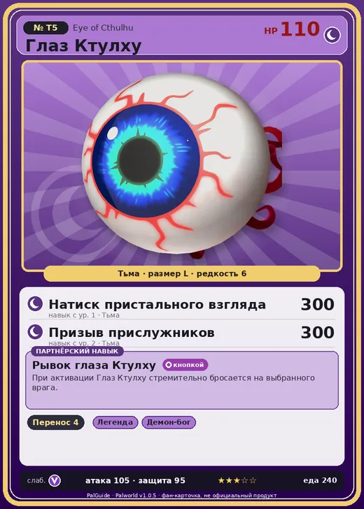

# Глаз Ктулху

<canvas id="fx"></canvas>

№ T5 · Eye of Cthulhu

Тьма

Слабость: Дракон

📦 Транспортировка <b>4</b>

<b>Рывок глаза Ктулху</b> 🔘 кнопкой

❤️ 110 · ⚔️ 105 · 🛡 95

| Поле | Значение |
|---|---|
| Стихия | Тьма |
| Слабость (кто бьёт сильнее) | Дракон |
| Редкость | 6 |
| Размер | L |
| HP / Атака / Защита (база вида) | 110 / 105 / 95 |
| Сколько ест | 240 |
| Цена продажи | 3000 |
| Множитель поимки | ×1 |
| Скорость рывка верхом | 1200 |
| Коллаборация | Terraria (остров Якусима) (нет в Палпедии) |

=== "Обзор"

    #### Работа на базе
    - Транспортировка — ур. 4

    #### Партнёрский навык: Рывок глаза Ктулху
    При активации Глаз Ктулху стремительно бросается на выбранного врага.

    #### Чем хорош / чем плох
    - ✅ хорошая атака (105)
    - ❌ явных минусов нет

    > [Коллаборация с Terraria] Монстр из другого мира. Похоже, здесь его можно приручить.

    См. также: [Стихии](../../guide/06_stihii.md) · [Разведение](../../guide/07_razvedenie.md) · [Все палы](README.md)

=== "Атаки"

    #### Атаки по уровням
    - ур. 1: Натиск пристального взгляда (Тьма, сила 300)
    - ур. 2: Призыв прислужников (Тьма, сила 300)

=== "Где живёт"

    #### Где водится
    - В дикой природе: да; точек появления днём: ?, ночью: ?
    - Яйцо: Большое яйцо тьмы

=== "Дроп"

    #### Дроп
    - Святой слиток — 2 шт., 100%

=== "Разведение"

    #### Разведение
    - Ранг разведения (CombiRank): 3100

=== "Пассивки"

    #### Лучшие пассивки по роли

    

⚔️ Боец

максимум урона и живучести в бою

<a class="psv r-4" data-psv="Легенда" href="../../../passivki/legend/">Легенда</a><a class="psv r-4" data-psv="Демон-бог" href="../../../passivki/demon_god/">Демон-бог</a><a class="psv r-3" data-psv="Король тьмы" href="../../../passivki/lord_of_the_underworld/">Король тьмы</a><a class="psv r-3" data-psv="Хладнокровный" href="../../../passivki/serenity/">Хладнокровный</a>

🛠 Рабочий

работает быстрее и меньше устаёт на базе

<a class="psv r-5" data-psv="Дьявольские руки" href="../../../passivki/demons_hand/">Дьявольские руки</a><a class="psv r-4" data-psv="Виртуоз" href="../../../passivki/remarkable_craftsmanship/">Виртуоз</a><a class="psv r-3" data-psv="Мастеровитый" href="../../../passivki/artisan/">Мастеровитый</a><a class="psv r-3" data-psv="Трудоголик" href="../../../passivki/workaholic/">Трудоголик</a>

    <small>Нажми на пассивку, чтобы узнать, что она даёт и где её взять.</small>

<a class="card-link" href="../enchanted_sword/">← Зачарованный меч</a><a class="card-link" href="../green_slime/">Зеленый слизень →</a>

