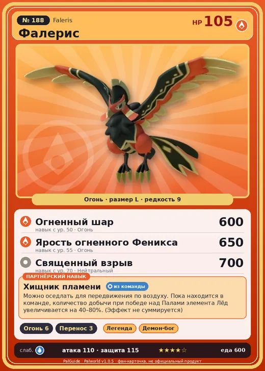

# #188 Фалерис (Faleris)

№ 188

Огонь

Слабость: Вода

🔥 Разжигание огня <b>6</b>📦 Транспортировка <b>3</b>

<b>Хищник пламени</b> 🎒 из команды 🐎 верхом

❤️ 105 · ⚔️ 110 · 🛡 115

| Поле | Значение |
|---|---|
| Стихия | Огонь |
| Слабость (кто бьёт сильнее) | Вода |
| Редкость | 9 |
| Размер | L |
| HP / Атака / Защита (база вида) | 105 / 110 / 115 |
| Сколько ест | 600 |
| Цена продажи | 2685 |
| Множитель поимки | ×1 |
| Скорость рывка верхом | 1400 |

=== "Обзор"

    #### Работа на базе
    - Разжигание огня — ур. 6
    - Транспортировка — ур. 3

    #### Партнёрский навык: Хищник пламени
    Можно оседлать для передвижения по воздуху. Пока находится в команде, количество добычи при победе над Палами элемента Лёд увеличивается на (40~80)% . (Эффект не суммируется) Технологии 60 level value 1 , 40 2 , 50 3 , 60 4 , 70 5 , 80

    #### Чем хорош / чем плох
    - ✅ Огонь, разжигание 6; хорошая атака (110); отличный рабочий (пригодность 6); можно оседлать; летает (ездовой)
    - ❌ Слаб к воде; много ест (600); разводится только особой парой

    > Завидев стаю добычи, выжигает всё вокруг раскалённым вихрем. В местах, где обитает Фалерис , пахнет аппетитно.

    См. также: [Стихии](../../guide/06_stihii.md) · [Разведение](../../guide/07_razvedenie.md) · [Все палы](README.md)

=== "Атаки"

    #### Атаки по уровням
    - ур. 1: Огненный выстрел (Огонь, сила 40)
    - ур. 7: Огненная стрела (Огонь, сила 120)
    - ур. 15: Расщеплённый огонь (Огонь, сила 80)
    - ур. 22: Огненное дыхание (Огонь, сила 160)
    - ур. 30: Полёт Феникса (Огонь, сила 320)
    - ур. 40: Инферно (Огонь, сила 500)
    - ур. 50: Огненный шар (Огонь, сила 600)
    - ур. 55: Ярость огненного Феникса (Огонь, сила 650)
    - ур. 70: Священный взрыв (Нейтральный, сила 700)

=== "Где живёт"

    #### Где водится
    - В дикой природе: нет/особый способ; точек появления днём: 0, ночью: 0
    - Яйцо: Огромное раскалённое яйцо

=== "Дроп"

    #### Дроп
    - Огненный орган — 1–4 шт., 100%

    **Дроп альфы:**
    - Деталь древней цивилизации — 6–8 шт., 100%
    - Ценное перо — 6–8 шт., 100%

=== "Разведение"

    #### Разведение
    - Ранг разведения (CombiRank): 500
    - **Особая пара:** [Фалерис](../../4_spravochniki/paly/faleris.md) + [Фалерис](../../4_spravochniki/paly/faleris.md)
    - Участвует в особых парах: Фалерис → Фалерис; Фалерис → Фалерис; Йормунтайд → Фалерис Аква

=== "Пассивки"

    #### Лучшие пассивки по роли
    - по обзору: Легенда, Демон-бог, Хладнокровный, Император огня
    - боец: Легенда, Демон-бог, Хладнокровный, Бессмертие, Император огня (вместо Бессмертия, если нет мутации)
    - рабочий: Дьявольские руки, Виртуоз, Мастеровитый, Небожитель/Трудоголик
    - ездовой: Божественная скорость, Легенда, Вечный двигатель, Небесное скольжение

<a class="card-link" href="../orserk/">← Орсерк</a><a class="card-link" href="../faleris_aqua/">Фалерис Аква →</a>

