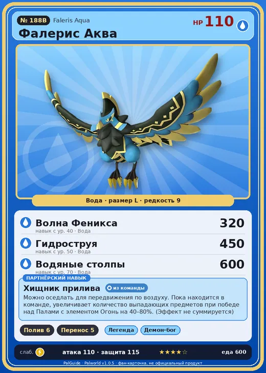

# #188B Фалерис Аква (Faleris Aqua)

№ 188B

Вода

Слабость: Молния

💧 Полив <b>6</b>📦 Транспортировка <b>5</b>

<b>Хищник прилива</b> 🎒 из команды 🐎 верхом

❤️ 110 · ⚔️ 110 · 🛡 115

| Поле | Значение |
|---|---|
| Стихия | Вода |
| Слабость (кто бьёт сильнее) | Молния |
| Редкость | 9 |
| Размер | L |
| HP / Атака / Защита (база вида) | 110 / 110 / 115 |
| Сколько ест | 600 |
| Цена продажи | 2797 |
| Множитель поимки | ×1 |
| Скорость рывка верхом | 1400 |

## Работа на базе
- Полив — ур. 6
- Транспортировка — ур. 5

## Партнёрский навык: Хищник прилива
Можно оседлать для передвижения по воздуху. Пока находится в команде, увеличивает количество выпадающих предметов при победе над Палами с элементом Огонь на (40~80)% . (Эффект не суммируется) Технологии 60 level value 1 , 40 2 , 50 3 , 60 4 , 70 5 , 80

## Атаки по уровням
- ур. 1: Акваджет (Вода, сила 40)
- ур. 7: Пузырьковый выстрел (Вода, сила 80)
- ур. 15: Кислотный дождь (Вода, сила 120)
- ур. 22: Полоса брызг (Вода, сила 160)
- ур. 30: Водяная стена (Вода, сила 300)
- ур. 40: Волна Феникса (Вода, сила 320)
- ур. 50: Гидроструя (Вода, сила 450)
- ур. 70: Водяные столпы (Вода, сила 600)

## Где водится
- В дикой природе: да; точек появления днём: 151, ночью: 151
- Яйцо: Огромное яйцо воды

## Дроп
- Жидкость водного Пала — 2–4 шт., 100%

**Дроп альфы:**
- Деталь древней цивилизации — 7–8 шт., 100%
- Ценное перо — 2–3 шт., 100%

## Разведение
- Ранг разведения (CombiRank): 450
- **Особая пара:** [Фалерис](../../4_spravochniki/paly/faleris.md) + [Йормунтайд](../../4_spravochniki/paly/jormuntide.md)

## Лучшие пассивки по роли
- боец: Легенда, Демон-бог, Хладнокровный, Бессмертие, Владыка морей (вместо Бессмертия, если нет мутации)
- рабочий: Дьявольские руки, Виртуоз, Мастеровитый, Небожитель/Трудоголик
- ездовой: Божественная скорость, Легенда, Вечный двигатель, Небесное скольжение

## Чем хорош / чем плох
- ✅ хорошая атака (110); отличный рабочий (пригодность 6); можно оседлать; летает (ездовой)
- ❌ много ест (600); разводится только особой парой

> Завидев стаю добычи, заливает всё вокруг мощным потоком воды. Чаще всего добыча ускользает, и он её теряет из виду — так что назвать это охотой, мягко говоря, сомнительно.

См. также: [Стихии](../../guide/06_stihii.md) · [Разведение](../../guide/07_razvedenie.md) · [Все палы](README.md)
