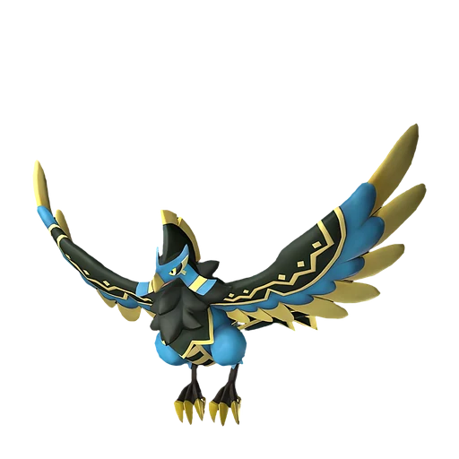

# Фалерис Аква

<canvas id="fx"></canvas>

№ 188B

Вода

Слабость: Молния <b class="mx">×1,5</b> <button class="hlp" data-tip="Множители перемножаются по обеим стихиям: ×1,5 за стихию, которую атака бьёт, ×0,65 за ту, что её держит.">?</button>

Устойчив: Огонь <b class="mx">×0,65</b>

💧 Полив <b>6</b>📦 Транспортировка <b>5</b>

<b>Хищник прилива</b> 🎒 Работает из команды🐎 Верхом

❤️ 110 · ⚔️ 110 · 🛡 115

Основное

💎Редкость <button class="hlp" data-tip="Чем выше число, тем реже встречается пал. 1–4 — обычные, 5–7 — редкие, 8+ — легендарные.">?</button><b>9</b>

📏Размер<b>L</b>

💰Цена продажи <button class="hlp" data-tip="Сколько золота даст торговец за пала.">?</button><b>2797</b>

Бой

🎯Множитель поимки <button class="hlp" data-tip="Насколько легче или труднее поймать: ×1 — обычно, меньше — сложнее.">?</button><b>×1</b>

🐎Скорость рывка верхом <button class="hlp" data-tip="Скорость, если сесть на пала и бежать рывком.">?</button><b>1400</b>

Ферма и еда

🍖Сколько ест <button class="hlp" data-tip="Сколько сытости пал тратит — чем больше, тем больше еды нужно на базе.">?</button><b>600</b>

Разведение

🧬Сила разведения <button class="hlp" data-tip="Скрытое число игры: у детёныша оно примерно среднее от родителей. Чем меньше — тем «сильнее» пал.">?</button><b>450</b>

💞Особая пара <button class="hlp" data-tip="Этого пала можно вывести только от этой пары.">?</button><b>Фалерис + Йормунтайд</b>

=== "Обзор"

    #### Работа на базе

    
<a class="wbar" href="../../../2_mehaniki/rabota/?w=watering&lv=6">💧 Полив<i style="--v:60%"></i><b>6</b></a><a class="wbar" href="../../../2_mehaniki/rabota/?w=transporting&lv=5">📦 Транспортировка<i style="--v:50%"></i><b>5</b></a><a class="wb-more" href="../../../2_mehaniki/rabota/">Что значат уровни работы →</a>

    #### Партнёрский навык: Хищник прилива
    Можно оседлать для передвижения по воздуху. Пока находится в команде, увеличивает количество выпадающих предметов при победе над Палами с элементом Огонь на 40–80%. (Эффект не суммируется) Технологии 60.

    #### Чем хорош / чем плох
    - ✅ хорошая атака (110); отличный рабочий (пригодность 6); можно оседлать; летает (ездовой)
    - ❌ много ест (600); разводится только особой парой

    > Завидев стаю добычи, заливает всё вокруг мощным потоком воды. Чаще всего добыча ускользает, и он её теряет из виду — так что назвать это охотой, мягко говоря, сомнительно.

    См. также: [Стихии](../../guide/06_stihii.md) · [Разведение](../../guide/07_razvedenie.md) · [Все палы](README.md)

=== "Атаки"

    #### Атаки по уровням
    - ур. 1: Акваджет (Вода, сила 40)
    - ур. 7: Пузырьковый выстрел (Вода, сила 80)
    - ур. 15: Кислотный дождь (Вода, сила 120)
    - ур. 22: Полоса брызг (Вода, сила 160)
    - ур. 30: Водяная стена (Вода, сила 300)
    - ур. 40: Волна Феникса (Вода, сила 320)
    - ур. 50: Гидроструя (Вода, сила 450)
    - ур. 70: Водяные столпы (Вода, сила 600)

=== "Где живёт"

    #### Где водится

    

<button data-k="d" class="on">☀️ День</button><button data-k="n">🌙 Ночь</button>

<button data-w=p class=on>Палпагос</button><button data-w=t>Мировое древо</button>

ур. 65–80<a class="btn hm-full" href="../../../map/?pal=">Показать на большой карте</a>

Ледяной коралловый холмСолнечный пределРазбившийся корабль Тэнраку

🥚 Яйцо<b>Огромное яйцо воды</b>

=== "Дроп"

    #### Дроп
    - Жидкость водного Пала — 2–4 шт., 100%

    **Дроп альфы:**
    - Деталь древней цивилизации — 7–8 шт., 100%
    - Ценное перо — 2–3 шт., 100%

=== "Разведение"

    #### Разведение
    - Ранг разведения: 450
    - **Особая пара:** [Фалерис](../../4_spravochniki/paly/faleris.md) + [Йормунтайд](../../4_spravochniki/paly/jormuntide.md)

=== "Пассивки"

    #### Лучшие пассивки по роли

    

⚔️ Боец

максимум урона и живучести в бою

<a class="psv r-4" data-psv="Легенда" href="../../../passivki/legend/">Легенда</a><a class="psv r-4" data-psv="Демон-бог" href="../../../passivki/demon_god/">Демон-бог</a><a class="psv r-3" data-psv="Владыка морей" href="../../../passivki/lord_of_the_sea/">Владыка морей</a><a class="psv r-3" data-psv="Хладнокровный" href="../../../passivki/serenity/">Хладнокровный</a>

🛠 Рабочий

работает быстрее и меньше устаёт на базе

<a class="psv r-5" data-psv="Дьявольские руки" href="../../../passivki/demons_hand/">Дьявольские руки</a><a class="psv r-4" data-psv="Виртуоз" href="../../../passivki/remarkable_craftsmanship/">Виртуоз</a><a class="psv r-3" data-psv="Мастеровитый" href="../../../passivki/artisan/">Мастеровитый</a><a class="psv r-3" data-psv="Трудоголик" href="../../../passivki/workaholic/">Трудоголик</a>

🐎 Ездовой

быстрее бегает или летает с тобой верхом

<a class="psv r-4" data-psv="Божественная скорость" href="../../../passivki/swift/">Божественная скорость</a><a class="psv r-4" data-psv="Легенда" href="../../../passivki/legend/">Легенда</a><a class="psv r-4" data-psv="Вечный двигатель" href="../../../passivki/eternal_engine/">Вечный двигатель</a><a class="psv r-3" data-psv="Умелый бегун" href="../../../passivki/runner/">Умелый бегун</a>

    <small>Нажми на пассивку, чтобы узнать, что она даёт и где её взять.</small>

<a class="card-link" href="../faleris/">← Фалерис</a><a class="card-link" href="../shadowbeak/">Шэдоубик →</a>

