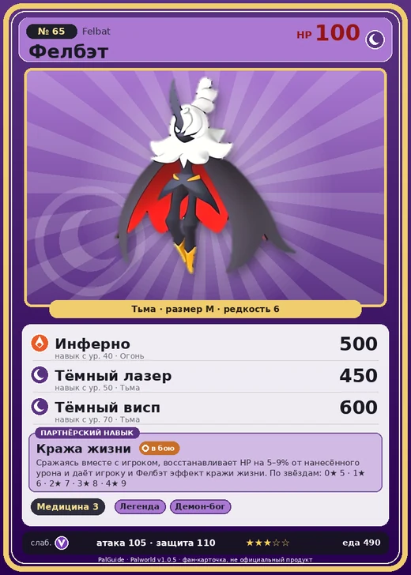

# #65 Фелбэт (Felbat)

#65 · Felbat

Тьма

Слабость: Дракон

💊 Фармацевтика <b>3</b>

<b>Кража жизни</b> 🐾 выпущен

❤️ 100 · ⚔️ 105 · 🛡 110

| Поле | Значение |
|---|---|
| Стихия | Тьма |
| Слабость (кто бьёт сильнее) | Дракон |
| Редкость | 6 |
| Размер | M |
| HP / Атака / Защита (база вида) | 100 / 105 / 110 |
| Сколько ест | 490 |
| Цена продажи | 1744 |
| Множитель поимки | ×1 |
| Скорость рывка верхом | 700 |

## Работа на базе
- Фармацевтика — ур. 3

## Партнёрский навык: Кража жизни
Сражаясь вместе с игроком, восстанавливает HP на (5~9)% от нанесённого урона и даёт игроку и Фелбэт эффект кражи жизни. level value 1 LifeSteal 5 2 LifeSteal 6 3 LifeSteal 7 4 LifeSteal 8 5 LifeSteal 9

## Атаки по уровням
- ур. 1: Ядовитый выстрел (Тьма, сила 30)
- ур. 7: Тёмный шар (Тьма, сила 50)
- ур. 15: Теневой взрыв (Тьма, сила 80)
- ур. 22: Духовное пламя (Тьма, сила 200)
- ур. 30: Кошмарная сфера (Тьма, сила 300)
- ур. 40: Инферно (Огонь, сила 500)
- ур. 50: Тёмный лазер (Тьма, сила 450)
- ур. 70: Тёмный висп (Тьма, сила 600)

## Где водится
- В дикой природе: да; точек появления днём: 121, ночью: 121; уровни в первых точках: 63–66
- Подземелья: Пещера Горного Потока
- Яйцо: Большое яйцо тьмы

## Дроп
- Ткань — 1–2 шт., 100%
- Маленькая душа Пала — 1 шт., 3%

**Дроп альфы:**
- Деталь древней цивилизации — 1–3 шт., 100%
- Ценный мех — 1–3 шт., 100%

## Разведение
- Ранг разведения (CombiRank): 1570
- Участвует в особых парах: Блейзхаул → Блейзхаул Нокт

## Лучшие пассивки по роли
- боец: Легенда, Демон-бог, Хладнокровный, Бессмертие, Король тьмы (вместо Бессмертия, если нет мутации)
- рабочий: Дьявольские руки, Виртуоз, Мастеровитый, Небожитель/Трудоголик
- ездовой: Божественная скорость, Легенда, Вечный двигатель, Небесное скольжение

## Чем хорош / чем плох
- ✅ хорошая атака (105); можно оседлать
- ❌ явных минусов нет

> Нападает на добычу из сумрака, накрывая её своими подобными плащу крыльями. Что происходит под ними и почему внутренняя сторона его крыльев красная - лучше и не знать.

См. также: [Стихии](../../2_mehaniki/stihii.md) · [Разведение](../../2_mehaniki/razvedenie.md) · [Все палы](README.md)
