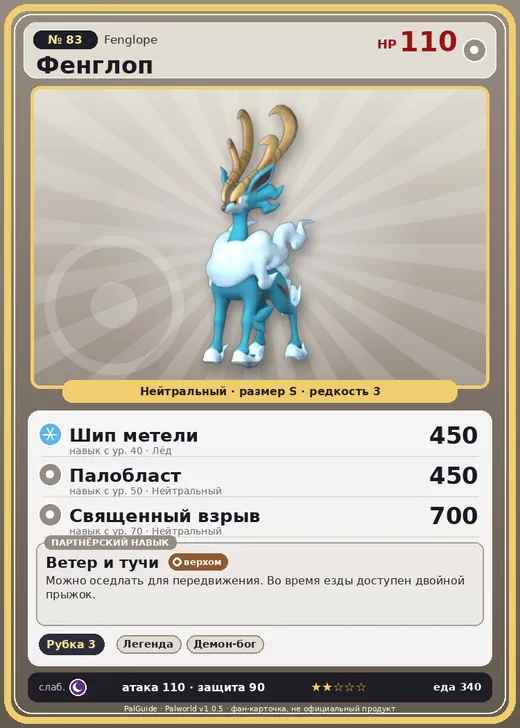

# #83 Фенглоп (Fenglope)

#83 · Fenglope

Нейтральный

Слабость: Тьма

🪓 Рубка деревьев <b>3</b>

<b>Ветер и тучи</b> 🐎 верхом

❤️ 110 · ⚔️ 110 · 🛡 90

| Поле | Значение |
|---|---|
| Стихия | Нейтральный |
| Слабость (кто бьёт сильнее) | Тьма |
| Редкость | 3 |
| Размер | S |
| HP / Атака / Защита (база вида) | 110 / 110 / 90 |
| Сколько ест | 340 |
| Цена продажи | 1659 |
| Множитель поимки | ×1 |
| Скорость рывка верхом | 1050 |

## Работа на базе
- Рубка деревьев — ур. 3

## Партнёрский навык: Ветер и тучи
Можно оседлать для передвижения. Во время езды доступен двойной прыжок. Технологии 26 level value 2 MoveSpeed_up_PartnerSkill_Ride_1 10 Пробуждение : (Скорость передвижения верхом: +10% ) 3 MoveSpeed_up_PartnerSkill_Ride_2 12 Пробуждение : (Скорость передвижения верхом: +12% ) 4 MoveSpeed_up_PartnerSkill_Ride_3 15 Пробуждение : (Скорость передвижения верхом: +15% ) 5 MoveSpeed_up_PartnerSkill_Ride_4 20 Пробуждение : (Скорость передвижения верхом: +20% ) 1 Пробуждение :

## Атаки по уровням
- ур. 1: Воздушная пушка (Нейтральный, сила 40)
- ур. 7: Водяной выстрел (Вода, сила 50)
- ур. 15: Буря в облаках (Нейтральный, сила 120)
- ур. 22: Кислотный дождь (Вода, сила 120)
- ур. 30: Водяная бомба (Вода, сила 200)
- ур. 40: Шип метели (Лёд, сила 450)
- ур. 50: Палобласт (Нейтральный, сила 450)
- ур. 70: Священный взрыв (Нейтральный, сила 700)

## Где водится
- В дикой природе: да; точек появления днём: 12, ночью: 12
- Яйцо: Обычное яйцо

## Дроп
- Кожа — 3 шт., 100%
- Рог — 2 шт., 100%

**Дроп альфы:**
- Деталь древней цивилизации — 3–5 шт., 100%
- Ценный мех — 3–5 шт., 100%

## Разведение
- Ранг разведения (CombiRank): 1960
- Участвует в особых парах: Азурмейн → Фенглоп Лакс

## Лучшие пассивки по роли
- боец: Легенда, Демон-бог, Хладнокровный, Бессмертие, Святое небо (вместо Бессмертия, если нет мутации)
- рабочий: Дьявольские руки, Виртуоз, Мастеровитый, Небожитель/Трудоголик
- ездовой: Божественная скорость, Легенда, Вечный двигатель, Небесное скольжение

## Чем хорош / чем плох
- ✅ хорошая атака (110); можно оседлать
- ❌ явных минусов нет

> В далёкие времена его прекрасный облик вдохновлял художников и был привычным образом в живописи. С течением времени ценность обрели уже не формы, а его красивая шкура и рога — как материалы для создания предметов искусства.

См. также: [Стихии](../../2_mehaniki/stihii.md) · [Разведение](../../2_mehaniki/razvedenie.md) · [Все палы](README.md)
