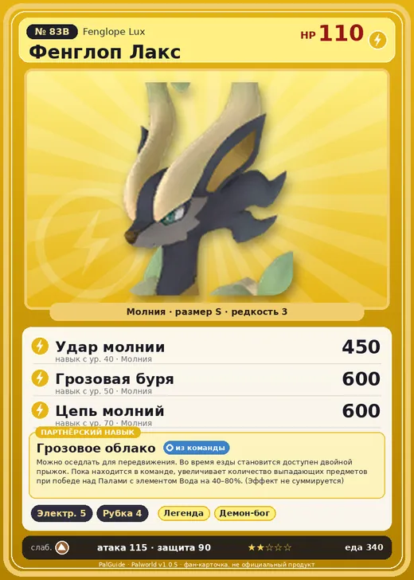

# Фенглоп Лакс

<canvas id="fx"></canvas>

№ 83B · Fenglope Lux

Молния

Слабость: Земля

⚡ Генерация энергии <b>5</b>🪓 Рубка деревьев <b>4</b>

<b>Грозовое облако</b> 🎒 из команды 🐎 верхом

❤️ 110 · ⚔️ 115 · 🛡 90

| Поле | Значение |
|---|---|
| Стихия | Молния |
| Слабость (кто бьёт сильнее) | Земля |
| Редкость | 3 |
| Размер | S |
| HP / Атака / Защита (база вида) | 110 / 115 / 90 |
| Сколько ест | 340 |
| Цена продажи | 2164 |
| Множитель поимки | ×1 |
| Скорость рывка верхом | 1050 |

=== "Обзор"

    #### Работа на базе
    - Генерация энергии — ур. 5
    - Рубка деревьев — ур. 4

    #### Партнёрский навык: Грозовое облако
    Можно оседлать для передвижения. Во время езды становится доступен двойной прыжок. Пока находится в команде, увеличивает количество выпадающих предметов при победе над Палами с элементом Вода на 40–80%. (Эффект не суммируется) Технологии 57.

    #### Чем хорош / чем плох
    - ✅ хорошая атака (115); отличный рабочий (пригодность 5); можно оседлать
    - ❌ разводится только особой парой

    > В далёкие времена люди верили, что если изобразить Пала Фенглоп Лакс на картине, тебя поразит молния. С течением времени изделия с его изображением стали привычной частью жизни — их использовали как талисманы от грозы.

    См. также: [Стихии](../../guide/06_stihii.md) · [Разведение](../../guide/07_razvedenie.md) · [Все палы](README.md)

=== "Атаки"

    #### Атаки по уровням
    - ур. 1: Шоковая волна (Молния, сила 80)
    - ур. 7: Грозовая линия (Молния, сила 160)
    - ур. 15: Кислотный дождь (Вода, сила 120)
    - ур. 22: Грозовой шторм (Молния, сила 300)
    - ур. 30: Грозовой дождь (Молния, сила 400)
    - ур. 40: Удар молнии (Молния, сила 450)
    - ур. 50: Грозовая буря (Молния, сила 600)
    - ур. 70: Цепь молний (Молния, сила 600)

=== "Где живёт"

    #### Где водится
    - В дикой природе: да; точек появления днём: 268, ночью: 268; уровни в первых точках: 57–58
    - Яйцо: Яйцо молнии

=== "Дроп"

    #### Дроп
    - Кожа — 3 шт., 100%
    - Рог — 2 шт., 100%
    - Электрический орган — 1–2 шт., 100%

    **Дроп альфы:**
    - Деталь древней цивилизации — 6–8 шт., 100%
    - Ценный мех — 2–3 шт., 100%

=== "Разведение"

    #### Разведение
    - Ранг разведения (CombiRank): 900
    - **Особая пара:** [Фенглоп](../../4_spravochniki/paly/fenglope.md) + [Азурмейн](../../4_spravochniki/paly/azurmane.md)

=== "Пассивки"

    #### Лучшие пассивки по роли

    

⚔️ Боец

максимум урона и живучести в бою

<a class="psv r-4" data-psv="Легенда" href="../../../passivki/legend/">Легенда</a><a class="psv r-4" data-psv="Демон-бог" href="../../../passivki/demon_god/">Демон-бог</a><a class="psv r-3" data-psv="Император молнии" href="../../../passivki/lord_of_lightning/">Император молнии</a><a class="psv r-3" data-psv="Хладнокровный" href="../../../passivki/serenity/">Хладнокровный</a>

🛠 Рабочий

работает быстрее и меньше устаёт на базе

<a class="psv r-5" data-psv="Дьявольские руки" href="../../../passivki/demons_hand/">Дьявольские руки</a><a class="psv r-4" data-psv="Виртуоз" href="../../../passivki/remarkable_craftsmanship/">Виртуоз</a><a class="psv r-3" data-psv="Мастеровитый" href="../../../passivki/artisan/">Мастеровитый</a><a class="psv r-3" data-psv="Трудоголик" href="../../../passivki/workaholic/">Трудоголик</a>

🐎 Ездовой

быстрее бегает или летает с тобой верхом

<a class="psv r-4" data-psv="Божественная скорость" href="../../../passivki/swift/">Божественная скорость</a><a class="psv r-4" data-psv="Легенда" href="../../../passivki/legend/">Легенда</a><a class="psv r-4" data-psv="Вечный двигатель" href="../../../passivki/eternal_engine/">Вечный двигатель</a><a class="psv r-4" data-psv="Небесное скольжение" href="../../../passivki/sky_strider/">Небесное скольжение</a>

    <small>Нажми на пассивку, чтобы узнать, что она даёт и где её взять.</small>

<a class="card-link" href="../fenglope/">← Фенглоп</a><a class="card-link" href="../dinossom/">Диноссум →</a>

